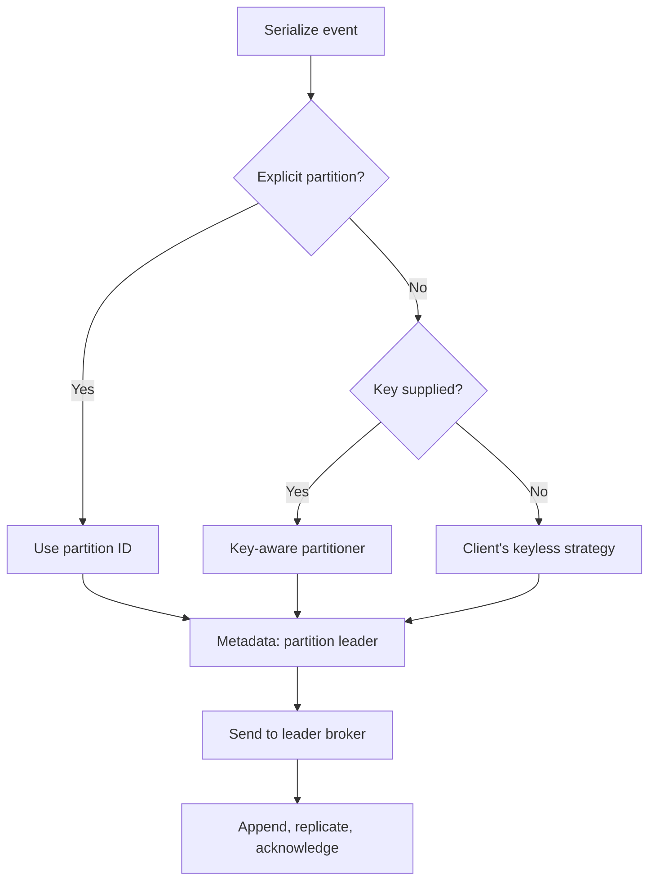
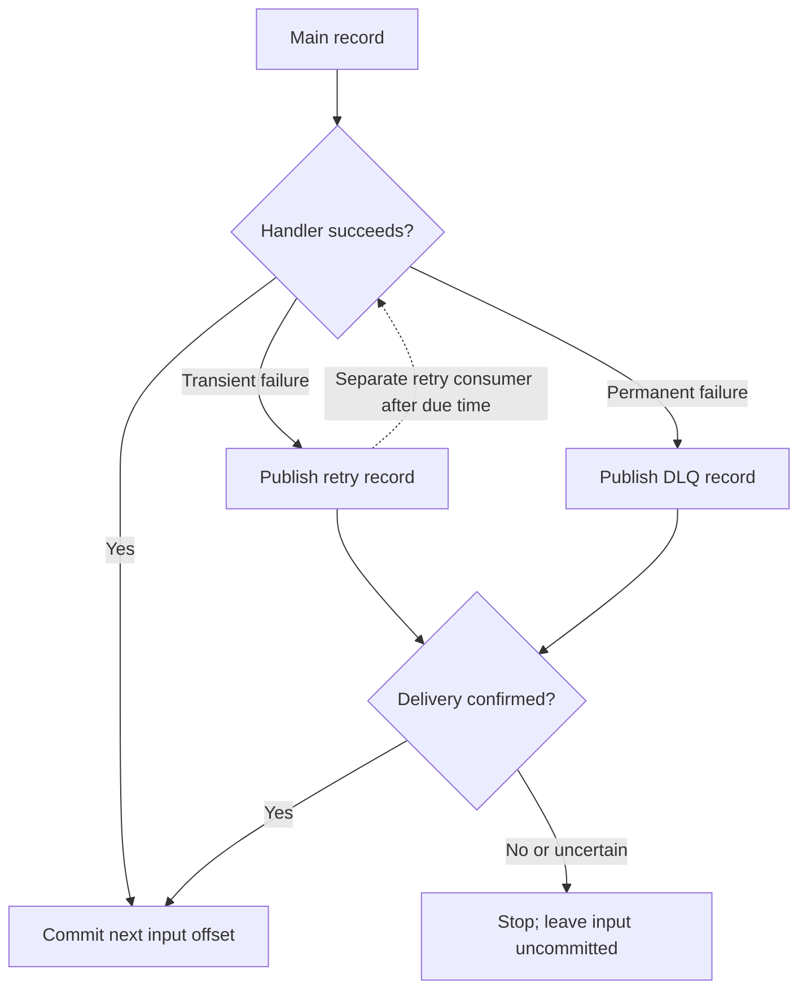

the follower partitions will take over the leader partition when the leader partition goes down


---

# Kafka and Amazon MSK: production concepts and interview guide

Added: 2026-10-31. The original notes and images above are preserved.

**Correction to the original sentence:** a follower **replica of the same topic-partition** can become its leader. `topic-A / partition-1` is not the backup of `topic-A / partition-0`, and topic B is not the backup of topic A.

This guide uses ordinary **partition-assigned consumer groups** and the conventional ISR replication model. Newer share-group consumption and Eligible Leader Replicas (ELR) have different details; check your Kafka/MSK version and feature settings before applying those models. Client examples use `confluent-kafka` (librdkafka), whose configuration names and defaults can differ from Java and `kafka-python`. Sources below include versioned Kafka 4.1 references; this is not a claim that 4.1 is the newest release.

## Reading map

1. What Kafka is, when to use it, and real-world use cases.
2. Terminology and the partition/replica mental model.
3. Producer routing, consumer offsets, rebalancing, and leader failover.
4. Scalability, durability, retries, performance, and retention.
5. Python producer and consumer, including retry-topic and DLQ handling.
6. MSK responsibilities, troubleshooting, and interview practice.

## 1. What Kafka is and when to use it

Apache Kafka is an open-source, distributed event-streaming platform. Producers publish records; Kafka retains them in partition logs; consumers read them independently. Kafka brokers store and transport events. Your application, Kafka Streams, Flink, or another processor performs the business computation. Kafka does not transcode a video just because you publish a message. [S1]

Use it when a durable event history, replay, high throughput, and independent consumers are useful together. For example, one upload event can feed transcoding, moderation, and analytics without making the upload API wait for all three.

For a small background-job system that mainly needs per-job acknowledgement and delayed retries, a task queue may be simpler. For a query requiring an immediate answer, use an API or database. Those are design choices based on your requirements, not limitations to hide in an interview.

### Representative real-world use cases

This is a broad practical list, not an exhaustive list of every possible application. The examples apply Kafka's messaging, activity tracking, metrics, log aggregation, and stream-processing capabilities. [S2]

| Use case | Example event | What consumers do |
| --- | --- | --- |
| Video/media pipeline | `VideoUploaded` with object URI | Register transcoding jobs, moderate content, generate thumbnails |
| Orders and fulfillment | `OrderPlaced` | Reserve stock, plan shipping, update analytics |
| Payments and fraud | `PaymentAttempted` | Calculate risk, notify operations, populate audit views |
| Clickstream analytics | `ProductViewed` | Update funnels and recommendations |
| Database change capture | Row changed in source database | Refresh search indexes and analytical stores |
| IoT and telemetry | `SensorReading` | Detect anomalies and aggregate measurements |
| Application logs | Structured service event | Feed observability and security pipelines |
| Live dashboards | `ShipmentLocationUpdated` | Update a dashboard service; it can use SSE/WebSocket to the browser |
| Notifications | `AccountStatusChanged` | Decide whether to send email, push, or in-app notification |
| Data enrichment | `TransactionReceived` | Join reference data and emit an enriched event |
| Replay/backfill | Retained historical events | Rebuild a read model after fixing consumer logic |
| Event-sourced systems | Domain event with version | Reconstruct state, with explicit ordering and retention design |

For the video example, store the file in object storage first; publish its identifier and URI. Decide what happens if upload succeeds but event publication fails: a database outbox, reconciliation job, or another durable publication mechanism must close that gap. Do not rely on the producer's RAM after the API process exits.

## 2. Terminology

| Term                      | Definition                                                | Concrete example                                              |
| ------------------------- | --------------------------------------------------------- | ------------------------------------------------------------- |
| Cluster                   | Brokers and the metadata/control system working together  | A three-broker deployment                                     |
| Broker                    | Server that serves partition replicas                     | Broker 1 hosts leaders and followers for different partitions |
| Topic                     | Named stream split into partitions                        | `video.uploaded`                                              |
| Partition                 | Ordered append-only log within a topic                    | `video.uploaded`, partition 0                                 |
| Record/event/message      | Key, value, timestamp, headers and Kafka metadata         | JSON upload metadata                                          |
| Key                       | Optional bytes used by a key-aware partitioner            | UTF-8 bytes of `video_id`                                     |
| Offset                    | Record position within one partition                      | Partition 0, offset 42                                        |
| Producer                  | Client that publishes records                             | Upload API or outbox publisher                                |
| Consumer                  | Client that fetches records                               | Job-registration worker                                       |
| Consumer group            | Consumers sharing partition ownership and progress        | `transcoding-workers`                                         |
| Replica                   | Copy of one partition log on another broker               | Another copy of partition 0                                   |
| Leader                    | Replica currently accepting writes for that partition     | P0 leader on Broker 1                                         |
| Follower                  | Replica that fetches the leader's data                    | P0 follower on Broker 2                                       |
| Replication factor / RF   | Total replicas, including the leader                      | RF=3 means 1 leader + 2 followers                             |
| ISR (in-sync replica)     | Current in-sync replica set, including the leader         | Brokers 1, 2 and 3 while all are caught up                    |
| Group coordinator         | Broker role coordinating group membership/progress        | Tracks the worker group                                       |
| KRaft controller          | Metadata/control-plane role in modern Kafka               | Coordinates partition leadership changes                      |
| Committed consumer offset | Durable next position to resume for a group and partition | Commit 43 after processing record 42                          |
| Consumer lag              | Distance behind a chosen end/readable position            | End 120, committed 100: offset gap 20                         |

Topics, keys, partitions, and offsets describe the data model [S1]; replicas and ISR describe durability [S3]. Group coordination and offset commits describe consumption [S4]. KRaft metadata coordination is separate from application-event processing [S18]. An offset gap is not always an exact count of business events: compaction, transactions, and offset gaps can matter.

### Three partitions with replication factor three

| Broker | P0 replica | P1 replica | P2 replica |
| --- | --- | --- | --- |
| Broker 1 | Leader | Follower | Follower |
| Broker 2 | Follower | Leader | Follower |
| Broker 3 | Follower | Follower | Leader |

There are **3 independent logs and 9 replica copies**, not 9 independent work queues. A single broker does not have to contain every partition. Adding replicas improves fault tolerance but adds storage/network work; adding partitions creates more units of parallelism.

A log resembles a FIFO queue only within a partition. Reading a record does not **remove** it. Other groups can read it, and the same group can replay it while retained. Ordering is by partition offset, not global event timestamp. Parallel handlers and retry topics can change completion order even when Kafka's log order is intact(完好无损的).

## 3. Workflow: how a producer finds the right broker

1. Connect to a reachable address in `bootstrap.servers` and obtain cluster metadata.
2. Serialize the key and value to bytes.
3. Choose a partition: an explicit partition wins; otherwise use the configured partitioner.
4. Look up that partition's current leader in metadata and send directly to that broker.
5. The leader appends the batch; followers replicate; the producer receives the configured acknowledgement.
6. On a leadership change, the client refreshes metadata and retries eligible failures within its deadline. Bootstrap addresses are discovery entry points, not a gateway through which all events pass. [S5]



**A key chooses a partition, not a broker.** The broker hosting its leader may change without the key changing. Identical serialized keys normally map to the same partition with the same partitioner and partition count. Increasing the count can remap keys; old records stay where they were. Plan an ordering-aware migration if continuity across that change matters.

**No key does not universally mean round-robin.** The Java producer documents sticky behavior by default. Other clients have their own choices. The Python examples explicitly select `murmur2_random`; non-null keys use Java-compatible Murmur2 hashing, while null keys use that client's keyless behavior. Do not use Python's built-in `hash()` as a cross-process partitioning contract. [S6][S7]

## 4. Workflow: consumption, offsets, and rebalancing

In an ordinary(普通的) consumer group, one partition has at most one assigned consumer at a time. One consumer can own several partitions. Separate groups maintain independent progress. This assignment rule does **not** guarantee that application side effects happen exactly once. A stale(陈旧) handler can also continue external work after losing ownership unless the application stops or fences it. [S4]

Illustrative assignments for six partitions:

| Members in one group | Possible assignment |
| --- | --- |
| 2 | C1: P0–P2; C2: P3–P5 |
| 3 | Two partitions each |
| 8 | At most six active partition owners; two have no partition |

### Resume from the next unprocessed offset

Suppose P0 has records 40, 41, 42 and 43. The group has committed **42**: its recovery position is record 42. After successfully processing 42, commit **43**. The Python call `commit(message=message)` performs the +1 for you. P1 might independently be at offset 900; offsets do not need to match across partitions. [S8]

Keep three positions separate: fetched/current position, successfully processed position, and durably committed position. Prefetching or handing work to a thread pool does not prove processing completed.

`auto.offset.reset` is a fallback when a usable committed offset is absent(缺席的) or out of range. `earliest` starts at the oldest retained position; `latest` starts at the end and can skip retained backlog. It does not override a valid committed offset on every restart. In production, consider failing visibly on an unexpected reset and investigating retention or group identity. [S9]

### Rebalance sequence

1. A consumer joins, leaves, times out, or a subscription/partition set changes.
2. The group protocol/assignor redistributes **partition ownership**. Eager, cooperative, and newer protocols differ in how much movement they require.
3. A departing owner stops or fences work for revoked partitions. Commit only the completed contiguous prefix while still permitted; handle commit failure.
4. The new owner resumes from committed offsets. Work completed externally but not committed can run again.

For an asynchronous worker pool, if offset 42 is unfinished but 43 finishes, do not commit 44. That would skip 42 after a crash. Track completion per partition and advance only past a contiguous completed prefix. This is an application concurrency rule derived from offset semantics, not a feature a thread pool supplies automatically.

Keep polling within `max.poll.interval.ms`. A live process or heartbeat alone does not establish that its processing loop is making progress. Long video processing should generally be registered durably with a separate worker system; committing after merely putting a task in process memory risks losing it. [S9]

## 5. Fault tolerance, durability, and acknowledgements

The producer sends to the **leader once**. It does not call every replica. The leader coordinates replication; its response expresses whether the requested condition has been met. [S3]

| Producer setting | Meaning                                                                   | Failure consequence                                     |
| ---------------- | ------------------------------------------------------------------------- | ------------------------------------------------------- |
| `acks=0`         | Do not wait for broker acknowledgement                                    | Cannot confirm broker acceptance                        |
| `acks=1`         | Leader has appended to its local log                                      | A leader failure before replication can lose that write |
| `acks=all`       | Wait for current ISR(In-Sync Replica) replication, subject to minimum ISR | Stronger durability; may reject writes to protect data  |

`min.insync.replicas` is a minimum admissible ISR count for `acks=all`, **not an instruction to wait for only that many replicas when more are in sync**. [S10]

Assume RF(Replication Factor)=3(one leader and 2 follower replicas), minimum ISR=2, `acks=all`, conventional ISR mode:

| Current ISR | Result |
| --- | --- |
| B1, B2, B3 | All three in-sync copies must receive the write |
| B1, B2 | Two copies suffice after ISR membership changes |
| B1 only | Writes cannot succeed under this durability requirement |

With RF=2 and minimum ISR=2, losing one replica prevents successful writes. RF=2/minimum ISR=1 can continue on one copy, but losing that remaining copy can lose newly accepted data. The choice trades availability against durability. `acks` confirms Kafka storage, not consumer processing; consumer offset commits are a different operation. [S10]

### Leader failure workflow

1. P0 leader on B1 becomes unavailable.
2. Kafka's control plane selects an eligible replacement, ordinarily an in-sync replica in this model.
3. Clients discover the new leader and retry transient failures.
4. The old broker catches up as a follower when it returns.

Failover takes time and does not guarantee zero errors. A network split or lack of safe replicas can make a partition unavailable. Unclean leader election can choose a stale replica at the cost of lost records; do not describe that as safe failover. RF is not a backup against accidental deletion, bad data, or region loss. [S3][S18]

## 6. Scalability and performance

Start with the bottleneck, not a configuration shopping list. The following is a diagnostic approach; benchmark against your actual messages and downstream services.

| Symptom                         | Investigate                                 | Possible action and trade-off                                                                                                                                                                             |
| ------------------------------- | ------------------------------------------- | --------------------------------------------------------------------------------------------------------------------------------------------------------------------------------------------------------- |
| All partitions accumulate lag   | Handler rate, DB/API capacity, consumer CPU | More consumers up to partition ownership limits; optimize downstream calls                                                                                                                                |
| One partition is slow           | Hot key, uneven(不均匀) payload sizes          | Redesign key distribution; splitting one key can sacrifice its ordering                                                                                                                                   |
| Brokers saturate(饱和)            | Disk, network, CPU, leader distribution     | Add capacity and redistribute replicas/leaders; a new broker alone does not move all existing data                                                                                                        |
| Too many small produce requests | Batch sizes and request rate                | Increase batching/linger(萦回) modestly(谦虚地)(增加批处理/适度延长); trade latency for throughput                                                                                                                      |
| Large payload pressure          | Record sizes and compression                | Store blobs separately; send references; align producer/broker/fetch limits                                                                                                                               |
| Retry storm                     | Downstream failure and retry rate           | Bound attempts, exponential backoff with jitter(JC - right, the consumer can retry with exponential backoff with jitter to decrease to reach the rate limitation), circuit breaking and admission control |

Partition count supports parallelism but costs metadata, buffers, files, recovery work, and operational complexity. More replicas do not create independent write capacity for a partition. Quotas and a 1-MB application limit protect resources; they do not increase underlying processing capacity.

For the Python producer, `linger.ms=10` allows short batching, `batch.size=65536` bounds batch size, and `compression.type=lz4` uses Kafka's record-batch compression. This does not create a `.zip` file. The consumer library decompresses batches and returns individual records. These are example starting values, not universal optimums. [S7]

Avoid flushing after every event in the throughput path. `produce()` enqueues asynchronously; delivery callbacks report eventual success or failure. Poll to serve callbacks and flush at shutdown. The retry-transfer helper intentionally waits for one record's acknowledgement to make the safety boundary easy to see, at a throughput cost. [S11]

## 7. Producer retries versus consumer retries

### Delivery guarantees: name the boundary

| Guarantee | Typical approach | What can happen on a crash |
| --- | --- | --- |
| At most once | Commit before the business action | Input may be skipped if the action never finishes |
| At least once | Complete durable work, then commit | Work may be delivered/attempted again |
| Exactly once within Kafka | Transaction couples Kafka outputs and input offsets | Aborted output stays invisible to `read_committed` consumers |
| One effective database action | At-least-once delivery plus atomic inbox/business transaction | Replays occur, but the same event ID does not repeat the DB change |

The last row is the Python lab's boundary. Neither producer idempotence nor consumer-group membership makes arbitrary external side effects exactly once. [S8][S11]

### Producer: transport retry

The client retries eligible transport/broker failures according to its retry/backoff settings and delivery deadline. This is largely configuration, but the application must still observe the final delivery result, handle a full local buffer, and retain work if publication cannot be confirmed. Authentication, authorization, schema, and oversized-record errors need correction rather than unlimited retries. A timeout can leave the delivery outcome uncertain. [S12]

`enable.idempotence=true` lets Kafka recognize duplicate transmission attempts by the producer protocol. It does not deduplicate two explicit `produce()` calls representing the same order, every restart, or an external payment API. Keep a stable business `event_id`, use a durable outbox when needed, and make downstream effects idempotent. [S12]

### Consumer: business-operation retry

Kafka cannot infer(推断) whether your database write, HTTP call, or video job succeeded. Your proposal—**main topic, retry topic, then dead-letter topic**—is valid. A DLQ is an ordinary Kafka topic with application-defined behavior; there is no automatic business retry/DLQ policy for the consumer shown here. [S13]

| Approach                          | Good fit                                        | Main cost                                                                  |
| --------------------------------- | ----------------------------------------------- | -------------------------------------------------------------------------- |
| Short retry inside handler        | Brief transient failure                         | Blocks that processing lane; budget time carefully                         |
| Pause failed partition and retry  | Strict per-partition processing order           | Later records in that partition wait; keep polling and manage reassignment |
| Retry topic and separate consumer | Independent work can keep moving                | Later same-key events may overtake the failed event                        |
| Durable(耐用的) external job queue   | Long delays, job lifecycle, independent workers | Another system and a cross-system handoff                                  |
| DLQ plus controlled replay        | Poison record or exhausted retry budget         | Requires ownership, alerts, diagnosis, and replay tooling                  |

### Retry workflow and the handoff failure window



The diagram's retry path also has a bounded attempt count: exhaustion routes to DLQ.

Consider these two failure experiments in the Python example:

- Retry-topic publish fails: leave the original input uncommitted and stop; restart can replay it.
- Retry-topic publish succeeds, then the process crashes before committing the original: restart may publish another retry record. This is **at-least-once handoff**, so duplicate retry/DLQ records are possible.

For Kafka-to-Kafka processing in the same cluster, transactions can atomically commit output records and input offsets: begin transaction, produce output, call `send_offsets_to_transaction()` with next offsets and current group metadata, then commit the transaction. Consumers of transactional output use `read_committed`. Handle retriable, abort-required, and fatal errors distinctly; use a stable transactional ID per logical producer and fence duplicate instances. A Kafka transaction does not include an arbitrary database, SQS, or HTTP side effect. [S8]

### Delay is not supplied by a topic name

Calling a topic `retry-30s` does not make Kafka wait 30 seconds. Store an attempt count and due timestamp; a consumer/scheduler must enforce the delay. A scalable worker can pause the affected partition, keep polling other partitions, resume when due, and discard stale scheduled work on revocation. Fixed delay-stage topics can simplify this. Repeatedly reading and immediately republishing a not-yet-due record creates a hot loop. [S13]

### Can SQS be used? What if Kafka is not on AWS?

Yes. MSK(Amazon Managed Streaming for Apache Kakfa) and SQS are independent services; your consumer can bridge them. Self-managed Kafka outside AWS can also call SQS with permitted network access and AWS credentials. Kafka does not require SQS or AWS.

For an SQS handoff, send the retry job and confirm acceptance before committing the Kafka input. A crash between those operations can duplicate the job; there is no shared Kafka/SQS transaction. After SQS processing, delete the message on success. An expired visibility timeout can make unfinished work available again; standard-queue consumers must tolerate duplicates. A configured redrive policy can send repeated failures to an SQS DLQ. [S14]

SQS delivery delay and visibility timeout are different: delay applies before initial visibility, visibility timeout after receipt. SQS delays/message timers are limited to 15 minutes; longer schedules need another mechanism. [S15]

Without AWS, practical alternatives are:

- **Kafka retry topics:** reuse the same cluster and implement delay/attempt tracking.
- **RabbitMQ:** a queue with TTL and dead-letter routing can move expired records to another queue; review confirmation and dead-letter reliability settings, particularly for quorum queues. [S16]
- **A database-backed scheduler:** persist job ID, payload, due time, attempts, and a claim lease; workers atomically claim due jobs. This is an architectural alternative, not functionality Kafka adds for you.

Choose based on delay length, ordering, operational familiarity, and handoff guarantees. Do not add SQS solely because the Kafka cluster happens to be MSK.

## 8. Retention, replay, and compaction

Kafka retains log segments on broker storage, with optional tiered storage depending on deployment. Consumption does not delete records. For delete-policy topics, `retention.ms` limits time and `retention.bytes` limits size **per partition**; either can make old segments eligible for removal. Cleanup is segment-based and asynchronous, not an exact per-record timer. Seven days is the documented Kafka 4.1 time default, but inspect actual topic and service configuration. [S17]

For an illustrative size budget: six partitions × 1 GiB/partition gives about 6 GiB of logical retained data. RF=3 gives roughly 18 GiB of replica data before indexes, active segments, cleanup lag, operational headroom, and any tiered-storage differences. This is planning arithmetic, not a hard disk cap. A hot partition may reach its size limit sooner than the others.

`cleanup.policy=compact` eventually preserves the newest value per key, with tombstones representing deletion. It is useful for state reconstruction, not a full immutable audit history. Compaction does not instantly remove duplicates and does not renumber offsets. `compact,delete` applies both kinds of cleanup. Consumer-group offset retention is separate from topic-data retention. [S17][S19]

Set retention from outage duration + catch-up time + replay needs, with capacity headroom. Alert on the **age of the oldest unprocessed event**, not just a count. If retention deletes unread data, retries and offsets cannot restore it. Replaying with a new group re-executes side effects unless your application protects them.

## 9. Python lab: producer, consumer, retries, DLQ, and idempotent DB work

Save each code block below using the shown filename in the same directory. The three files form one teaching example. The scripts need a reachable Kafka cluster; the examples do not create or modify AWS infrastructure.

The consumer's business action is **registering a video job in SQLite**, not transcoding a video. It inserts an inbox deduplication key and the job in one database transaction. On a crash after DB commit but before Kafka offset commit, replay finds the existing event ID. For multiple hosts, replace this local SQLite demonstration with a shared durable database and an atomic unique constraint/transaction. A local file per container cannot provide group-wide deduplication.

The `demo_mode` field injects failures for learning; remove it from a real event contract. Retry delays are intentionally limited to 5 and 30 seconds. The synchronous waiting blocks every partition assigned to this worker. It keeps the example readable but is unsuitable for high throughput or long jobs. Its bounded handler/delay/transfer path must remain comfortably below the five-minute poll interval; if you add real network calls, set their deadlines and redesign polling. Rebalance/commit errors stop the process rather than allowing it to commit later records past a failed one.

### Local prerequisites and topic setup

Install the Python client in your own virtual environment:

```bash
python -m venv .venv
source .venv/bin/activate
python -m pip install confluent-kafka
export KAFKA_BOOTSTRAP=localhost:9092
```

Using the Kafka distribution's CLI against a **disposable one-broker local cluster**, create the three topics:

```bash
for topic in video.uploaded video.retry video.dlq; do
  kafka-topics.sh --bootstrap-server localhost:9092 --create \
    --topic "$topic" --partitions 3 --replication-factor 1 \
    --config min.insync.replicas=1 \
    --config cleanup.policy=delete \
    --config retention.ms=604800000
done
```

RF=1/minimum ISR=1 is only for this local lab. A provisioned three-broker production illustration uses RF=3/minimum ISR=2, sufficient capacity, and replicas across failure domains. Provision real topics through your normal reviewed infrastructure workflow.

### `common.py`: connection and delivery confirmation

```python
import os
import time


def connection_config():
    # Local-only default. Set KAFKA_SECURITY=msk_iam for the MSK example.
    config = {"bootstrap.servers": os.getenv("KAFKA_BOOTSTRAP", "localhost:9092")}
    security = os.getenv("KAFKA_SECURITY", "local")
    if security == "msk_iam":
        from aws_msk_iam_sasl_signer import MSKAuthTokenProvider

        def oauth_cb(_):
            token, expiry_ms = MSKAuthTokenProvider.generate_auth_token(
                os.environ["AWS_REGION"]
            )
            return token, expiry_ms / 1000.0

        config.update({
            "security.protocol": "SASL_SSL",
            "sasl.mechanism": "OAUTHBEARER",
            "oauth_cb": oauth_cb,
        })
    elif security != "local":
        raise ValueError("This demo supports local or msk_iam")
    return config


def producer_config():
    return {
        **connection_config(),
        "enable.idempotence": True,
        "acks": "all",
        "max.in.flight.requests.per.connection": 5,
        "delivery.timeout.ms": 30000,
        "retry.backoff.ms": 100,
        "retry.backoff.max.ms": 1000,
        "linger.ms": 10,
        "batch.size": 65536,
        "compression.type": "lz4",
        "partitioner": "murmur2_random",
    }


def send_confirmed(producer, topic, key, value, headers=None, timeout=35):
    """Teaching helper: wait for THIS record's delivery report or fail closed."""
    result = []
    deadline = time.monotonic() + timeout

    def delivered(error, message):
        result.append((error, message))

    while True:
        try:
            producer.produce(topic, key=key, value=value, headers=headers,
                             on_delivery=delivered)
            break
        except BufferError:
            # Local buffer full: this call did not enqueue the record.
            if time.monotonic() >= deadline:
                raise TimeoutError("Producer local buffer remained full")
            producer.poll(0.1)
    while not result:
        if time.monotonic() >= deadline:
            # Delivery may be uncertain. Caller must NOT commit the input.
            raise TimeoutError("No final delivery report; outcome may be unknown")
        producer.poll(0.1)
    error, message = result[0]
    if error is not None:
        raise RuntimeError(f"Kafka delivery failed: {error}")
    return message
```

The producer's built-in retries remain bounded by its delivery timeout; the example does not impose a separate five-retry count. A new application call after final failure is not the same thing as an internal protocol retry. The helper raises if delivery is failed or uncertain. [S7][S11][S12]

### `producer.py`: key-based routing, batching, and delivery reports

```python
import json
import time
import uuid

from confluent_kafka import Producer
from common import producer_config


def main():
    producer = Producer(producer_config())
    failures = []

    def delivered(error, message):
        if error is not None:
            failures.append(str(error))
        else:
            print(message.topic(), message.partition(), message.offset())

    # No actual video bytes: these are references to an already stored object.
    for mode in ("ok", "transient", "permanent", "exhaust"):
        video_id = str(uuid.uuid4())
        event = {
            "event_id": str(uuid.uuid4()),
            "schema_version": 1,
            "video_id": video_id,
            "object_uri": f"s3://example-video-bucket/{video_id}.mp4",
            "demo_mode": mode,
        }
        payload = json.dumps(event).encode("utf-8")
        deadline = time.monotonic() + 5
        while True:
            try:
                producer.produce(
                    "video.uploaded", key=video_id.encode("utf-8"),
                    value=payload, on_delivery=delivered,
                )
                break
            except BufferError:
                if time.monotonic() >= deadline:
                    raise TimeoutError("Local producer queue is full")
                producer.poll(0.1)
        producer.poll(0)

    remaining = producer.flush(35)
    if remaining or failures:
        raise RuntimeError(f"Unconfirmed={remaining}; delivery errors={failures}")


if __name__ == "__main__":
    main()
```

With `key=video_id.encode(...)`, events for that key use the configured hash partitioner. To observe keyless behavior, omit `key`. To explicitly target a partition in a controlled experiment, pass `partition=0`; do not hard-code broker selection.

### `consumer.py`: manual commits, retry topic, and DLQ

```python
import json
import os
import random
import sqlite3
import time

from confluent_kafka import Consumer, KafkaException, Producer
from common import connection_config, producer_config, send_confirmed

MAIN = "video.uploaded"
RETRY = "video.retry"
DLQ = "video.dlq"
MAX_ATTEMPTS = 3  # 1 main attempt + 2 retry-topic attempts


class PermanentFailure(Exception):
    pass


class TemporaryFailure(Exception):
    pass


def open_db(path):
    db = sqlite3.connect(path, timeout=5)
    db.executescript("""
        CREATE TABLE IF NOT EXISTS inbox (
            event_id TEXT PRIMARY KEY
        );
        CREATE TABLE IF NOT EXISTS video_jobs (
            video_id TEXT PRIMARY KEY,
            object_uri TEXT NOT NULL,
            status TEXT NOT NULL
        );
    """)
    return db


def decode_event(raw):
    try:
        event = json.loads(raw)
    except (ValueError, TypeError, UnicodeError) as exc:
        raise PermanentFailure("Invalid JSON") from exc
    if not isinstance(event, dict):
        raise PermanentFailure("Event must be an object")
    for field in ("event_id", "video_id", "object_uri"):
        if not isinstance(event.get(field), str) or not event[field]:
            raise PermanentFailure(f"Missing or invalid {field}")
    if event.get("schema_version") != 1:
        raise PermanentFailure("Unsupported schema version")
    return event


def retry_metadata(message):
    if message.topic() == MAIN:
        return 0, 0.0
    headers = dict(message.headers() or [])
    try:
        attempt = int(headers["x-demo-attempt"])
        due = float(headers["x-demo-not-before"])
    except (KeyError, ValueError, TypeError) as exc:
        raise PermanentFailure("Invalid retry metadata") from exc
    # This demo only creates 5s/30s delays. Reject malformed metadata.
    if not 1 <= attempt < MAX_ATTEMPTS or not 0 <= due <= time.time() + 31:
        raise PermanentFailure("Retry metadata outside demo limits")
    return attempt, due


def process_once(db, event, attempt):
    """A durable DB job-registration demo, NOT a video transcoder."""
    mode = event.get("demo_mode", "ok")
    if mode == "permanent":
        raise PermanentFailure("Simulated unsupported video")
    if mode == "exhaust" or (mode == "transient" and attempt == 0):
        raise TemporaryFailure("Simulated downstream service unavailable")
    # Both writes commit or roll back together. No external HTTP side effect.
    with db:
        inserted = db.execute(
            "INSERT OR IGNORE INTO inbox(event_id) VALUES (?)",
            (event["event_id"],),
        ).rowcount
        if inserted == 0:
            return False
        db.execute(
            "INSERT INTO video_jobs(video_id, object_uri, status) VALUES (?, ?, ?) "
            "ON CONFLICT(video_id) DO UPDATE SET "
            "object_uri=excluded.object_uri, status=excluded.status",
            (event["video_id"], event["object_uri"], "registered"),
        )
    return True


def transfer(producer, message, destination, attempt, delay, reason):
    headers = list(message.headers() or [])
    if not any(name == "x-demo-origin" for name, _ in headers):
        origin = f"{message.topic()}:{message.partition()}:{message.offset()}"
        headers.append(("x-demo-origin", origin.encode()))
    replace = {"x-demo-attempt", "x-demo-not-before", "x-demo-error"}
    headers = [(name, value) for name, value in headers if name not in replace]
    headers.extend([
        ("x-demo-attempt", str(attempt).encode()),
        ("x-demo-not-before", str(time.time() + delay).encode()),
        ("x-demo-error", reason.encode()),
    ])
    # Preserve the original raw bytes and key, including malformed JSON.
    send_confirmed(producer, destination, message.key(), message.value(), headers)


def handle_record(message, db, producer):
    attempt = 0
    try:
        attempt, due = retry_metadata(message)
        # BOUNDED teaching delay; blocks all partitions assigned to this worker.
        time.sleep(max(0.0, due - time.time()))
        event = decode_event(message.value())
        for local_try in range(3):  # up to 3 handler calls per stage
            try:
                process_once(db, event, attempt)
                return
            except TemporaryFailure:
                if local_try == 2:
                    raise
                time.sleep(random.uniform(0, 0.2 * (2 ** local_try)))
    except PermanentFailure as exc:
        transfer(producer, message, DLQ, attempt, 0, str(exc))
    except TemporaryFailure as exc:
        next_attempt = attempt + 1
        if next_attempt < MAX_ATTEMPTS:
            delay = (5, 30)[next_attempt - 1]
            transfer(producer, message, RETRY, next_attempt, delay, str(exc))
        else:
            transfer(producer, message, DLQ, next_attempt, 0, str(exc))
    # Unexpected/infrastructure errors propagate: do not commit or skip them.


def handle_and_commit(consumer, producer, db, message):
    handle_record(message, db, producer)
    # Reached only after DB success/deduplication OR confirmed retry/DLQ write.
    committed = consumer.commit(message=message, asynchronous=False)
    for partition in committed or []:
        if partition.error is not None:
            raise KafkaException(partition.error)


def main():
    topic = os.getenv("INPUT_TOPIC", MAIN)
    if topic not in (MAIN, RETRY):
        raise ValueError("INPUT_TOPIC must be video.uploaded or video.retry")
    db = open_db(os.getenv("DEMO_DB", "video-demo.sqlite3"))
    producer = Producer(producer_config())
    consumer = Consumer({
        **connection_config(),
        "group.id": f"video-demo-{topic}",
        "enable.auto.commit": False,
        "enable.auto.offset.store": False,
        "auto.offset.reset": "earliest",
        "isolation.level": "read_committed",
        "max.poll.interval.ms": 300000,
        "allow.auto.create.topics": False,
    })
    consumer.subscribe([topic])
    try:
        while True:
            message = consumer.poll(1.0)
            if message is None:
                continue
            if message.error():
                raise KafkaException(message.error())
            handle_and_commit(consumer, producer, db, message)
    except KeyboardInterrupt:
        pass
    finally:
        # Auto-commit is disabled; close cannot acknowledge unfinished work.
        consumer.close()
        db.close()


if __name__ == "__main__":
    main()
```

Only `TemporaryFailure` receives bounded retries. Invalid JSON/schema or the simulated permanent error is quarantined. Database failures and unexpected programming errors stop processing with the input uncommitted. In a real service, classify errors deliberately: do not turn a database outage into a flood of poison-message reports.

`MAX_ATTEMPTS=3` permits the main stage plus two retry-topic stages; each stage makes up to three short handler attempts. Crashes/redeliveries can add executions beyond that nominal budget. Retry/DLQ copies preserve raw value, key, original location, error category text, and attempt metadata. The same event ID must survive every handoff. Keep sensitive payloads protected in retry/DLQ topics too.

### Run and inspect

In separate terminals sharing this directory and the same SQLite path:

```bash
# Terminal 1: main worker
python consumer.py

# Terminal 2: retry worker, separate group, same demo database
INPUT_TOPIC=video.retry python consumer.py

# Terminal 3: publish four demonstration records
python producer.py

# Inspect retained DLQ records
kafka-console-consumer.sh --bootstrap-server localhost:9092 \
  --topic video.dlq --from-beginning

# Inspect the main group's committed progress
kafka-consumer-groups.sh --bootstrap-server localhost:9092 \
  --describe --group video-demo-video.uploaded
```

Expected behavior: `ok` registers immediately; `transient` reaches the retry topic and then registers; `permanent` goes directly to DLQ; `exhaust` reaches DLQ after the retry stages. Re-running the producer creates fresh IDs and therefore new business events. To test deduplication, replay the same serialized event with its original ID. [S20]

Suggested failure experiments: stop a worker before its offset commit; make retry-topic writes unavailable; replay invalid JSON; compare one group with two consumers against two distinct groups. A real broker test is necessary to observe actual reassignment, failover, and transactional behavior.

## 10. Amazon MSK: what AWS manages and what you still design

MSK is AWS's managed Apache Kafka service. Managed brokers still experience maintenance, leader movement, network failures, and capacity constraints. For Standard provisioned brokers, AWS recommends a three-AZ cluster and replication factor at least three; minimum ISR two with RF three permits a replica to be offline while retaining two-copy writes. Service mode, broker type, supported Kafka versions, and allowed configurations matter. [S21]

Your application still owns event schemas, partition keys, retries, idempotency, offset correctness, backpressure, monitoring, and downstream failures. Define an RPO/RTO for wider outages; replication within one cluster is not a cross-region recovery plan.

For the included **MSK IAM** connection option:

```bash
python -m pip install aws-msk-iam-sasl-signer-python
export KAFKA_SECURITY=msk_iam
export AWS_REGION=us-east-1
export KAFKA_BOOTSTRAP='YOUR_MSK_IAM_BOOTSTRAP_BROKERS'
```

Use the actual IAM bootstrap string from your cluster, a permitted network route to all advertised broker endpoints, appropriate security groups/DNS, and an AWS role with topic/group permissions. The callback in `common.py` uses SASL/OAUTHBEARER over TLS and converts token expiry milliseconds to seconds for librdkafka. It obtains credentials through AWS's normal credential chain rather than embedding access keys. This configuration is not interchangeable with MSK SCRAM or mutual TLS. [S22][S23]

## 11. Operational signals and interview troubleshooting

Watch partition-level lag and lag age, producer error/retry/throttle rates, processing latency, commit failures, rebalance frequency, DLQ rate, offline/under-replicated partitions, ISR shrinkage, and broker disk/network/CPU. Metrics and exact names depend on the broker/client/service. Connect them to an action: a growing lag age approaching retention is a potential data-loss deadline, not merely a dashboard number. [S24]

When asked "the consumer is slow," work through a concrete sequence:

1. Compare arrival rate and completion rate; check whether backlog is growing.
2. Locate the lag by partition; one hot partition suggests skew rather than a group-wide capacity shortage.
3. Measure time in processing, downstream calls, retry waiting, and offset commits.
4. Check available partition ownership and downstream capacity before adding workers.
5. Verify that catch-up can finish before retained data expires; reduce incoming load or increase retention/capacity if needed.

Schema evolution, authentication/authorization, tenant quotas, transaction boundaries, and replay safety are useful follow-up topics. For event contracts, include a stable event ID, schema version, event type, entity key, event time, and correlation ID; define compatibility rules rather than assuming every consumer deploys simultaneously.

## 12. Interview answers to practice aloud

**What is Kafka?**

> Kafka is a distributed event-streaming platform. Producers append events to topic partitions, and consumer groups process them independently. I use it when I need durable buffering, replay, and multiple downstream consumers. The application performs the business processing.

**How would you scale it?**

> I would identify the bottleneck first. Partitions provide parallelism, and consumers in a group divide those partitions. I would check key skew and downstream capacity before adding workers. Replicas improve resilience and add resource cost; they do not create additional independent write lanes.

**What does `acks=all` mean?**

> The producer sends to the partition leader. In the conventional ISR model, success requires replication to the current in-sync set and satisfaction of the minimum ISR setting. With three replicas and minimum ISR two, we can tolerate one replica being unavailable for writes. The acknowledgement does not mean that a consumer finished processing.

**How do you avoid losing failed consumer work?**

> I commit only after a durable business action or a confirmed retry/DLQ handoff. I use bounded retries for transient failures, quarantine permanent failures, and make effects idempotent because crashes can cause replay. If the handoff stays inside Kafka, a transaction can couple the output and input offset.

**How do offsets behave during rebalance?**

> Rebalancing moves partition ownership. Each new owner resumes from the group's committed offset for its partition, which identifies the next record to read. I stop or fence revoked work and only commit a completed contiguous prefix. I do not try to make offsets equal across consumers.

**Why not simply retry every 100 milliseconds?**

> Fixed frequent retries can overload a failing dependency. I distinguish transient and permanent failures, cap retries and total time, and add backoff with jitter. For longer delays I use a durable retry mechanism and decide whether later records may overtake the failed one.

**Does MSK mean I can ignore outages?**

> AWS manages the broker service, but my clients and downstream systems still fail. I need timeouts, delivery handling, idempotency, capacity headroom, and a recovery plan. I would explain how the system behaves during a broker failure and during a wider outage.

These are practice formulations applying the concepts above, not claims about a particular production system you operated.

## 13. Verification and limits

Validation on 2026-10-31: all three Python blocks passed syntax checks, and 17 offline checks passed using simulated Kafka clients and a real SQLite database. The checks cover database deduplication and rollback, successful and failed retry/DLQ handoffs, invalid payload preservation, retry recovery/exhaustion, commit-error propagation, full-buffer handling, uncertain delivery, and the IAM callback expiry conversion.

These checks did **not** run a Kafka broker, exercise a real rebalance or leader failure, validate live client configuration, authenticate to MSK, or test SQS/RabbitMQ. The broker commands are a lab recipe; the Python examples are teaching code with the stated polling, throughput, database, and cross-system limitations. Transactional processing is explained but not implemented in these scripts.

## Official references

- [S1: Apache Kafka introduction](https://kafka.apache.org/41/getting-started/introduction/)
- [S2: Apache Kafka use cases](https://kafka.apache.org/41/getting-started/uses/)
- [S3: Apache Kafka design and replication](https://kafka.apache.org/41/design/design/)
- [S4: Confluent consumer groups and commit behavior](https://docs.confluent.io/platform/current/clients/consumer.html)
- [S5: Apache Kafka protocol and metadata routing](https://kafka.apache.org/41/design/protocol/)
- [S6: Apache Java producer configuration](https://kafka.apache.org/41/configuration/producer-configs/)
- [S7: librdkafka configuration reference](https://github.com/confluentinc/librdkafka/blob/master/CONFIGURATION.md)
- [S8: Confluent Python API, offsets, and transactions](https://docs.confluent.io/platform/current/clients/confluent-kafka-python/html/index.html)
- [S9: Apache consumer configuration](https://kafka.apache.org/41/configuration/consumer-configs/)
- [S10: Minimum ISR configuration details](https://docs.confluent.io/platform/current/installation/configuration/topic-configs.html#min-insync-replicas)
- [S11: Confluent Python producer and consumer guide](https://docs.confluent.io/kafka-clients/python/current/overview.html)
- [S12: librdkafka delivery, retries, and idempotence](https://docs.confluent.io/platform/current/clients/librdkafka/html/md_INTRODUCTION.html)
- [S13: Confluent error-handling and retry patterns](https://www.confluent.io/blog/error-handling-patterns-in-kafka/)
- [S14: SQS visibility timeout and failure handling](https://docs.aws.amazon.com/AWSSimpleQueueService/latest/SQSDeveloperGuide/sqs-visibility-timeout.html)
- [S15: SQS delay queues](https://docs.aws.amazon.com/AWSSimpleQueueService/latest/SQSDeveloperGuide/sqs-delay-queues.html)
- [S16: RabbitMQ dead-letter exchanges](https://www.rabbitmq.com/docs/dlx)
- [S17: Apache topic retention and cleanup configuration](https://kafka.apache.org/41/configuration/topic-configs/)
- [S18: Apache Kafka KRaft operations](https://github.com/apache/kafka/blob/trunk/docs/operations/kraft.md)
- [S19: MSK configuration, including offset retention](https://docs.aws.amazon.com/msk/latest/developerguide/msk-configuration-properties.html)
- [S20: Apache Kafka basic operations](https://kafka.apache.org/41/operations/basic-kafka-operations/)
- [S21: MSK Standard broker best practices](https://docs.aws.amazon.com/msk/latest/developerguide/bestpractices.html)
- [S22: MSK IAM client configuration](https://docs.aws.amazon.com/msk/latest/developerguide/configure-clients-for-iam-access-control.html)
- [S23: AWS MSK Python IAM signer](https://github.com/aws/aws-msk-iam-sasl-signer-python)
- [S24: Apache Kafka monitoring](https://kafka.apache.org/41/operations/monitoring/)
