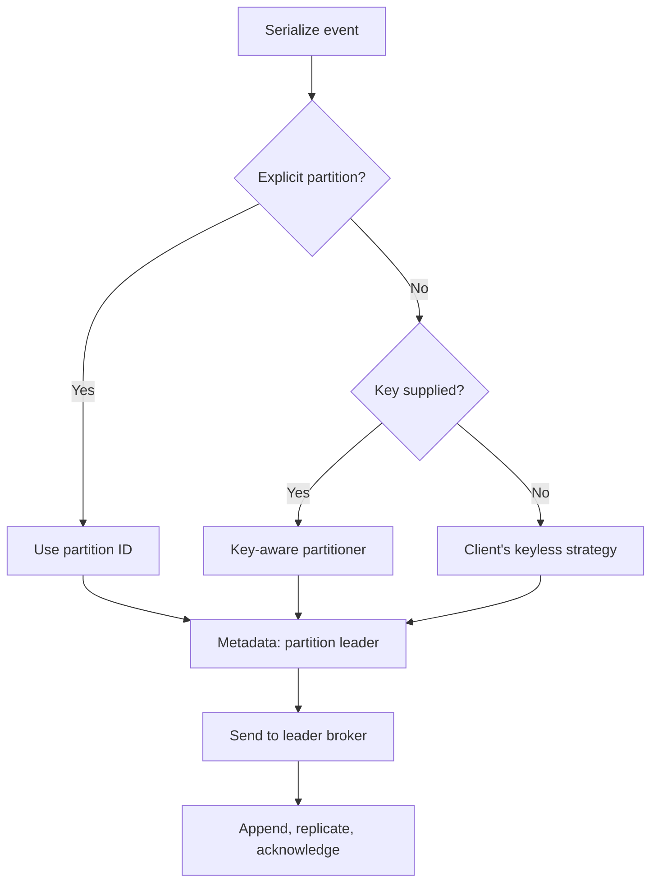
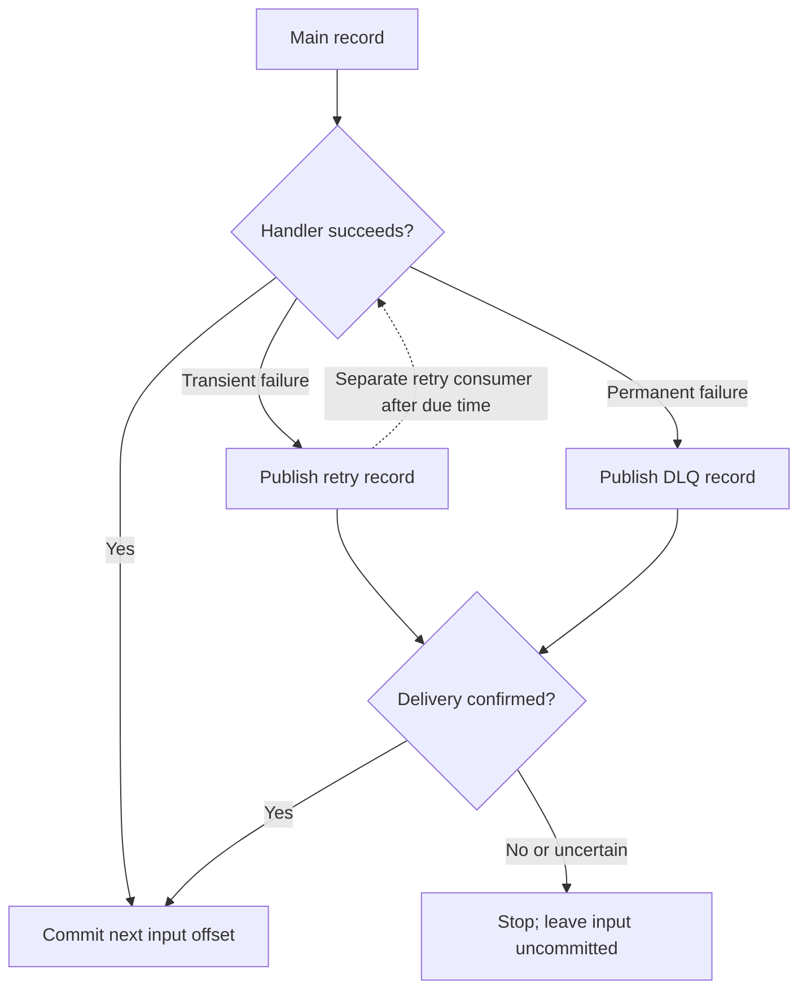

the follower partitions will take over the leader partition when the leader partition goes down


---

# Kafka and Amazon MSK: production concepts and interview guide

Added: 2026-10-31. Updated: 2026-11-01 with the broker/topic/partition explanation and simplified MSK examples. The original notes and images above are preserved.

**Correction to the original sentence:** a follower **replica of the same topic-partition** can become its leader. `topic-A / partition-1` is not the backup of `topic-A / partition-0`, and topic B is not the backup of topic A.

This guide uses ordinary **partition-assigned consumer groups** and the conventional ISR replication model. Newer share-group consumption and Eligible Leader Replicas (ELR) have different details; check your Kafka/MSK version and feature settings before applying those models. Client examples use `confluent-kafka` (librdkafka), whose configuration names and defaults can differ from Java and `kafka-python`. Sources below include versioned Kafka 4.1 references; this is not a claim that 4.1 is the newest release.

## Reading map

1. What Kafka is, when to use it, and real-world use cases.
2. Terminology and the partition/replica mental model.
3. Producer routing, consumer offsets, rebalancing, and leader failover.
4. Scalability, durability, retries, performance, and retention.
5. Simple AWS MSK setup plus standalone producer.py and consumer.py; no local Kafka lab.
6. MSK responsibilities, troubleshooting, and interview practice.

## 1. What Kafka is and when to use it

Apache Kafka is an open-source, distributed event-streaming platform. Producers publish records; Kafka retains them in partition logs; consumers read them independently. Kafka brokers store and transport events. Your application, Kafka Streams, Flink, or another processor performs the business computation. Kafka does not transcode a video just because you publish a message. [S1]

Use it when a durable event history, replay, high throughput, and independent consumers are useful together. For example, one upload event can feed transcoding, moderation, and analytics without making the upload API wait for all three.

For a small background-job system that mainly needs per-job acknowledgement and delayed retries, a task queue may be simpler. For a query requiring an immediate answer, use an API or database. Those are design choices based on your requirements, not limitations to hide in an interview.

### Representative real-world use cases

This is a broad practical list, not an exhaustive list of every possible application. The examples apply Kafka's messaging, activity tracking, metrics, log aggregation, and stream-processing capabilities. [S2]

| Use case | Example event | What consumers do |
| --- | --- | --- |
| Video/media pipeline | `VideoUploaded` with object URI | Register transcoding jobs, moderate content, generate thumbnails |
| Orders and fulfillment | `OrderPlaced` | Reserve stock, plan shipping, update analytics |
| Payments and fraud | `PaymentAttempted` | Calculate risk, notify operations, populate audit views |
| Clickstream analytics | `ProductViewed` | Update funnels and recommendations |
| Database change capture | Row changed in source database | Refresh search indexes and analytical stores |
| IoT and telemetry | `SensorReading` | Detect anomalies and aggregate measurements |
| Application logs | Structured service event | Feed observability and security pipelines |
| Live dashboards | `ShipmentLocationUpdated` | Update a dashboard service; it can use SSE/WebSocket to the browser |
| Notifications | `AccountStatusChanged` | Decide whether to send email, push, or in-app notification |
| Data enrichment | `TransactionReceived` | Join reference data and emit an enriched event |
| Replay/backfill | Retained historical events | Rebuild a read model after fixing consumer logic |
| Event-sourced systems | Domain event with version | Reconstruct state, with explicit ordering and retention design |

For the video example, store the file in object storage first; publish its identifier and URI. Decide what happens if upload succeeds but event publication fails: a database outbox, reconciliation job, or another durable publication mechanism must close that gap. Do not rely on the producer's RAM after the API process exits.

## 2. Terminology

| Term                      | Definition                                                | Concrete example                                              |
| ------------------------- | --------------------------------------------------------- | ------------------------------------------------------------- |
| Cluster                   | Brokers and the metadata/control system working together  | A three-broker deployment                                     |
| Broker                    | Server that serves partition replicas                     | Broker 1 hosts leaders and followers for different partitions |
| Topic                     | Named stream split into partitions                        | `video.uploaded`                                              |
| Partition                 | Ordered append-only log within a topic                    | `video.uploaded`, partition 0                                 |
| Record/event/message      | Key, value, timestamp, headers and Kafka metadata         | JSON upload metadata                                          |
| Key                       | Optional bytes used by a key-aware partitioner            | UTF-8 bytes of `video_id`                                     |
| Offset                    | Record position within one partition                      | Partition 0, offset 42                                        |
| Producer                  | Client that publishes records                             | Upload API or outbox publisher                                |
| Consumer                  | Client that fetches records                               | Job-registration worker                                       |
| Consumer group            | Consumers sharing partition ownership and progress        | `transcoding-workers`                                         |
| Replica                   | Copy of one partition log on another broker               | Another copy of partition 0                                   |
| Leader                    | Replica currently accepting writes for that partition     | P0 leader on Broker 1                                         |
| Follower                  | Replica that fetches the leader's data                    | P0 follower on Broker 2                                       |
| Replication factor / RF   | Total replicas, including the leader                      | RF=3 means 1 leader + 2 followers                             |
| ISR (in-sync replica)     | Current in-sync replica set, including the leader         | Brokers 1, 2 and 3 while all are caught up                    |
| Group coordinator         | Broker role coordinating group membership/progress        | Tracks the worker group                                       |
| KRaft controller          | Metadata/control-plane role in modern Kafka               | Coordinates partition leadership changes                      |
| Committed consumer offset | Durable next position to resume for a group and partition | Commit 43 after processing record 42                          |
| Consumer lag              | Distance behind a chosen end/readable position            | End 120, committed 100: offset gap 20                         |

Topics, keys, partitions, and offsets describe the data model [S1]; replicas and ISR describe durability [S3]. Group coordination and offset commits describe consumption [S4]. KRaft metadata coordination is separate from application-event processing [S18]. An offset gap is not always an exact count of business events: compaction, transactions, and offset gaps can matter.


### Broker, topic, partition ID, replica, and message key

A **topic** is a named stream. A **partition** is one ordered log within that topic. A **replica** is a stored copy of the partition log. A **broker** is a Kafka server hosting those copies. A Kafka partition is not a general disk partition shared by several topics.

| Item | Example | Meaning |
| --- | --- | --- |
| Topic | `orders` | Stream chosen by the publisher and subscriber. |
| Topic-partition | `(orders, 0)` | Partition 0 specifically within Orders. |
| Different topic-partition | `(payments, 0)` | A separate log, despite also having partition ID 0. |
| Replica | Another copy of `(orders, 0)` on Broker 2 | The same logical partition, not another independent write lane. |
| Message key | `customer-42` | Record value used by a key-aware partitioner to select a partition. |
| Broker | Broker 1 | Server hosting replicas from many partitions and topics. |

**Partition ID is not message key.** The ID is a number such as 0, 1, or 2. Many message keys can map to one partition. The producer first specifies the topic, then uses its configured partitioner and serialized message key to choose a partition within that topic. Metadata identifies the current leader broker. The producer does not normally hash the topic name or directly select a physical disk. [S5][S6][S7]

#### Can Orders partition 0 exist on two brokers?

Yes—as replicas of **one partition**. For a two-partition topic with replication factor two, this is a valid illustrative layout:

| Broker | `orders / partition 0` | `orders / partition 1` |
| --- | --- | --- |
| Broker 1 | Leader copy of P0 | Follower copy of P1 |
| Broker 2 | Follower copy of P0 | Leader copy of P1 |

There are **two independent logs and four stored copies**. P0's follower copies P0, not P1. Both brokers host a leader, but for different partitions. A replica of P0 keeps P0's identity; a new independent partition needs a different ID within Orders. Leader/follower roles apply per topic-partition, not to the entire broker. [S3]

Replicas of the **same** partition are placed on different brokers, not together on one broker. With one broker, a topic can have several partitions, each with one leader copy and no followers. A broker can host many partition replicas: **four partitions was an example, not its maximum**.

#### What changes when capacity is added?

| Change | Purpose | Important distinction |
| --- | --- | --- |
| Add a topic partition | Another independent log and potential parallel work | Adds no physical server; existing records remain in their old partitions. |
| Add a partition replica | Another copy for recovery | Does not create another independent write lane. |
| Add a broker | More server resources | Does not by itself increase the topic's partition count. |

A new partition can have its leader on an existing or new broker. Check placement rather than assuming the new leader is automatically on the newly added broker. Producers must distribute traffic across partitions to use the parallelism; one hot key can remain a bottleneck.

Increasing partition count can remap future keyed messages and affect ordering across the change. Standard MSK capacity expansion and replica/leader redistribution need planning; supported Express intelligent-rebalancing operations can automate redistribution. Broker scaling and creating new partitions remain separate concepts. [S20][S29]

### Three partitions with replication factor three

| Broker | P0 replica | P1 replica | P2 replica |
| --- | --- | --- | --- |
| Broker 1 | Leader | Follower | Follower |
| Broker 2 | Follower | Leader | Follower |
| Broker 3 | Follower | Follower | Leader |

There are **3 independent logs and 9 replica copies**, not 9 independent work queues. A single broker does not have to contain every partition. Adding replicas improves fault tolerance but adds storage/network work; adding partitions creates more units of parallelism.

A log resembles a FIFO queue only within a partition. Reading a record does not **remove** it. Other groups can read it, and the same group can replay it while retained. Ordering is by partition offset, not global event timestamp. Parallel handlers and retry topics can change completion order even when Kafka's log order is intact(完好无损的).

## 3. Workflow: how a producer finds the right broker

1. Connect to a reachable address in `bootstrap.servers` and obtain cluster metadata.
2. Serialize the key and value to bytes.
3. Choose a partition: an explicit partition wins; otherwise use the configured partitioner.
4. Look up that partition's current leader in metadata and send directly to that broker.
5. The leader appends the batch; followers replicate; the producer receives the configured acknowledgement.
6. On a leadership change, the client refreshes metadata and retries eligible failures within its deadline. Bootstrap addresses are discovery entry points, not a gateway through which all events pass. [S5]



**A key chooses a partition, not a broker.** The broker hosting its leader may change without the key changing. Identical serialized keys normally map to the same partition with the same partitioner and partition count. Increasing the count can remap keys; old records stay where they were. Plan an ordering-aware migration if continuity across that change matters.

**No key does not universally mean round-robin.** The Java producer documents sticky behavior by default. Other clients have their own choices. The Python examples explicitly select `murmur2_random`; non-null keys use Java-compatible Murmur2 hashing, while null keys use that client's keyless behavior. Do not use Python's built-in `hash()` as a cross-process partitioning contract. [S6][S7]

## 4. Workflow: consumption, offsets, and rebalancing

In an ordinary(普通的) consumer group, one partition has at most one assigned consumer at a time. One consumer can own several partitions. Separate groups maintain independent progress. This assignment rule does **not** guarantee that application side effects happen exactly once. A stale(陈旧) handler can also continue external work after losing ownership unless the application stops or fences it. [S4]

Illustrative assignments for six partitions:

| Members in one group | Possible assignment |
| --- | --- |
| 2 | C1: P0–P2; C2: P3–P5 |
| 3 | Two partitions each |
| 8 | At most six active partition owners; two have no partition |

### Resume from the next unprocessed offset

Suppose P0 has records 40, 41, 42 and 43. The group has committed **42**: its recovery position is record 42. After successfully processing 42, commit **43**. The Python call `commit(message=message)` performs the +1 for you. P1 might independently be at offset 900; offsets do not need to match across partitions. [S8]

Keep three positions separate: fetched/current position, successfully processed position, and durably committed position. Prefetching or handing work to a thread pool does not prove processing completed.

`auto.offset.reset` is a fallback when a usable committed offset is absent(缺席的) or out of range. `earliest` starts at the oldest retained position; `latest` starts at the end and can skip retained backlog. It does not override a valid committed offset on every restart. In production, consider failing visibly on an unexpected reset and investigating retention or group identity. [S9]

### Rebalance sequence

1. A consumer joins, leaves, times out, or a subscription/partition set changes.
2. The group protocol/assignor redistributes **partition ownership**. Eager, cooperative, and newer protocols differ in how much movement they require.
3. A departing owner stops or fences work for revoked partitions. Commit only the completed contiguous prefix while still permitted; handle commit failure.
4. The new owner resumes from committed offsets. Work completed externally but not committed can run again.

For an asynchronous worker pool, if offset 42 is unfinished but 43 finishes, do not commit 44. That would skip 42 after a crash. Track completion per partition and advance only past a contiguous completed prefix. This is an application concurrency rule derived from offset semantics, not a feature a thread pool supplies automatically.

Keep polling within `max.poll.interval.ms`. A live process or heartbeat alone does not establish that its processing loop is making progress. Long video processing should generally be registered durably with a separate worker system; committing after merely putting a task in process memory risks losing it. [S9]

## 5. Fault tolerance, durability, and acknowledgements

The producer sends to the **leader once**. It does not call every replica. The leader coordinates replication; its response expresses whether the requested condition has been met. [S3]

| Producer setting | Meaning                                                                   | Failure consequence                                     |
| ---------------- | ------------------------------------------------------------------------- | ------------------------------------------------------- |
| `acks=0`         | Do not wait for broker acknowledgement                                    | Cannot confirm broker acceptance                        |
| `acks=1`         | Leader has appended to its local log                                      | A leader failure before replication can lose that write |
| `acks=all`       | Wait for current ISR(In-Sync Replica) replication, subject to minimum ISR | Stronger durability; may reject writes to protect data  |

`min.insync.replicas` is a minimum admissible ISR count for `acks=all`, **not an instruction to wait for only that many replicas when more are in sync**. [S10]

Assume RF(Replication Factor)=3(one leader and 2 follower replicas), minimum ISR=2, `acks=all`, conventional ISR mode:

| Current ISR | Result |
| --- | --- |
| B1, B2, B3 | All three in-sync copies must receive the write |
| B1, B2 | Two copies suffice after ISR membership changes |
| B1 only | Writes cannot succeed under this durability requirement |

With RF=2 and minimum ISR=2, losing one replica prevents successful writes. RF=2/minimum ISR=1 can continue on one copy, but losing that remaining copy can lose newly accepted data. The choice trades availability against durability. `acks` confirms Kafka storage, not consumer processing; consumer offset commits are a different operation. [S10]

### Leader failure workflow

1. P0 leader on B1 becomes unavailable.
2. Kafka's control plane selects an eligible replacement, ordinarily an in-sync replica in this model.
3. Clients discover the new leader and retry transient failures.
4. The old broker catches up as a follower when it returns.

Failover takes time and does not guarantee zero errors. A network split or lack of safe replicas can make a partition unavailable. Unclean leader election can choose a stale replica at the cost of lost records; do not describe that as safe failover. RF is not a backup against accidental deletion, bad data, or region loss. [S3][S18]

## 6. Scalability and performance

Start with the bottleneck, not a configuration shopping list. The following is a diagnostic approach; benchmark against your actual messages and downstream services.

| Symptom                         | Investigate                                 | Possible action and trade-off                                                                                                                                                                             |
| ------------------------------- | ------------------------------------------- | --------------------------------------------------------------------------------------------------------------------------------------------------------------------------------------------------------- |
| All partitions accumulate lag   | Handler rate, DB/API capacity, consumer CPU | More consumers up to partition ownership limits; optimize downstream calls                                                                                                                                |
| One partition is slow           | Hot key, uneven(不均匀) payload sizes          | Redesign key distribution; splitting one key can sacrifice its ordering                                                                                                                                   |
| Brokers saturate(饱和)            | Disk, network, CPU, leader distribution     | For Standard clusters, add capacity and plan replica/leader redistribution; supported Express intelligent rebalancing can automate movement [S29]                                                                                                        |
| Too many small produce requests | Batch sizes and request rate                | Increase batching/linger(萦回) modestly(谦虚地)(增加批处理/适度延长); trade latency for throughput                                                                                                                      |
| Large payload pressure          | Record sizes and compression                | Store blobs separately; send references; align producer/broker/fetch limits                                                                                                                               |
| Retry storm                     | Downstream failure and retry rate           | Bound attempts, exponential backoff with jitter(JC - right, the consumer can retry with exponential backoff with jitter to decrease to reach the rate limitation), circuit breaking and admission control |

Partition count supports parallelism but costs metadata, buffers, files, recovery work, and operational complexity. More replicas do not create independent write capacity for a partition. Quotas and a 1-MB application limit protect resources; they do not increase underlying processing capacity.

For a later tuning exercise, `linger.ms=10`, `batch.size=65536`, and `compression.type=lz4` illustrate batching and record-batch compression. They are not required by the simple scripts in section 9 or universal optimums. The consumer library decompresses batches; this does not create a `.zip` file. [S7]

Avoid flushing after every event in the throughput path. `produce()` enqueues asynchronously; delivery callbacks report eventual success or failure. Poll to serve callbacks and flush at shutdown. A retry-topic handoff must be confirmed before committing the source offset; synchronous confirmation trades throughput for simpler control flow. [S11]

## 7. Producer retries versus consumer retries

### Delivery guarantees: name the boundary

| Guarantee | Typical approach | What can happen on a crash |
| --- | --- | --- |
| At most once | Commit before the business action | Input may be skipped if the action never finishes |
| At least once | Complete durable work, then commit | Work may be delivered/attempted again |
| Exactly once within Kafka | Transaction couples Kafka outputs and input offsets | Aborted output stays invisible to `read_committed` consumers |
| One effective database action | At-least-once delivery plus atomic inbox/business transaction | Replays occur, but the same event ID does not repeat the DB change |

The last row is the Python lab's boundary. Neither producer idempotence nor consumer-group membership makes arbitrary external side effects exactly once. [S8][S11]

### Producer: transport retry

The client retries eligible transport/broker failures according to its retry/backoff settings and delivery deadline. This is largely configuration, but the application must still observe the final delivery result, handle a full local buffer, and retain work if publication cannot be confirmed. Authentication, authorization, schema, and oversized-record errors need correction rather than unlimited retries. A timeout can leave the delivery outcome uncertain. [S12]

`enable.idempotence=true` lets Kafka recognize duplicate transmission attempts by the producer protocol. It does not deduplicate two explicit `produce()` calls representing the same order, every restart, or an external payment API. Keep a stable business `event_id`, use a durable outbox when needed, and make downstream effects idempotent. [S12]

### Consumer: business-operation retry

Kafka cannot infer(推断) whether your database write, HTTP call, or video job succeeded. Your proposal—**main topic, retry topic, then dead-letter topic**—is valid. A DLQ is an ordinary Kafka topic with application-defined behavior; there is no automatic business retry/DLQ policy for the consumer shown here. [S13]

| Approach                          | Good fit                                        | Main cost                                                                  |
| --------------------------------- | ----------------------------------------------- | -------------------------------------------------------------------------- |
| Short retry inside handler        | Brief transient failure                         | Blocks that processing lane; budget time carefully                         |
| Pause failed partition and retry  | Strict per-partition processing order           | Later records in that partition wait; keep polling and manage reassignment |
| Retry topic and separate consumer | Independent work can keep moving                | Later same-key events may overtake the failed event                        |
| Durable(耐用的) external job queue   | Long delays, job lifecycle, independent workers | Another system and a cross-system handoff                                  |
| DLQ plus controlled replay        | Poison record or exhausted retry budget         | Requires ownership, alerts, diagnosis, and replay tooling                  |

### Retry workflow and the handoff failure window



The diagram's retry path also has a bounded attempt count: exhaustion routes to DLQ.

Consider these two failure experiments in the Python example:

- Retry-topic publish fails: leave the original input uncommitted and stop; restart can replay it.
- Retry-topic publish succeeds, then the process crashes before committing the original: restart may publish another retry record. This is **at-least-once handoff**, so duplicate retry/DLQ records are possible.

For Kafka-to-Kafka processing in the same cluster, transactions can atomically commit output records and input offsets: begin transaction, produce output, call `send_offsets_to_transaction()` with next offsets and current group metadata, then commit the transaction. Consumers of transactional output use `read_committed`. Handle retriable, abort-required, and fatal errors distinctly; use a stable transactional ID per logical producer and fence duplicate instances. A Kafka transaction does not include an arbitrary database, SQS, or HTTP side effect. [S8]

### Delay is not supplied by a topic name

Calling a topic `retry-30s` does not make Kafka wait 30 seconds. Store an attempt count and due timestamp; a consumer/scheduler must enforce the delay. A scalable worker can pause the affected partition, keep polling other partitions, resume when due, and discard stale scheduled work on revocation. Fixed delay-stage topics can simplify this. Repeatedly reading and immediately republishing a not-yet-due record creates a hot loop. [S13]

### Can SQS be used? What if Kafka is not on AWS?

Yes. MSK(Amazon Managed Streaming for Apache Kakfa) and SQS are independent services; your consumer can bridge them. Self-managed Kafka outside AWS can also call SQS with permitted network access and AWS credentials. Kafka does not require SQS or AWS.

For an SQS handoff, send the retry job and confirm acceptance before committing the Kafka input. A crash between those operations can duplicate the job; there is no shared Kafka/SQS transaction. After SQS processing, delete the message on success. An expired visibility timeout can make unfinished work available again; standard-queue consumers must tolerate duplicates. A configured redrive policy can send repeated failures to an SQS DLQ. [S14]

SQS delivery delay and visibility timeout are different: delay applies before initial visibility, visibility timeout after receipt. SQS delays/message timers are limited to 15 minutes; longer schedules need another mechanism. [S15]

Without AWS, practical alternatives are:

- **Kafka retry topics:** reuse the same cluster and implement delay/attempt tracking.
- **RabbitMQ:** a queue with TTL and dead-letter routing can move expired records to another queue; review confirmation and dead-letter reliability settings, particularly for quorum queues. [S16]
- **A database-backed scheduler:** persist job ID, payload, due time, attempts, and a claim lease; workers atomically claim due jobs. This is an architectural alternative, not functionality Kafka adds for you.

Choose based on delay length, ordering, operational familiarity, and handoff guarantees. Do not add SQS solely because the Kafka cluster happens to be MSK.

## 8. Retention, replay, and compaction

Kafka retains log segments on broker storage, with optional tiered storage depending on deployment. Consumption does not delete records. For delete-policy topics, `retention.ms` limits time and `retention.bytes` limits size **per partition**; either can make old segments eligible for removal. Cleanup is segment-based and asynchronous, not an exact per-record timer. Seven days is the documented Kafka 4.1 time default, but inspect actual topic and service configuration. [S17]

For an illustrative size budget: six partitions × 1 GiB/partition gives about 6 GiB of logical retained data. RF=3 gives roughly 18 GiB of replica data before indexes, active segments, cleanup lag, operational headroom, and any tiered-storage differences. This is planning arithmetic, not a hard disk cap. A hot partition may reach its size limit sooner than the others.

`cleanup.policy=compact` eventually preserves the newest value per key, with tombstones representing deletion. It is useful for state reconstruction, not a full immutable audit history. Compaction does not instantly remove duplicates and does not renumber offsets. `compact,delete` applies both kinds of cleanup. Consumer-group offset retention is separate from topic-data retention. [S17][S19]

Set retention from outage duration + catch-up time + replay needs, with capacity headroom. Alert on the **age of the oldest unprocessed event**, not just a count. If retention deletes unread data, retries and offsets cannot restore it. Replaying with a new group re-executes side effects unless your application protects them.

## 9. Simple Amazon MSK example: separate producer.py and consumer.py

This section replaces the previous local Kafka/SQLite/retry-worker lab. It uses **Amazon MSK Provisioned, Standard brokers, and IAM authentication**. No local Kafka server, Docker cluster, database, retry-worker framework, or shared application module is required.

The following `producer.py` and `consumer.py` sections are separate **inline code examples in this Markdown note**. They represent independent applications, potentially on different AWS hosts/services, and do not import or call each other. No standalone Python files are included in the repository.

### Step 1: AWS creates the cluster and brokers

In the MSK console, create a Provisioned Standard cluster using an available Kafka version **3.6 or later**, three Availability Zones, and one broker per zone: **three managed brokers total**. Select the VPC/subnets/security groups and enable IAM client authentication with TLS. MSK creates and runs the broker servers; neither application script creates brokers. MSK Serverless abstracts broker counts and is not the provisioning example here. [S25]

### Step 2: create the topic and partitions once

Use either the MSK console's **Topics → Create topic** screen or the AWS Python setup snippet below. Set topic name `orders`, partition count `3`, and replication factor `3`. These topic-management features apply to supported MSK Provisioned clusters using Kafka 3.6+. [S26][S28]

```python
import os
import boto3

msk = boto3.client("kafka", region_name=os.environ["AWS_REGION"])
cluster_arn = os.environ["MSK_CLUSTER_ARN"]
result = msk.create_topic(
    ClusterArn=cluster_arn,
    TopicName="orders",
    PartitionCount=3,
    ReplicationFactor=3,
)
print("Topic status:", result["Status"])
print("IAM endpoints:", msk.get_bootstrap_brokers(
    ClusterArn=cluster_arn
)["BootstrapBrokerStringSaslIam"])
```

The setup uses current `boto3` with `create_topic` support. The cluster must already be active. Topic creation is asynchronous: wait for topic status **ACTIVE** before starting the applications. Run creation once; an existing name produces a topic-exists error. Choose the console or script method, not both for the same topic. [S27]

| Setup value | What it creates or identifies |
| --- | --- |
| Three brokers | Three managed servers, not three producer applications. |
| `TopicName="orders"` | One named topic used by both scripts. |
| `PartitionCount=3` | Three independent logs: Orders P0, P1, and P2. |
| `ReplicationFactor=3` | Three copies per partition: one leader and two followers on different brokers. |
| Three partitions × three copies | Nine replica copies, not nine independent work streams. |
| `MSK_CLUSTER_ARN` | AWS resource identity used by the setup API. |
| `MSK_BOOTSTRAP` | Kafka connection endpoints used by the two applications; not the cluster ARN. |

RF=3 does not itself configure `min.insync.replicas=2`. Apply that topic setting separately if using the RF=3/minimum-ISR=2 policy explained in section 5.

### Step 3: give the AWS applications connection settings

If deploying the examples, use AWS compute such as EC2 or ECS with network access to the cluster. Install only the Python client libraries; a Kafka server/CLI installation on the client machine is unnecessary.

```bash
python -m pip install --upgrade boto3 confluent-kafka aws-msk-iam-sasl-signer-python
export AWS_REGION='us-east-1'
export MSK_CLUSTER_ARN='YOUR_MSK_CLUSTER_ARN'
export MSK_BOOTSTRAP='YOUR_CLUSTER_IAM_BOOTSTRAP_STRING'
```

Use the real IAM bootstrap string returned by the setup snippet or the MSK client-connection screen. The applications need VPC routing, DNS, security-group access to **all advertised brokers**, and AWS roles with the relevant topic/group permissions. The setup identity needs separate AWS topic-management permissions. Credentials come from the AWS default credential chain; access keys are not embedded in the scripts.

The short `iam_token` callback is MSK connection/authentication code. AWS's signer uses IAM credentials; `confluent-kafka` expects expiry in seconds, so it divides milliseconds by 1000. Both files repeat this small callback to stay independently readable. These settings are specifically for MSK IAM, not SCRAM or mutual TLS. [S22][S23]

### producer.py: one application publishes an order event

```python
import json
import os
from confluent_kafka import Producer
from aws_msk_iam_sasl_signer import MSKAuthTokenProvider


def iam_token(_):
    token, expiry_ms = MSKAuthTokenProvider.generate_auth_token(
        os.environ["AWS_REGION"]
    )
    return token, expiry_ms / 1000


def delivered(error, message):
    if error is not None:
        raise RuntimeError(f"Delivery failed: {error}")
    print(
        f"Sent: {message.topic()} / partition {message.partition()} "
        f"/ offset {message.offset()}"
    )


producer = Producer({
    "bootstrap.servers": os.environ["MSK_BOOTSTRAP"],
    "security.protocol": "SASL_SSL",
    "sasl.mechanism": "OAUTHBEARER",
    "oauth_cb": iam_token,
    "acks": "all",
    "partitioner": "murmur2_random",
})

order = {"order_id": "order-1001", "customer_id": "customer-42"}
producer.produce(
    topic="orders",
    key=order["customer_id"],
    value=json.dumps(order),
    on_delivery=delivered,
)
if producer.flush(10):
    raise TimeoutError("Delivery is unconfirmed; the outcome is unknown.")
```

What to notice:

- `Producer(...)` is a Kafka client. It creates no brokers, topics, or partitions.
- `topic="orders"` selects the stream; `key=order["customer_id"]` supplies the **message key**.
- No partition or broker ID is hard-coded. The partitioner chooses a partition; metadata locates its leader.
- `delivered` prints the actual topic, partition ID, and offset acknowledged by Kafka.
- This one-shot publisher flushes at shutdown. A timeout means unconfirmed delivery, not proof that the event was rejected.
- `acks="all"` concerns replication acknowledgements, not consumer completion.

### consumer.py: another application processes the event

```python
import json
import os
from confluent_kafka import Consumer, KafkaException
from aws_msk_iam_sasl_signer import MSKAuthTokenProvider


def iam_token(_):
    token, expiry_ms = MSKAuthTokenProvider.generate_auth_token(
        os.environ["AWS_REGION"]
    )
    return token, expiry_ms / 1000


consumer = Consumer({
    "bootstrap.servers": os.environ["MSK_BOOTSTRAP"],
    "security.protocol": "SASL_SSL",
    "sasl.mechanism": "OAUTHBEARER",
    "oauth_cb": iam_token,
    "group.id": "orders-workers",
    "auto.offset.reset": "earliest",
    "enable.auto.commit": False,
})
consumer.subscribe(["orders"])

try:
    while True:
        message = consumer.poll(1)
        if message is None:
            continue
        if message.error():
            raise KafkaException(message.error())
        order = json.loads(message.value().decode("utf-8"))
        print(
            f"Process {order} from {message.topic()} "
            f"/ partition {message.partition()} / offset {message.offset()}"
        )
        # Replace print with successful business work before committing.
        consumer.commit(message=message, asynchronous=False)
except KeyboardInterrupt:
    pass
finally:
    consumer.close()
```

What to notice:

- `subscribe(["orders"])` selects a **topic**, not a message key or broker.
- `orders-workers` is the consumer group. With ordinary partition assignment, one member can own all three partitions; multiple members divide them.
- `poll(1)` fetches an event. The message exposes its topic, partition, offset, key, and value.
- The print is a placeholder business action. Replace it with successful durable processing before committing.
- `commit(message=...)` stores the next offset for that topic-partition; it does not delete the event.
- `earliest` applies when no valid committed offset exists. It does not force replay on every restart.

The consumer acts as the worker; the record describes the work. A crash after the business action but before the offset commit can cause replay. The example therefore does not promise exactly-once business effects. Idempotency, durable retries, and DLQ design remain explained separately in section 7.

### How the AWS setup maps to the scripts

| Stage | Example | Owner |
| --- | --- | --- |
| Provision | Three-broker MSK cluster | AWS console/infrastructure deployment; MSK runs brokers. |
| Create topic | Orders, 3 partitions, RF=3 | One-time console action or `boto3` setup. |
| Publish | `produce(topic="orders", key="customer-42", ...)` | `producer.py`. |
| Route | Key-aware partitioner selects, for example, P1 | Producer client. |
| Locate | Metadata says P1's leader is on Broker 2 | Kafka metadata and producer client. |
| Store | Leader appends; followers copy the same partition's records | MSK/Kafka brokers. |
| Read | Assigned consumer receives the Orders P1 record | `consumer.py`. |
| Process | Perform the action, then commit the next offset | Consumer application. |

P1/Broker 2 are illustrative, not guaranteed results for this particular key. The print statements expose the actual results. Leader placement can change without changing the topic-partition identity.

Run the applications as separate processes/services if deployed: the producer sends one event and exits; the consumer waits until interrupted. The producer can publish while the consumer is stopped, and the consumer can later read retained events. They share the topic and event contract, not a direct application-to-application call.

## 10. Amazon MSK: what AWS manages and what you still design

MSK runs the broker service and its infrastructure. You choose the cluster mode/capacity, topic partitioning, authentication/network access, and durability policy. Section 9 uses Provisioned Standard brokers; Serverless hides broker counts, and Express has different protected settings and operational features. [S25]

Managed brokers still experience maintenance, leadership changes, network failures, and capacity constraints. Applications still own event schemas, message keys, processing, retries, idempotency, offset correctness, backpressure, and downstream failures. A separate recovery plan is needed for cross-region outages.

For Standard capacity expansion, examine replica and leader placement rather than assuming all existing data moves when brokers are added. Supported Express intelligent rebalancing can redistribute partitions automatically during broker-count changes. This is distinct from increasing a topic's partition count. [S29]

The independent scripts in section 9 use MSK IAM bootstrap endpoints with SASL/OAUTHBEARER over TLS. Their IAM callbacks are connection code, not a connection between the producer application and the consumer application. [S22][S23]

## 11. Operational signals and interview troubleshooting

Watch partition-level lag and lag age, producer error/retry/throttle rates, processing latency, commit failures, rebalance frequency, DLQ rate, offline/under-replicated partitions, ISR shrinkage, and broker disk/network/CPU. Metrics and exact names depend on the broker/client/service. Connect them to an action: a growing lag age approaching retention is a potential data-loss deadline, not merely a dashboard number. [S24]

When asked "the consumer is slow," work through a concrete sequence:

1. Compare arrival rate and completion rate; check whether backlog is growing.
2. Locate the lag by partition; one hot partition suggests skew rather than a group-wide capacity shortage.
3. Measure time in processing, downstream calls, retry waiting, and offset commits.
4. Check available partition ownership and downstream capacity before adding workers.
5. Verify that catch-up can finish before retained data expires; reduce incoming load or increase retention/capacity if needed.

Schema evolution, authentication/authorization, tenant quotas, transaction boundaries, and replay safety are useful follow-up topics. For event contracts, include a stable event ID, schema version, event type, entity key, event time, and correlation ID; define compatibility rules rather than assuming every consumer deploys simultaneously.

## 12. Interview answers to practice aloud

**What is Kafka?**

> Kafka is a distributed event-streaming platform. Producers append events to topic partitions, and consumer groups process them independently. I use it when I need durable buffering, replay, and multiple downstream consumers. The application performs the business processing.

**How would you scale it?**

> I would identify the bottleneck first. Partitions provide parallelism, and consumers in a group divide those partitions. I would check key skew and downstream capacity before adding workers. Replicas improve resilience and add resource cost; they do not create additional independent write lanes.

**What does `acks=all` mean?**

> The producer sends to the partition leader. In the conventional ISR model, success requires replication to the current in-sync set and satisfaction of the minimum ISR setting. With three replicas and minimum ISR two, we can tolerate one replica being unavailable for writes. The acknowledgement does not mean that a consumer finished processing.

**How do you avoid losing failed consumer work?**

> I commit only after a durable business action or a confirmed retry/DLQ handoff. I use bounded retries for transient failures, quarantine permanent failures, and make effects idempotent because crashes can cause replay. If the handoff stays inside Kafka, a transaction can couple the output and input offset.

**How do offsets behave during rebalance?**

> Rebalancing moves partition ownership. Each new owner resumes from the group's committed offset for its partition, which identifies the next record to read. I stop or fence revoked work and only commit a completed contiguous prefix. I do not try to make offsets equal across consumers.

**Why not simply retry every 100 milliseconds?**

> Fixed frequent retries can overload a failing dependency. I distinguish transient and permanent failures, cap retries and total time, and add backoff with jitter. For longer delays I use a durable retry mechanism and decide whether later records may overtake the failed one.

**Does MSK mean I can ignore outages?**

> AWS manages the broker service, but my clients and downstream systems still fail. I need timeouts, delivery handling, idempotency, capacity headroom, and a recovery plan. I would explain how the system behaves during a broker failure and during a wider outage.

These are practice formulations applying the concepts above, not claims about a particular production system you operated.

## 13. Verification and limits

Updated 2026-11-01. The inline producer and consumer examples and the one-time AWS setup snippet passed Python syntax checks and offline checks with simulated clients. Checks cover the producer's topic/key and delivery callback, consumer processing before a manual commit, closing without committing on an error, topic-creation parameters, and the IAM token-expiry conversion.

No real Kafka/MSK connection, AWS resource creation, live IAM authorization, broker placement, failover, or throughput test was performed. The consumer prints a decoded order as its placeholder action; it does not implement a database, business deduplication, or retry/DLQ workers. Those design concerns are explained separately.

## Official references

- [S1: Apache Kafka introduction](https://kafka.apache.org/41/getting-started/introduction/)
- [S2: Apache Kafka use cases](https://kafka.apache.org/41/getting-started/uses/)
- [S3: Apache Kafka design and replication](https://kafka.apache.org/41/design/design/)
- [S4: Confluent consumer groups and commit behavior](https://docs.confluent.io/platform/current/clients/consumer.html)
- [S5: Apache Kafka protocol and metadata routing](https://kafka.apache.org/41/design/protocol/)
- [S6: Apache Java producer configuration](https://kafka.apache.org/41/configuration/producer-configs/)
- [S7: librdkafka configuration reference](https://github.com/confluentinc/librdkafka/blob/master/CONFIGURATION.md)
- [S8: Confluent Python API, offsets, and transactions](https://docs.confluent.io/platform/current/clients/confluent-kafka-python/html/index.html)
- [S9: Apache consumer configuration](https://kafka.apache.org/41/configuration/consumer-configs/)
- [S10: Minimum ISR configuration details](https://docs.confluent.io/platform/current/installation/configuration/topic-configs.html#min-insync-replicas)
- [S11: Confluent Python producer and consumer guide](https://docs.confluent.io/kafka-clients/python/current/overview.html)
- [S12: librdkafka delivery, retries, and idempotence](https://docs.confluent.io/platform/current/clients/librdkafka/html/md_INTRODUCTION.html)
- [S13: Confluent error-handling and retry patterns](https://www.confluent.io/blog/error-handling-patterns-in-kafka/)
- [S14: SQS visibility timeout and failure handling](https://docs.aws.amazon.com/AWSSimpleQueueService/latest/SQSDeveloperGuide/sqs-visibility-timeout.html)
- [S15: SQS delay queues](https://docs.aws.amazon.com/AWSSimpleQueueService/latest/SQSDeveloperGuide/sqs-delay-queues.html)
- [S16: RabbitMQ dead-letter exchanges](https://www.rabbitmq.com/docs/dlx)
- [S17: Apache topic retention and cleanup configuration](https://kafka.apache.org/41/configuration/topic-configs/)
- [S18: Apache Kafka KRaft operations](https://github.com/apache/kafka/blob/trunk/docs/operations/kraft.md)
- [S19: MSK configuration, including offset retention](https://docs.aws.amazon.com/msk/latest/developerguide/msk-configuration-properties.html)
- [S20: Apache Kafka basic operations](https://kafka.apache.org/41/operations/basic-kafka-operations/)
- [S21: MSK Standard broker best practices](https://docs.aws.amazon.com/msk/latest/developerguide/bestpractices.html)
- [S22: MSK IAM client configuration](https://docs.aws.amazon.com/msk/latest/developerguide/configure-clients-for-iam-access-control.html)
- [S23: AWS MSK Python IAM signer](https://github.com/aws/aws-msk-iam-sasl-signer-python)
- [S24: Apache Kafka monitoring](https://kafka.apache.org/41/operations/monitoring/)

- [S25: Amazon MSK service, brokers, and cluster modes](https://aws.amazon.com/msk/faqs/)
- [S26: AWS topic-management APIs for Provisioned Kafka 3.6+](https://aws.amazon.com/about-aws/whats-new/2026/02/amazon-msk-kafka-topics-public-apis/)
- [S27: Boto3 Kafka create_topic](https://docs.aws.amazon.com/boto3/latest/reference/services/kafka/client/create_topic.html)
- [S28: Create topics in the MSK console](https://docs.aws.amazon.com/msk/latest/developerguide/create-topic-console.html)
- [S29: Express intelligent rebalancing during broker scaling](https://docs.aws.amazon.com/msk/latest/developerguide/intelligent-rebalancing-scaling-clusters.html)
