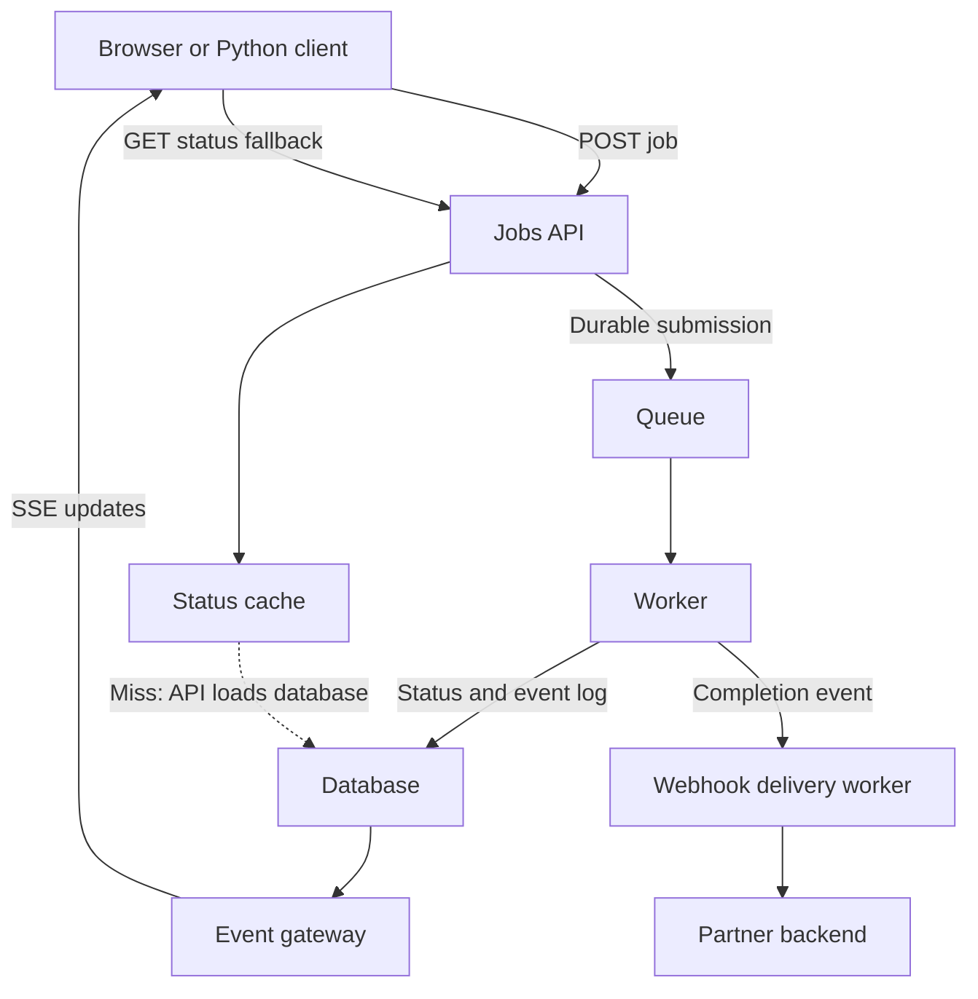

# Communication Technologies — Learning Map

Created: 2026-10-21. These guides expand our 2026-10-20 discussion and JC's request for explanations that connect definitions, implementation, use cases, and supporting technologies.

## Start with one familiar application

You submit a prompt to an AI service. Generating the answer takes time. You want to see progress, receive text as it is produced, and recover if the connection breaks.

- **REST-style HTTP API:** submit the work and retrieve or change resources.
- **Polling:** ask repeatedly whether that work is finished.
- **SSE:** connect once and receive a sequence of text events from the server.
- **WebSocket:** keep a connection on which both sides can independently send messages.
- **Webhook:** tell another backend that an event happened by calling its HTTP endpoint.

These are not all competing protocols at the same layer. REST is an architectural style; polling and webhooks are interaction patterns; SSE is an HTTP event-stream format and browser API; WebSocket is a bidirectional messaging protocol. One system can use several together.

## Reading order

| Guide | Main question answered | Supporting concepts |
|---|---|---|
| [01 — REST APIs](01-rest-apis.md) | How does a client request data or an action? | HTTP methods, validation, status codes, idempotency, pagination |
| [02 — Polling and long polling](02-polling.md) | How do I find out when an asynchronous job changes? | Intervals, deadlines, ETags, rate limits |
| [03 — Server-Sent Events](03-server-sent-events.md) | How does the server keep sending progress or AI text? | EventSource, event framing, heartbeats, replay, buffering |
| [04 — WebSockets](04-websockets.md) | What if both sides need to send messages frequently? | Ping/pong, reconnects, bounded queues, routing |
| [05 — Webhooks](05-webhooks.md) | How does a service notify another backend? | HMAC, durable inbox, retries, duplicates, ordering |
| [06 — Timeouts, backoff, and jitter](06-retries-backoff-jitter.md) | How do we recover without making an outage worse? | Retry-After, deadlines, retry budgets, idempotency |
| [07 — HMAC and encoding](07-hmac-and-encoding.md) | How do I know a webhook is authentic and unchanged? | UTF-8, ASCII, raw bytes, signed timestamps, replay |
| [08 — Caching and distributed coordination](08-caching-and-coordination.md) | How do we reduce reads without making incorrect decisions? | TTL, freshness, cache-aside, coalescing, leases, authoritative state |

The Python examples target Python 3.11+. Each guide says which snippets are runnable and which use application-specific adapters. Bind demonstrations to localhost. Authentication and persistence limitations are explained beside the examples.

## Choose from the requirement

| Need | Starting choice | Why |
|---|---|---|
| Fetch a profile or submit a job | HTTP API | A bounded request and response are sufficient |
| Check a five-minute job every few seconds | Polling | Simple; small detection delay is acceptable |
| Stream AI text or sports-score changes | SSE | Updates mostly flow from server to client |
| Interactive collaboration, game input, bidirectional messaging | WebSocket | Both sides independently send frequent messages |
| Notify a partner backend of completion | Webhook | The recipient exposes a callback endpoint |
| Correctly approve an irreversible action | Atomic authoritative operation | A cached UI snapshot cannot enforce the business rule |

An AI chat interface does not automatically require WebSockets. An HTTP POST can submit a prompt, with SSE delivering generated output. Realtime bidirectional audio has different requirements.

## How the technologies fit together

This is a design sketch: database events can reach the gateway via an outbox, CDC, or a durable event broker. A cache does not normally fetch database rows itself; the API implements that branch. If reliable worker completion plus notification is required, commit completion and an outbox record together.

## Terms that recur

- **Heartbeat:** a periodic small message used to keep a connection active or detect failure.
- **Backpressure:** limiting production or delivery when the consumer cannot keep up.
- **Idempotency:** repeated attempts have the same intended business effect as one attempt.
- **Replay:** resend retained events after a known sequence/cursor.
- **Reconciliation:** compare against authoritative state to repair missed or inconsistent updates.
- **Observability:** metrics, logs, and traces that reveal latency, errors, retries, and resource use.

## How to study each guide

1. Explain the definition without jargon.
2. Trace the request/message workflow.
3. Run the example and predict its output.
4. Introduce one failure: disconnect, duplicate, timeout, or stale value.
5. Explain which supporting technique addresses that failure and what it cannot guarantee.

Interview answers should follow **requirement → choice → example → trade-off → mitigation**. The daily interview task already includes current and future Markdown files in this folder, so these guides are part of that review pool.

The requested sr-due expression is intentionally literal. GitHub does not execute Obsidian Templater; it becomes a date only after the template is evaluated.

## Example verification

The examples were checked on 2026-10-21 with Python 3.12, FastAPI 0.156.4, Starlette 1.9.0, Uvicorn 0.54.0, HTTPX 0.28.1, and websockets 16.0. These record the test environment rather than prescribe production dependency versions.

Verification covered REST creation/validation, polling to completion, incremental SSE delivery and cursor replay, two-way WebSocket messages and disconnect cleanup, signed webhook acceptance and duplicates, retry deadlines, and concurrent local-cache coalescing. All 18 Python code blocks were syntax-checked. The Redis distributed-cache example and long-polling adapter are implementation sketches; they were not integration-tested against Redis or a durable event system. The browser EventSource example was checked by inspection; automated streaming checks used the Python client.
