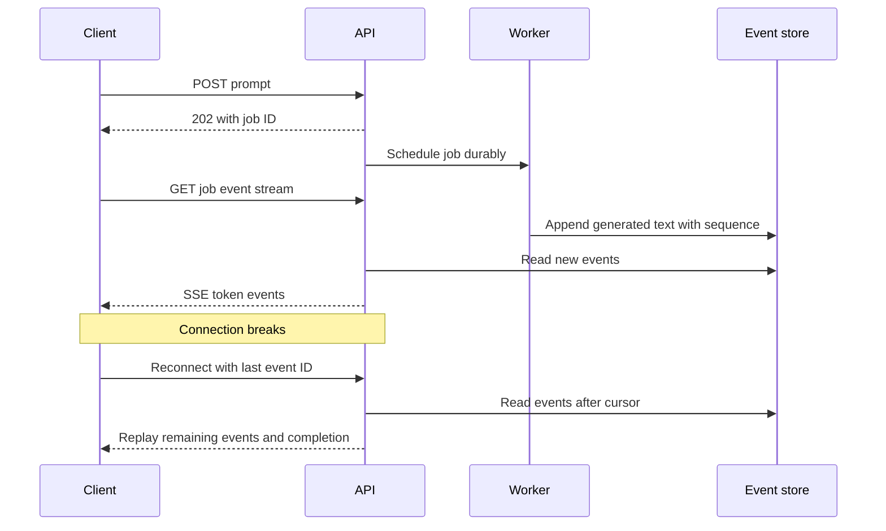

# SSE — Server-Sent Events from the Server to Your Screen

## 1. A definition you can picture

**SSE stands for Server-Sent Events.** It is a web technology that lets a server push updates or a continuing stream of text to a browser or another client over a single, long-lived HTTP response. The client connects once; the server sends another event whenever new information becomes available, without waiting for another status request.

It is a good fit for sports scores, stock-price displays, job-status updates, notifications, and AI-generated text arriving a piece at a time. It is one-way at the application-event level: server to client. The client can still submit commands through separate HTTP requests.

“Long-lived” means the response stays open for a while, not forever. Connections fail, servers restart, proxies have timeouts, and the application may finish the stream. A TCP connection may also carry multiple HTTP/2 streams; SSE does not require a dedicated physical connection in every HTTP version.

Imagine an AI answer: a normal JSON response can arrive after the entire answer is ready. With SSE, the response begins earlier and more text is appended while generation continues. Streaming improves time to first visible output; it does not necessarily shorten the model's total computation.

## 2. What actually travels over the wire?

The client requests an endpoint, commonly using GET. The response has `Content-Type: text/event-stream`. Its UTF-8 body contains records separated by a blank line:

```text
id: 12
event: token
data: {"text":"Hello"}

id: 13
event: token
data: {"text":" there"}

```

- `data:` is the payload. JSON is a convention here, not required by SSE.
- `event:` names the event type. Without it, browsers dispatch a `message` event.
- `id:` sets the stream cursor that a browser can send on reconnect.
- `retry:` can suggest a browser reconnection delay in milliseconds.
- A line beginning with `:` is a comment; it can serve as a heartbeat.
- The blank line terminates an event. A network chunk is not necessarily one event.

## 3. A workflow with an AI worker



Opening or reconnecting the stream should not start the expensive job again. The job and the viewing connection are separate lifecycles. A client leaving may or may not cancel generation; define an explicit cancellation policy.

## 4. Runnable Python server

Install `fastapi`, `uvicorn`, and `httpx`. Save as `sse_server.py`; run `python -m uvicorn sse_server:app --host 127.0.0.1 --port 8002`.

This demo streams a fixed retained answer, so reconnecting can replay it. It simulates gradual availability; it does not call an AI model. It has no login and must remain a local demo. In production the list would be a per-job durable event log with ownership checks.

```python
import asyncio
import json
from fastapi import FastAPI, HTTPException, Request, Response
from fastapi.responses import HTMLResponse, StreamingResponse

app = FastAPI()
TOKENS = ["Caching ", "reduces ", "repeated ", "database ", "reads."]
LAST_ID = len(TOKENS) + 1

def frame(event_id, event_type, payload):
    # IDs/types are server-controlled; json.dumps escapes embedded newlines.
    return (
        f"id: {event_id}\n"
        f"event: {event_type}\n"
        f"data: {json.dumps(payload)}\n\n"
    )

@app.get("/events")
async def events(request: Request):
    try:
        after = int(request.headers.get("last-event-id", "0"))
    except ValueError:
        raise HTTPException(400, "Invalid event cursor")
    if not 0 <= after <= LAST_ID:
        raise HTTPException(400, "Cursor outside this demo stream")
    if after == LAST_ID:
        return Response(status_code=204)  # Stop native EventSource reconnects.

    async def generate():
        yield "retry: 3000\n\n"
        for event_id, token in enumerate(TOKENS, start=1):
            if event_id <= after:
                continue
            if await request.is_disconnected():
                return
            await asyncio.sleep(0.2)
            yield frame(event_id, "token", {"text": token})
        if not await request.is_disconnected():
            yield frame(LAST_ID, "complete", {"status": "completed"})

    return StreamingResponse(
        generate(),
        media_type="text/event-stream",
        headers={"Cache-Control": "no-cache", "X-Accel-Buffering": "no"},
    )

@app.get("/", response_class=HTMLResponse)
async def page():
    return '''<pre id="answer"></pre><script>
const output = document.getElementById("answer");
const events = new EventSource("/events");
events.addEventListener("token", e => {
  output.textContent += JSON.parse(e.data).text;
});
events.addEventListener("complete", () => events.close());
events.onerror = () => console.log("Stream interrupted; reconnect may follow");
</script>'''
```

Visit `http://127.0.0.1:8002/`. The sentence appears incrementally. `EventSource` parses frames and manages ordinary reconnections. The named `token` event uses `addEventListener`, not `onmessage`. Closing on completion prevents an unnecessary reconnect loop.

The `X-Accel-Buffering` header is specific to compatible proxy configurations. It is not a universal switch. Deployment settings must permit streaming.

## 5. Runnable Python client

Save as `sse_client.py`. This minimal parser handles the fields emitted by our demo and joins multiple data lines. It does not implement the full EventSource parsing/reconnect standard. HTTPX is an HTTP streaming client, not a full SSE client.

```python
import asyncio
import json
import httpx

async def read_events(after="0"):
    headers = {"Accept": "text/event-stream", "Last-Event-ID": after}
    async with httpx.AsyncClient(timeout=httpx.Timeout(20, connect=5)) as client:
        async with client.stream(
            "GET", "http://127.0.0.1:8002/events", headers=headers
        ) as response:
            response.raise_for_status()
            if response.status_code == 204:
                return
            event_type, event_id, data = "message", "", []
            async for line in response.aiter_lines():
                if not line:
                    if data:
                        payload = json.loads("\n".join(data))
                        print(event_id, event_type, payload)
                        # Persist cursor AFTER your application accepts the event.
                        if event_type == "complete":
                            return
                    event_type, event_id, data = "message", "", []
                elif line.startswith(":"):
                    continue
                else:
                    field, separator, value = line.partition(":")
                    if value.startswith(" "):
                        value = value[1:]
                    if field == "event":
                        event_type = value
                    elif field == "id":
                        event_id = value
                    elif field == "data":
                        data.append(value)

if __name__ == "__main__":
    asyncio.run(read_events())
```

Try `read_events("3")` to replay events 4 onward. A real Python reconnect loop retains its accepted cursor, retries transient connection failures with backoff/jitter, and stops on completion or permanent errors. Merely sending Last-Event-ID cannot recover events that the server never retained.

## 6. Supporting technology and production behavior

| Failure or requirement | Technique | Why it matters |
|---|---|---|
| Quiet stream is closed by infrastructure | Periodic comment heartbeat | Send more often than the relevant idle timeout |
| Tokens arrive in one big batch | Disable proxy/compression buffering where needed | Generator yields do not guarantee immediate UI delivery |
| Disconnect loses data | Durable event log plus cursor/replay | Native reconnect alone does not restore missed history |
| Cursor older than retention | Snapshot/resync protocol | Do not silently claim full recovery |
| All clients reconnect together | Reconnect backoff/jitter | Native EventSource offers limited custom policy control |
| Slow browser | Bounded per-client buffers, coalesce progress, disconnect/resume | Avoid unlimited server memory |
| Multiple gateway instances | Shared event source and correct fan-out | In-memory lists are not shared across processes |
| Authenticated stream | Cookies or a fetch-based client with suitable auth | Native EventSource cannot set arbitrary Authorization headers |

For native EventSource, use a deliberate same-origin cookie design or an appropriate alternative; cookies require suitable SameSite/CORS/CSRF controls for related write endpoints. Do not place long-lived bearer tokens in URLs. A fetch-based SSE client can send POST bodies/headers but must implement framing and reconnection itself. SSE-formatted HTTP responses are not limited to native EventSource GET requests.

If the stream is quiet, a producer can periodically yield `": keepalive\n\n"`. To wait on work and still send heartbeats, wait for a queue/event with a timeout; on timeout send the comment. Do not block an async event loop with synchronous I/O or `time.sleep`.

Redis Pub/Sub can distribute live notifications but cannot replay messages missed while disconnected. A durable log such as a database event table or appropriately configured stream/log broker is needed when replay matters. Sharing one consumer group across gateway instances may distribute events to only one instance rather than every interested browser; design fan-out explicitly.

Native browser cursor advancement indicates receipt/dispatch, not a durable application acknowledgment. Financial or critical processing still needs an explicit acknowledgment/idempotency design.

## 7. Interview answer and practice

“I would use SSE when the server needs to push text updates and client commands can use ordinary HTTP requests. The browser connects once and receives multiple framed events. I would plan for proxy buffering, heartbeats, bounded buffers, reconnects, and replay from an event cursor.”

1. Explain SSE using an AI answer appearing word by word.
2. Does the server open a new inbound connection to the browser?
3. Why is a blank line important in the wire format?
4. Why is an event ID not sufficient without retained events?
5. How would a user send a “cancel job” command while watching SSE?
6. Why could refreshing the page restart text from the beginning even though EventSource handles reconnects?

## 8. References

- [WHATWG SSE standard](https://html.spec.whatwg.org/multipage/server-sent-events.html)
- [MDN SSE usage](https://developer.mozilla.org/en-US/docs/Web/API/Server-sent_events/Using_server-sent_events)
- [Starlette StreamingResponse](https://starlette.dev/responses/#streamingresponse)
- [HTTPX streaming](https://www.python-httpx.org/async/#streaming-responses)
- Next: [WebSockets](04-websockets.md), [Retries](06-retries-backoff-jitter.md).
