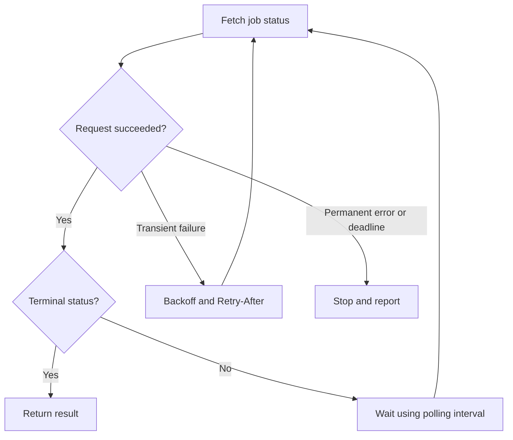

# Polling and Long Polling — Checking Asynchronous Work

## 1. Definition and mental picture

**Polling (輪詢)** means a client repeatedly asks the server for information. Think of checking an oven timer: you look, wait, and look again. Each short-polling request returns immediately even if nothing changed.

An AI batch job can take five minutes. The client submits it once and then calls `GET /jobs/{id}` until the response is terminal. Repeatedly submitting `POST /jobs` would create work, not check existing work.

**Long polling** means the server holds a request open until a change occurs or a timeout expires, then finishes the response. The client sends another request. SSE differs: one response can carry many events without finishing after the first update.

## Plain-text request flows

### Polling — repeat GET with a five-second interval

The server responds immediately, even when nothing has changed. In this example, the client waits five seconds after each unfinished response before sending the next GET.

```text
Client                              Server
  |                                    |
  |-------- GET /status --------------->|
  |<------- Pending -------------------|
  |                                    |
  | Wait 5 seconds                     |
  |                                    |
  |-------- GET /status --------------->|
  |<------- Pending -------------------|
  |                                    |
  | Wait 5 seconds                     |
  |                                    |
  |-------- GET /status --------------->|
  |<------- Completed + result --------|
```

### Long polling — hold the request until an update or timeout

If no update is available, the server keeps the HTTP request pending until an update arrives or the hold timeout expires. After either normal response, the client immediately sends the next GET.

```text
Client                              Server
  |                                    |
  |-------- GET /updates ------------->|
  |                                    | No update yet
  |         Request stays open         | Wait...
  |                                    |
  |                                    | Update arrives
  |<------- 200 + update --------------|
  |                                    |
  | Immediately send another GET       |
  |-------- GET /updates ------------->|
  |                                    | No update yet
  |         Request stays open         | Wait...
  |                                    |
  |                                    | Timeout reached
  |<------- 204 No Content ------------|
  |                                    |
  | Immediately send another GET       |
  |-------- GET /updates ------------->|
  |         Request stays open         | Wait...
```

Long polling returns one response per GET; it does not stream multiple updates within the same response. `204 No Content` is an illustrative timeout response, not a required status code. Ordinary polling can also reuse an HTTP connection; the distinction is whether the server holds the request pending. Network failures and rate limits should use bounded retry/backoff rather than immediate retry loops.

## Real-world use cases

| Real-world scenario | What happens in the product | Why polling fits |
|---|---|---|
| Long AI or MCP task | A client checks whether a submitted analysis or batch generation task has finished. | A few seconds of detection delay may be acceptable, and the client only needs the latest task state. |
| Video processing | An upload page checks whether a video's thumbnails and playback formats are ready. | Processing takes much longer than a status request; a simple status endpoint is often sufficient. |
| Report export | A user requests a large CSV export and waits for a download button to become available. | Occasional checks can detect completion without maintaining a persistent connection. |
| CI command-line tool | A developer's CLI checks a build ID until the pipeline succeeds or fails. | The tool can make outbound HTTP requests without exposing a webhook receiver. |
| Partner shipment synchronization | A retailer periodically queries a carrier that does not provide callbacks. | Polling works when the upstream service only offers a read API. |
| Inventory dashboard with relaxed freshness | A purchasing team refreshes supplier stock figures every few minutes. | The business can tolerate a bounded delay, so continuous event delivery may add little value. |
| Long-polling notification inbox | A client asks for messages after a cursor, and the server waits until messages arrive or the request expires. | Long polling avoids immediate empty responses when a client or service integration is built around request/response exchanges. |

**Walk through a report export:** submit the export once, save its job ID, and poll its status while the page is visible. Stop when the job succeeds, fails, is cancelled, or reaches the client's waiting deadline. For a job expected to take several minutes, an illustrative policy might check every two seconds initially and then every ten seconds; this reduces requests by accepting slower completion detection later. Use measured job durations and the user's freshness requirement to choose actual intervals.

**Interview practice:** state the acceptable detection delay and estimate request volume as active clients divided by polling interval. Explain why a live sports play-by-play screen may need a different delivery method.

## 2. When to choose polling

Choose polling when updates every few seconds or minutes are sufficient, completion time is unpredictable, callbacks are unavailable, or simple HTTP request/response operations are easiest to operate. It is often an appropriate first implementation.

Prefer SSE for frequent server-to-client updates that should appear promptly. Prefer webhooks for notifying another backend that can accept callbacks. Long polling can reduce empty checks while retaining a request/response interface, but holds connections and needs careful timeout settings.

## 3. Request count and freshness

With N active clients and a fixed interval T seconds, average request rate is roughly N/T. For 10,000 clients checking every five seconds, that is about 2,000 requests per second. If changes occur uniformly relative to the polling cycle, mean discovery delay is about T/2.

**Adaptive polling** changes the interval. Check quickly at first if jobs may finish quickly, then reduce frequency during a long unchanged period. This reduces request count because the wait increases; polling itself is not a traffic optimization.

**Polling jitter** spreads normal checks. **Error backoff** controls retries after failures. They are related timing tools but solve different situations.



## 4. Runnable server and Python client

Install `fastapi`, `uvicorn`, and `httpx`. Save as `polling_server.py`; run `python -m uvicorn polling_server:app --host 127.0.0.1 --port 8001`.

This is a simulated job: elapsed time determines progress. It is not an actual background worker. One process; restart loses jobs; no authentication.

```python
import time
from uuid import uuid4
from fastapi import FastAPI, HTTPException, Response

app = FastAPI()
started = {}

@app.post("/jobs", status_code=202)
async def create_job():
    job_id = str(uuid4())
    started[job_id] = time.monotonic()
    return {"id": job_id}

@app.get("/jobs/{job_id}")
async def status(job_id: str, response: Response):
    if job_id not in started:
        raise HTTPException(404, "Unknown job")
    elapsed = time.monotonic() - started[job_id]
    progress = min(100, int(elapsed / 12 * 100))
    response.headers["Cache-Control"] = "no-store"
    return {
        "id": job_id,
        "status": "completed" if progress == 100 else "running",
        "progress": progress,
    }
```

Save the following as `polling_client.py`. Copy `get_json` and its helper imports from the [retry guide](06-retries-backoff-jitter.md) into `retry_helpers.py` in the same directory. That helper handles GET retries; this loop handles successful-but-unfinished jobs.

```python
import asyncio
import random
import httpx
from retry_helpers import get_json

async def main():
    async with httpx.AsyncClient(base_url="http://127.0.0.1:8001") as client:
        submitted = await client.post("/jobs", timeout=5)
        submitted.raise_for_status()
        job_id = submitted.json()["id"]
        interval = 1.0

        # Python 3.11+: bounds all requests, retry waits, and poll waits.
        async with asyncio.timeout(60):
            while True:
                job = await get_json(client, f"/jobs/{job_id}", budget=10)
                print(job)
                if job["status"] in {"completed", "failed", "cancelled"}:
                    return
                await asyncio.sleep(random.uniform(0.8 * interval, interval))
                interval = min(5.0, interval * 1.5)

if __name__ == "__main__":
    asyncio.run(main())
```

Expected: several `running` responses followed by `completed`. The POST is not automatically retried, because this server lacks idempotency support. A polling deadline stops waiting; it does not cancel the server-side job.

## 5. What does long-polling code change?

Illustrative adapter-based handler:

```python
import asyncio

async def long_poll(events, job_id, after_version):
    try:
        async with asyncio.timeout(25):
            return await events.wait_for_newer(job_id, after_version)
    except TimeoutError:
        return None  # API may encode this as 204 or an empty result.
```

`events` is not a built-in library. It must check existing versions and register interest without losing an update between those steps. Use a replayable event store or a subscribe-then-recheck design. The client request timeout must exceed the server hold time plus overhead. Reconnect after both updates and ordinary hold-time expiry; avoid a tight retry loop on network failure.

## 6. Supporting techniques and failure cases

| Need | Technique | Caveat |
|---|---|---|
| Avoid synchronized clients | Jitter | Does not reduce total traffic by itself |
| 429 or 503 | Retry-After and bounded retry policy | Never retry earlier than server guidance |
| Avoid downloading unchanged body | ETag and If-None-Match | 304 saves bytes; it may not save a DB query |
| Cheap status lookup | Small indexed query, suitable cache | Cache TTL and polling delay combine |
| Preserve browser resources | Stop on completion, navigation, or abort | Job cancellation is a separate operation |
| Hidden tab or mobile background | Reduce polling / resume with fresh fetch | Product-specific freshness needs |
| Correct cancellation or payment | Atomic authoritative action | Cached status is only for display |

Do not add a two-second cache assuming it will help a single client polling once every five seconds. Measure reuse. When polling from multiple tabs, sharing a browser-side subscription can also reduce duplicate checks.

## 7. Interview answer and practice

“I would estimate polling QPS and ask how much discovery delay is acceptable. I would use adaptive intervals, jitter, transient-error backoff, and an overall deadline. For frequent low-latency updates I would consider SSE, and I would keep critical decisions on an authoritative transactional path.”

1. Why are adaptive polling and retry backoff different?
2. How many QPS do 20,000 clients polling every ten seconds produce?
3. How does long polling differ from SSE?
4. Does a 304 response mean no database read occurred?
5. What happens to the job when the client stops polling?

References: [HTTP semantics](https://www.rfc-editor.org/rfc/rfc9110.html), [HTTPX async requests](https://www.python-httpx.org/async/). Next: [SSE](03-server-sent-events.md).
