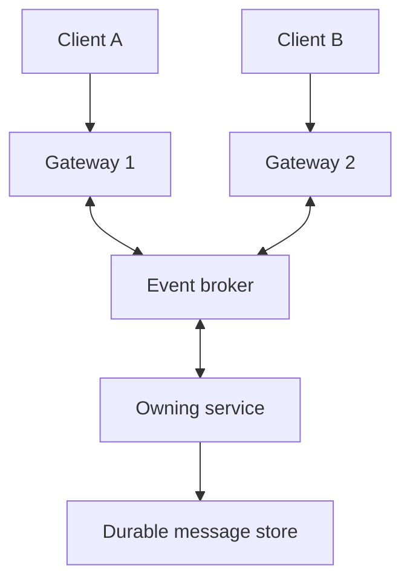

# WebSockets — Two-Way Messages over a Persistent Connection

## 1. Definition and contrast with SSE

**WebSocket is a protocol that lets a client and server independently send messages over an established connection.** After setup, the server can send a message without waiting for a new request, and the client can send one without opening a separate HTTP request, and these messages send from each other are no order, they are bi-directional.

Think of collaborative editing: you send cursor movements and edits while receiving other users' changes. Both directions are active. WebSocket supports text and binary messages. Use `wss://` for encrypted production connections; `ws://` is appropriate for local demonstrations.

The familiar HTTP/1.1 setup uses an Upgrade handshake. After that, messages use WebSocket frames rather than a sequence of REST requests. Other HTTP versions have their own standardized establishment mechanisms, so “always HTTP 101” is not universal.

SSE fits one-way event delivery. A bidirectional WebSocket may be useful for chat, multiplayer interactions, collaborative tools, and frequent interactive commands. Ordinary messaging can also use HTTP submission plus SSE; choose based on requirements, not the word “chat.”

## 2. What does the protocol give me?

It gives a connection and ordered message transport within that connection. It does not give database persistence, application-level acknowledgment, automatic recovery across reconnects, or exactly-once business effects.

A message sent before a disconnect may have been processed even if the acknowledgment was lost. For important commands, use a command ID and deduplicate on the server. For received history, use sequence numbers and replay or a fresh snapshot.

## 3. Runnable Python example

Install `fastapi`, `uvicorn`, and `websockets` with the modern `websockets.asyncio` API. Save as `ws_server.py`; run:

```bash
python -m uvicorn ws_server:app --host 127.0.0.1 --port 8003 --ws websockets --ws-max-size 65536 --ws-ping-interval 20 --ws-ping-timeout 20
```

The server independently sends ticks and receives commands. A single sender task writes messages from a bounded queue. This is a local demo with no authentication, durable commands, or room broadcast.

```python
import asyncio
from fastapi import FastAPI, WebSocket, WebSocketDisconnect

app = FastAPI()

@app.websocket("/ws")
async def endpoint(ws: WebSocket):
    await ws.accept()
    outgoing = asyncio.Queue(maxsize=8)

    async def enqueue(message):
        # Slow consumers cannot accumulate an unlimited queue.
        await asyncio.wait_for(outgoing.put(message), timeout=2)

    async def receive_commands():
        while True:
            command = await ws.receive_text()
            if len(command) > 1000:
                raise ValueError("Command too large")
            await enqueue({"type": "ack", "command": command})

    async def produce_ticks():
        sequence = 0
        while True:
            await asyncio.sleep(1)
            sequence += 1
            await enqueue({"type": "tick", "sequence": sequence})

    async def send_messages():
        while True:
            message = await outgoing.get()
            await asyncio.wait_for(ws.send_json(message), timeout=5)

    tasks = [asyncio.create_task(fn()) for fn in
             (receive_commands, produce_ticks, send_messages)]
    try:
        done, _ = await asyncio.wait(tasks, return_when=asyncio.FIRST_COMPLETED)
        for task in done:
            task.result()
    except WebSocketDisconnect:
        pass
    except (TimeoutError, ValueError):
        # Local demonstration policy: stop rather than buffer forever.
        pass
    finally:
        for task in tasks:
            task.cancel()
        await asyncio.gather(*tasks, return_exceptions=True)
        try:
            await ws.close()
        except (WebSocketDisconnect, RuntimeError, OSError):
            pass  # Peer may already have disconnected.
```

Save this as `ws_client.py` and run while the server is running:

```python
import asyncio
from websockets.asyncio.client import connect

async def main():
    async with connect(
        "ws://127.0.0.1:8003/ws",
        ping_interval=20, ping_timeout=20, max_size=65536,
    ) as ws:
        await ws.send("subscribe to job-123")
        for _ in range(4):
            print(await ws.recv())

if __name__ == "__main__":
    asyncio.run(main())
```

Expected: an acknowledgment and periodic ticks. “Subscribe” is echoed here; implementing subscriptions requires authorization and routing logic. Ticks start per connection, so their sequence is not a durable resume cursor.

## 4. What else is needed in a real service?

| Concern | Mechanism | Detail |
|---|---|---|
| Dead connection | Protocol ping/pong, idle timeouts | Browsers do not expose protocol ping controls to JavaScript |
| Reconnection storms | Bounded reconnect backoff with jitter | Native browser WebSocket does not automatically reconnect |
| Client too slow | Bounded send queues and backpressure | Drop/coalesce only data the application can afford to lose |
| Unauthorized access | Authenticate handshake, authorize subscriptions/commands | Also validate browser Origin where appropriate |
| Lost messages after reconnect | Retained history, sequence, replay or snapshot | Connection order does not imply cross-connection recovery |
| Duplicate command | Idempotency key plus atomic effect | Resending an unacknowledged command may duplicate work |
| Deployment restart | Graceful connection draining and reconnect support | Existing connections are tied to their handling process |
| Abuse | Message-size, connection, and per-tenant rate limits | An open socket is not unlimited permission |

**Backpressure** means consumers influence the rate of upstream production or delivery. If a progress dashboard falls behind, keeping only the latest percentage may be fine. Dropping a purchase event is not. For reliable messages, persist and let the consumer resume; do not grow memory indefinitely.

Authentication can expire while a socket remains open. Decide when to revalidate, close, or renegotiate credentials. Browser handshake restrictions differ from a backend client that can add headers. Do not assume a CORS policy alone secures WebSocket subscriptions.

## 5. Scaling beyond one process



Each gateway owns its live connections. A broker or routing layer delivers relevant events to the gateway with the subscriber. Sticky sessions may help a particular design, but do not make in-memory history durable or solve fan-out on their own.

Redis Pub/Sub provides live broadcast with no replay of disconnected deliveries. If history matters, add a durable store. Consumer groups usually divide work among group members; they do not automatically broadcast every event to every gateway. Choose routing/consumer topology deliberately.

Monitor active connections, disconnect reasons, queue depth, send latency, message rate, reconnect bursts, and per-tenant resource use.

## 6. Interview answer and recall

“I would use WebSockets for frequent bidirectional interaction. I would define an application message schema and plan for authentication, bounded queues, heartbeats, reconnects, and replay. A successful socket send does not prove that a business operation was committed.”

1. Why does an AI text stream often work with SSE instead?
2. What is the difference between ping/pong and an application acknowledgment?
3. How do you prevent a slow user from consuming unlimited memory?
4. Where does a new connection retrieve history after a gateway crashes?
5. Can all gateways use one consumer group and still receive every event for every browser?

References: [FastAPI WebSockets](https://fastapi.tiangolo.com/advanced/websockets/), [Python websockets client](https://websockets.readthedocs.io/en/stable/reference/asyncio/client.html), [Redis Pub/Sub semantics](https://redis.io/docs/latest/develop/pubsub/). Next: [Webhooks](05-webhooks.md).
