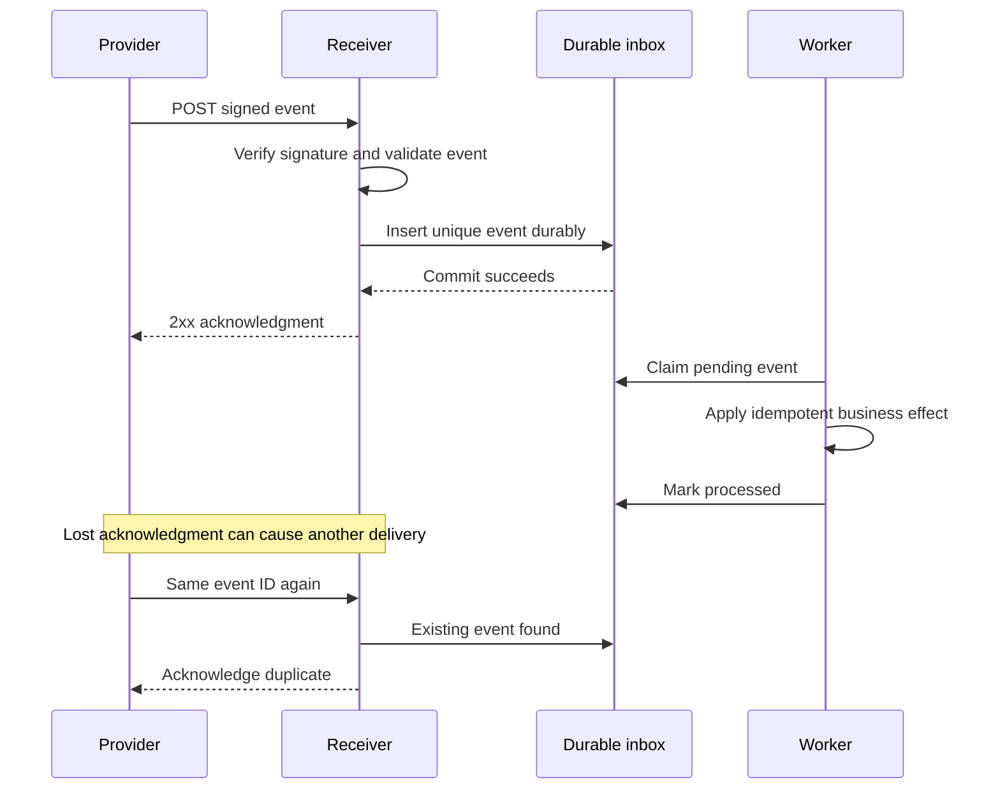

# Webhooks — A Service Calls Your Backend When Something Happens

## 1. Definition and use cases

**A webhook is an HTTP request a service sends to your backend when an event occurs.** You register a receiving URL; later the service calls it with an event payload. Think of giving a restaurant your phone number so it can tell you when your order is ready, instead of repeatedly asking.

Examples: a payment provider reports payment completion, a build system reports a finished build, a repository reports a push, or an AI batch service reports job completion. Your backend receives the event; it can then notify a browser through SSE or WebSocket.

A webhook is not a persistent connection. Each delivery is typically an independent HTTP request. It needs a reachable receiver, so it normally cannot call a browser tab directly. It also is not automatically a REST API, although the receiving endpoint uses HTTP.

## Real-world use cases

| Real-world scenario | Event and receiving system | Why a webhook fits |
|---|---|---|
| Payment completion | A payment service tells a store's backend that a payment succeeded or failed. | The result can arrive after checkout, and the store needs a server-to-server notification. |
| Repository automation | A code-hosting service notifies a CI service about a push or pull-request change. | The event can start a build without the CI system repeatedly querying every repository. |
| Order fulfillment | A commerce platform notifies a warehouse integration that an order is ready to fulfill. | An independent backend needs to react to a business event. |
| Shipping updates | A carrier calls a retailer's endpoint when a shipment is dispatched or delivered. | Tracking changes originate outside the retailer's system. |
| Electronic document signing | A signing service notifies a workflow backend that all required signatures are complete. | A long-running human process can resume when the external service reports completion. |
| AI batch completion | An AI service calls a registered endpoint when a batch has finished. | The receiving backend can download results and start the next processing stage. |
| Appointment changes | A scheduling provider informs a CRM about a new booking, cancellation, or reschedule. | The CRM can update its own records when changes happen in another service. |

**Walk through payment completion:** the provider sends an event to the store's backend. The receiver verifies the provider's authentication scheme, durably records the event with a unique identifier, and acknowledges it promptly. A worker then updates the order using validated payment details and business rules. Duplicate deliveries must not ship a second package. To update an open checkout page, the store can expose the new order state through polling or SSE.

**Interview practice:** explain who hosts the receiving endpoint, what happens if it is temporarily unavailable, and why an authenticated notification still needs duplicate handling.

## 2. How delivery works



A 2xx acknowledgment should mean you have durably accepted responsibility, not necessarily finished every downstream action. If storing the event fails, do not falsely acknowledge it. Provider retry behavior differs: some retry automatically, others require configured/manual redelivery. Inspect the contract.

## 3. Runnable receiver with a durable local inbox

Install `fastapi`, `uvicorn`, and `httpx`. Copy `webhook_security.py` from the [HMAC guide](07-hmac-and-encoding.md). Save the following as `webhook_server.py`.

Set the same randomly generated local secret in sender and server environments as `WEBHOOK_SECRET`; do not paste a real production secret into notes. Run `python -m uvicorn webhook_server:app --host 127.0.0.1 --port 8004`.

This demo authenticates and stores events in SQLite. It deliberately does not execute business effects. SQLite on a local disk illustrates durable acceptance; a replicated database/queue and deployment durability policy are separate production decisions.

```python
import json
import os
import sqlite3
from contextlib import closing
from fastapi import FastAPI, HTTPException, Request
from starlette.concurrency import run_in_threadpool
from webhook_security import verify

app = FastAPI()
SECRET = os.environ["WEBHOOK_SECRET"].encode("utf-8")
DB_PATH = "webhook_inbox.sqlite3"

with closing(sqlite3.connect(DB_PATH)) as db:
    db.execute("""CREATE TABLE IF NOT EXISTS inbox (
        event_id TEXT PRIMARY KEY,
        payload TEXT NOT NULL,
        state TEXT NOT NULL DEFAULT 'pending'
    )""")
    db.commit()

def persist_event(event):
    payload = json.dumps(event, sort_keys=True, separators=(",", ":"))
    with closing(sqlite3.connect(DB_PATH, timeout=2)) as db:
        with db:
            cursor = db.execute(
                "INSERT INTO inbox(event_id, payload) VALUES (?, ?) "
                "ON CONFLICT(event_id) DO NOTHING",
                (event["event_id"], payload),
            )
            inserted = cursor.rowcount == 1
            if not inserted:
                previous = db.execute(
                    "SELECT payload FROM inbox WHERE event_id = ?",
                    (event["event_id"],),
                ).fetchone()[0]
                if previous != payload:
                    raise ValueError("Same event ID with different payload")
    return inserted

@app.post("/webhooks/jobs")
async def receive(request: Request):
    chunks, size = [], 0
    async for chunk in request.stream():
        size += len(chunk)
        if size > 64_000:
            raise HTTPException(413, "Payload too large")
        chunks.append(chunk)
    raw = b"".join(chunks)
    if not verify(
        SECRET, request.headers.get("X-Webhook-Timestamp", ""), raw,
        request.headers.get("X-Webhook-Signature", ""),
    ):
        raise HTTPException(401, "Invalid signature or stale delivery")
    try:
        event = json.loads(raw)
    except (ValueError, UnicodeError):
        raise HTTPException(400, "Invalid JSON")
    if not isinstance(event, dict):
        raise HTTPException(400, "Object required")
    if not isinstance(event.get("event_id"), str) or not event["event_id"]:
        raise HTTPException(400, "Event ID required")
    if event.get("event_type") != "job.completed":
        raise HTTPException(400, "Unsupported event type")
    if not isinstance(event.get("job_id"), str) or not event["job_id"]:
        raise HTTPException(400, "Job ID required")
    try:
        inserted = await run_in_threadpool(persist_event, event)
    except ValueError as error:
        raise HTTPException(409, str(error))
    except sqlite3.Error:
        raise HTTPException(503, "Inbox unavailable", headers={"Retry-After": "5"})
    return {"accepted": True, "duplicate": not inserted}
```

The unique key makes concurrent duplicate inserts safe. A production deduplication key often includes provider/account/tenant plus event ID. The signing secret identifies the sender; validate the sender's authority over the event's tenant/job before accepting business effects. Add ingress timeouts as well as size limits.

## 4. Runnable sender

Save as `webhook_sender.py`; run with the same `WEBHOOK_SECRET` value:

```python
import json
import os
import time
import httpx
from webhook_security import sign

secret = os.environ["WEBHOOK_SECRET"].encode("utf-8")
body = json.dumps({
    "event_id": "evt-demo-1",
    "event_type": "job.completed",
    "job_id": "job-123",
}, separators=(",", ":")).encode("utf-8")

with httpx.Client(timeout=5) as client:
    for _ in range(2):
        timestamp = str(int(time.time()))
        response = client.post(
            "http://127.0.0.1:8004/webhooks/jobs", content=body,
            headers={
                "Content-Type": "application/json",
                "X-Webhook-Timestamp": timestamp,
                "X-Webhook-Signature": sign(secret, timestamp, body),
            },
        )
        response.raise_for_status()
        print(response.json())
```

For a fresh inbox, the first response reports duplicate=false and the second duplicate=true. Re-running the script reports duplicates because the event remains stored. The stable event ID stays the same even if a delivery gets a fresh timestamp/signature.

## 5. Acceptance is different from idempotent processing

The receiver above ensures one inbox record. It does not prove a downstream action occurs once. A worker can crash after an effect but before marking processed.

For effects in the same database, atomically claim/lock the event, apply the effect, and mark processed in a transaction with appropriate uniqueness constraints. For an external API, use a stable idempotency key and reconciliation. For an external queue, commit an outbox record with the state change and publish it reliably. Never assume “deduplicated ingestion” means every later effect is exactly once.

## 6. Supporting techniques and use-case decisions

| Failure | Response |
|---|---|
| Forged or changed request | HMAC verification, HTTPS, scoped sender credentials |
| Replay of valid request | Freshness window plus event deduplication |
| Receiver temporarily unavailable | Bounded sender retries, backoff/jitter, Retry-After where supported |
| Acknowledgment lost | Same event ID on retry; receiver idempotency |
| Out-of-order updates | Version/sequence check or fetch current authoritative status |
| Repeated processing failure | Dead-letter/failed-event store, alert, controlled replay |
| Notification never arrives | Reconciliation using provider state/delivery history |

Do not reset a completed job to running because an older event arrived late. Arrival order is not event order. A provider-defined event timestamp alone may not be a reliable total ordering mechanism.

If you let users supply callback URLs, prevent SSRF: restrict destinations/schemes, validate resolved addresses, handle redirects safely, and avoid sending secrets to arbitrary hosts. This concern belongs to the webhook sender, not only the receiver.

## 7. Interview answer and practice

“I would authenticate the webhook, durably record it with a unique event ID, and acknowledge promptly. A worker would process it idempotently. I would plan for duplicate or out-of-order delivery and reconcile important missed events.”

1. When is it safe to acknowledge a webhook?
2. What happens if a worker crashes after an external side effect?
3. Why doesn't HMAC eliminate duplicate deliveries?
4. Why might the same event arrive with a new delivery timestamp?
5. Why can a webhook notify your backend but not normally a browser tab?

References: [GitHub webhook practices](https://docs.github.com/en/webhooks/using-webhooks/best-practices-for-using-webhooks), [GitHub signature validation](https://docs.github.com/en/webhooks/using-webhooks/validating-webhook-deliveries). These are provider examples; their exact headers/retry policies are not universal.
