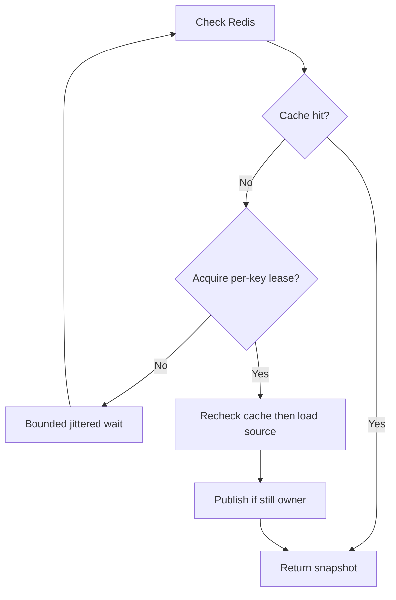

# Caching and Distributed Coordination — Fast Reads, Freshness, and Correctness

## 1. Definition and the reason to cache

**A cache stores a reusable copy of data so later requests avoid a more expensive operation.** For job-status polling, a Redis entry might let hundreds of readers reuse one database result. It is a performance technique with explicit consistency and failure trade-offs.

JC correctly identified other optimizations: select only needed fields, use appropriate indexes, and consider read replicas. Those reduce per-query work or primary load. Caching reduces database query frequency when cached values are reused. Adaptive polling instead reduces API request frequency.

Do not add Redis just because the system has a status endpoint. If one client polls every five seconds and the entry expires in two seconds, cache-aside can miss on every request.

## Real-world use cases

| Real-world scenario | What gets cached or coordinated | Why it helps and what must remain correct |
|---|---|---|
| Popular product catalog | Many shoppers request the same product description and images' metadata. | Reusing a cached representation reduces repeated database reads; checkout must still validate authoritative price and availability. |
| AI job-status page | Many viewers or services request the same job's progress. | A short-lived shared status entry can reuse one read across callers, provided the allowed display delay is explicit. |
| Live sports scoreboard | Many fans request the latest score snapshot when opening or reconnecting to a page. | A shared current-score cache avoids querying the primary store for every viewer; event delivery can keep connected screens updated separately. |
| Breaking-news article | A sudden audience surge requests an article just as its cache entry expires. | Coalescing concurrent loads lets callers share a refresh instead of all fetching the same database record. |
| Geocoding or route lookup | Customers repeatedly request the same location result. | Caching can avoid repeated expensive external calls when provider terms and the result's validity permit reuse. |
| User profile display | The same name and avatar appear on many pages. | Reusable display data can tolerate a defined refresh delay; cache keys and authorization must prevent cross-user or cross-tenant exposure. |
| Multi-service configuration reads | Many service instances repeatedly read tenant display preferences or feature configuration. | Local and shared caches reduce reads, but each layer needs a freshness policy; sensitive authorization decisions may need stronger validation. |
| Concurrent cache refresh across replicas | Several API instances notice the same missing popular key. | A shared lease can reduce duplicate refresh work across processes; bounded waiting and lease expiry handle a refresher crash. |

**Walk through cached job status:** suppose the product accepts progress displays up to three seconds behind the authoritative state. That is a product requirement, not a universal TTL recommendation. A design might allocate part of that budget to cache age and the rest to replica lag, refresh time, and client update delay. If the user then clicks a critical action such as cancel or charge, the backend checks and changes authoritative state atomically under its business rules; it does not trust the cached display alone.

For a news article, one loader per key can refresh while others wait or receive a previously cached version when serving stale content is allowed. A process-local lock coordinates only that process; several replicas need an appropriate shared strategy if cross-replica duplicate loads matter.

**Interview practice:** quantify acceptable staleness from the user impact, then discuss a hot-key expiry, a crashed refresher, and a cache outage.

## 2. Vocabulary and cache patterns

| Term | Meaning |
|---|---|
| Hit / miss | A usable cached value is present / absent |
| TTL | How long an entry remains usable after being written |
| Expiration | TTL elapsed |
| Invalidation | Explicitly remove or mark a value stale |
| Eviction | Remove an entry, often to reclaim memory |
| Cache-aside | Application reads cache; on miss it reads source and fills cache |
| Write-through | Write path synchronously maintains cache and backing store according to its contract |
| Write-behind | Cache accepts updates that are persisted later; requires durability/failure handling |
| Stale-while-revalidate | Serve an allowed stale value while a loader refreshes it |
| Stampede / single-flight | Many duplicate loads / coalescing them into one in-flight load |

Names do not remove failure windows. Writing a database and Redis in sequence is not a distributed transaction simply because it is called write-through.

## 3. Choose acceptable staleness first

Ask: who consumes this value; what happens if it is old; how quickly must changes be visible; are completion/failure more important than percentage updates?

For a display, five seconds behind may be acceptable. For authorizing payment or cancelling a queued job, use an authoritative atomic operation. This is a product-specific decision, not a universal TTL rule.

Budget publication delay + replica lag + cache staleness + next poll + transport/rendering. A five-second target cannot generally tolerate both a five-second cache and five-second polling. TTL measures residence after caching, not age since the source changed. Replicas and delayed loaders can already be stale.

Measure transition-commit to client-observation delay, cache hit ratio, DB QPS, miss latency, evictions, and cache-error rate. Distinguish a 99th-percentile freshness objective from a hard maximum.

## 4. Runnable local cache with coalescing

The example uses only Python's standard library. Save as `cache_demo.py` and run `python cache_demo.py`. It combines TTL cache-aside with a shared Future for each in-flight key. Concurrent callers share both successful results and current-load failures.

```python
import threading
import time
from concurrent.futures import Future, ThreadPoolExecutor

class CoalescingCache:
    def __init__(self, loader, ttl=2):
        self.loader, self.ttl = loader, ttl
        self.guard = threading.Lock()
        self.entries, self.inflight = {}, {}

    def get(self, key):
        with self.guard:
            entry = self.entries.get(key)
            if entry and entry[0] > time.monotonic():
                return entry[1]
            self.entries.pop(key, None)
            future = self.inflight.get(key)
            leader = future is None
            if leader:
                future = Future()
                self.inflight[key] = future

        if not leader:
            return future.result(timeout=5)

        try:
            value = self.loader(key)
            with self.guard:
                self.entries[key] = (time.monotonic() + self.ttl, value)
            future.set_result(value)
            return value
        except BaseException as exc:
            future.set_exception(exc)
            raise
        finally:
            with self.guard:
                self.inflight.pop(key, None)

def load_status(key):
    print("Database query:", key)
    time.sleep(0.2)
    return {"status": "running"}

if __name__ == "__main__":
    cache = CoalescingCache(load_status)
    with ThreadPoolExecutor(max_workers=20) as pool:
        results = list(pool.map(lambda _: cache.get("job-123"), range(20)))
    print("Responses:", len(results))
```

Expected: one printed database query and 20 responses. Different keys can load concurrently. This is one-process coordination; it does not synchronize multiple containers. The demo has no automatic memory bound or mutation invalidation. Treat returned values as immutable; add capacity limits, loader timeouts, controlled fallback, and a deliberate invalidation policy in a real implementation.

The Future gives waiters the same result/error. A timed-out waiter does not cancel the leader. Later requests can retry a failed load, so persistent backend failures may need a short error cooldown or circuit breaker.

## 5. Shared cache across instances

With Redis, all Jobs instances can reuse one key such as `job-status:tenant-7:job-123`. They can still miss together, so add distributed miss coordination only when duplicate work is costly enough.



### Redis Python implementation sketch

Install `redis` and connect to a development Redis. The injected loader must implement a bounded authoritative/replica read suitable for your freshness policy. This is adapter-based code, not a complete server.

```python
import json
import random
import time
import uuid

RELEASE = """
if redis.call('get', KEYS[1]) == ARGV[1] then
    return redis.call('del', KEYS[1])
end
return 0
"""

PUBLISH = """
if redis.call('get', KEYS[1]) == ARGV[1] then
    redis.call('set', KEYS[2], ARGV[2], 'PX', ARGV[3])
    redis.call('del', KEYS[1])
    return 1
end
return 0
"""

def shared_status(redis, tenant_id, job_id, loader):
    # Assume trusted, validated IDs; authorize the caller before this function.
    tag = f"{tenant_id}:{job_id}"
    # Matching hash tags keep the keys in one Redis Cluster slot for Lua.
    key = f"job-status:{{{tag}}}"
    lock = f"job-status-lock:{{{tag}}}"
    deadline = time.monotonic() + 3
    while time.monotonic() < deadline:
        value = redis.get(key)
        if value is not None:
            return json.loads(value)
        token = uuid.uuid4().hex
        if redis.set(lock, token, nx=True, px=2000):
            try:
                value = redis.get(key)
                if value is not None:
                    return json.loads(value)
                value = loader(tenant_id, job_id, timeout_seconds=1)
                published = redis.eval(
                    PUBLISH, 2, lock, key, token, json.dumps(value), 1000
                )
                if published:
                    return value
                # Lease expired; do not publish/return this late load as current.
            finally:
                redis.eval(RELEASE, 1, lock, token)
        await_seconds = random.uniform(0.02, 0.08)
        time.sleep(await_seconds)
    raise TimeoutError("Status temporarily unavailable")
```

Configure short Redis connection/socket timeouts too. The loop's time check is not a strict wall-clock deadline while synchronous I/O runs; use an outer deadline/cancellation-aware client if a strict bound is required. Redis failures in this sketch propagate instead of releasing every caller to the database. Handle cleanup failures without masking the primary error in production.

### Why a token and lease?

A lease expires if the holder crashes. The random token identifies one acquisition. If A pauses until its lease expires and B acquires the key, A must not delete B's lock. The Lua ownership check and deletion run atomically. Conditional publication also prevents an expired holder from publishing after losing ownership.

This still does not make cached data strongly consistent. A database mutation can race a valid loader; failover and lease assumptions affect coordination. Use source versions and a consistent invalidation/publication strategy if overwrites matter. A monotonic fencing token is different from a random owner token: a protected resource must enforce fencing to reject older writers. Do not treat cache locks as the business correctness mechanism.

## 6. Writes, invalidation, and the stale-fill race

An API may read old DB state, pause, then fill Redis after another worker commits new state and invalidates the key. The old value is now back in the cache. A short TTL bounds ordinary residence, but does not eliminate this race.

Options, depending on requirements:

- Accept brief stale display data and measure its effect.
- Publish versioned updates with atomic version checks.
- Retain version/tombstone information across deletion so an old loader cannot “win” against an empty key.
- Use an outbox or CDC for recoverable propagation; still handle duplicate and out-of-order events.
- Read/revalidate authoritative state for critical actions.

**Outbox:** save an event in the same transaction as the business change, then relay it. **CDC:** capture committed changes from the database. Neither alone supplies instantaneous cache consistency.

## 7. Critical actions use authoritative state

If cancellation is allowed only while queued, make the condition and transition atomic:

```sql
UPDATE jobs
SET status = 'cancelled', version = version + 1
WHERE tenant_id = :tenant_id AND job_id = :job_id AND status = 'queued'
RETURNING job_id, status, version;
```

A worker must likewise claim queued → running conditionally. Reading a fresh row and then writing without protection leaves a check-then-act race. External side effects need their own idempotency/recovery strategy.

## 8. Other failure patterns and mitigations

| Pattern | Mechanism | Limit |
|---|---|---|
| One hot key expires | Coalescing, stale-while-revalidate | Serving stale data requires permission from freshness requirements |
| Many keys expire together | TTL jitter | Does not solve same-key coalescing |
| Repeated nonexistent IDs | Input validation, short negative caching, rate limits | Avoid leaking unauthorized resource existence |
| Redis outage | Bounded fallback, concurrency limits, load shedding | Unrestricted fallback can overwhelm DB |
| Multiple service owners write same key | Define ownership and event contracts | Shared infrastructure does not mean shared authority |
| Terminal job retried under same ID | Attempt-specific keys or invalidation | “Terminal” is only immutable if the model guarantees it |

Different instances of Jobs can share Jobs-owned keys. Billing should normally use the Jobs API/events rather than modify those keys directly. A local L1 cache plus shared L2 Redis improves speed but creates another invalidation and freshness layer.

## 9. Interview answer and recall

“I would justify the cache with repeated reads and a freshness requirement. I would start with cache-aside and short TTLs, then add coalescing if expensive misses create a stampede. Across instances I could use leases for load coordination, while authoritative atomic operations protect business correctness.”

1. When does a two-second cache fail to reduce five-second polling reads?
2. Why does TTL not tell you the exact age of source data?
3. How can a value become stale immediately after invalidation?
4. Why does ownership-safe unlock not guarantee fresh cache contents?
5. What is the difference between a random lock token and a fencing token?
6. How would Redis failure affect your database capacity?

References: [AWS caching challenges](https://aws.amazon.com/builders-library/caching-challenges-and-strategies/), [Redis distributed lock guidance](https://redis.io/docs/latest/develop/clients/patterns/distributed-locks/). Related: [Polling](02-polling.md), [Retries](06-retries-backoff-jitter.md).
