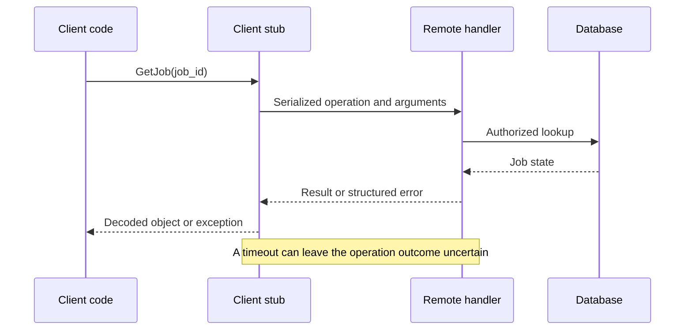

# RPC — Calling an Operation in Another Process

## Definition and mental model

**RPC means Remote Procedure Call.** A client invokes an operation implemented by another process, often on another machine, and receives a result or error. It may look like `jobs.get_status("job-123")` in application code, but underneath it serializes arguments, sends a request, waits, and decodes the response.

The spelling is RPC, rather than PRC. **gRPC is one RPC framework**, not a different name for every remote call. RPC can use HTTP, a message broker, or another transport. It does not require Protocol Buffers or a synchronous Python function.

Think of REST as commonly asking for a resource representation, such as `GET /jobs/123`, and RPC as invoking a named operation, such as `GetJobStatus(job_id="123")`. Both can use HTTP and both need security, versioning, retries, and observability. This is a difference in interface design, not proof that one is always faster.

## Workflow



**Stub/proxy:** client code that wraps serialization and transport. **Dispatcher:** routes a received operation name to an allowed handler. **Correlation ID:** matches a reply or trace to a request; it does not automatically deduplicate business effects.

## Runnable Python: an RPC-style HTTP envelope

Install `fastapi`, `uvicorn`, and `httpx`. Save as `rpc_server.py`; run `python -m uvicorn rpc_server:app --host 127.0.0.1 --port 8005`.

This is a deliberately small custom envelope, **not a complete JSON-RPC 2.0 implementation**. It demonstrates operation dispatch, correlation, validation, and explicit errors. It has no login and uses a fixed local dataset.

```python
from fastapi import FastAPI
from pydantic import BaseModel, Field

app = FastAPI()
JOBS = {"job-123": "running"}

class Call(BaseModel):
    request_id: str = Field(min_length=1, max_length=100)
    method: str = Field(min_length=1, max_length=100)
    params: dict

@app.post("/rpc")
async def invoke(call: Call):
    def error(code, message):
        return {"request_id": call.request_id,
                "error": {"code": code, "message": message}}

    if call.method != "GetJob":
        return error("METHOD_NOT_FOUND", "Unsupported operation")
    job_id = call.params.get("job_id")
    if not isinstance(job_id, str) or not job_id:
        return error("INVALID_ARGUMENT", "job_id must be a string")
    if job_id not in JOBS:
        return error("NOT_FOUND", "Unknown job")
    return {"request_id": call.request_id,
            "result": {"job_id": job_id, "status": JOBS[job_id]}}
```

Save separately as `rpc_client.py`:

```python
from uuid import uuid4
import httpx

class JobsClient:
    def __init__(self, client):
        self.client = client

    def get_job(self, job_id):
        request_id = str(uuid4())
        response = self.client.post("/rpc", json={
            "request_id": request_id,
            "method": "GetJob", "params": {"job_id": job_id},
        })
        response.raise_for_status()
        reply = response.json()
        if reply.get("request_id") != request_id:
            raise RuntimeError("Response correlation mismatch")
        if "error" in reply:
            raise RuntimeError(reply["error"])
        return reply["result"]

if __name__ == "__main__":
    with httpx.Client(base_url="http://127.0.0.1:8005", timeout=3) as http:
        print(JobsClient(http).get_job("job-123"))
```

Expected: job-123 is running. This envelope returns operation errors in a successful HTTP exchange, so the client checks both HTTP status and the envelope. A real protocol defines this mapping formally. Do not dispatch arbitrary input through `eval`, `getattr` on unrestricted objects, or unsafe pickle deserialization.

## When to use RPC

RPC fits internal services with operations such as `ReserveInventory`, `ValidatePayment`, or `GetJob`, particularly when generated typed clients make integration easier. A public resource API may benefit more from HTTP conventions and broad tooling. If a caller should not wait for completion, prefer a durable job/command submission pattern or messaging rather than hiding a minutes-long operation behind an ordinary RPC timeout.

Avoid treating a remote call as cheap or infallible just because it looks like a function. Replacing an in-process method with RPC introduces network latency, partial failure, security boundaries, and deployment compatibility concerns.

## Supporting techniques and interview traps

| Concern | Design choice |
|---|---|
| Caller can wait only two seconds | Deadline propagated to downstream calls, leaving response overhead |
| Timeout after mutation | Idempotency key and outcome lookup/reconciliation |
| Incompatible clients and servers | Versioned contract, compatible schema evolution, staged rollout |
| One slow dependency | Concurrency limit, circuit breaker, bounded retries |
| Too many tiny calls | Batch appropriate reads; avoid chatty interfaces |
| Unknown operation | Explicit method allowlist and argument validation |
| Tracing one request across services | Correlation/trace context; do not confuse it with deduplication |

Cancellation is cooperative. A client abandoning a call does not roll back an already-committed transaction. Do not automatically retry every remote error; invalid arguments and authorization failures usually require correction.

If RPC is carried over a queue, introduce request/reply correlation, reply expiration, temporary versus durable reply destinations, and timeout handling. A broker does not remove ambiguous outcomes; it changes the failure model.

## Quick recall and practice

**Remember:** RPC is the interaction model; gRPC is a framework; Protobuf is a schema/serialization system. A network call can have an unknown outcome.

**Interview answer:** “RPC exposes operations implemented in another process. I would make deadlines, error contracts, schema compatibility, and idempotency explicit so the generated client does not hide distributed-system failure modes.”

1. What makes a remote call different from a local function call?
2. Does a correlation ID prevent duplicate charges?
3. Can RPC use JSON over HTTP?
4. When would you return a job ID instead of waiting for an RPC result?
5. Why is unrestricted dynamic method dispatch risky?

References: [gRPC core concepts](https://grpc.io/docs/what-is-grpc/core-concepts/), [JSON-RPC specification for comparison](https://www.jsonrpc.org/specification). Next: [gRPC](11-grpc.md) and [Protocol Buffers](12-protocol-buffers.md).
