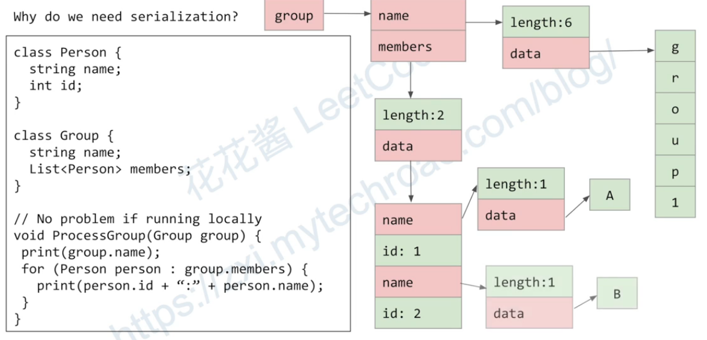
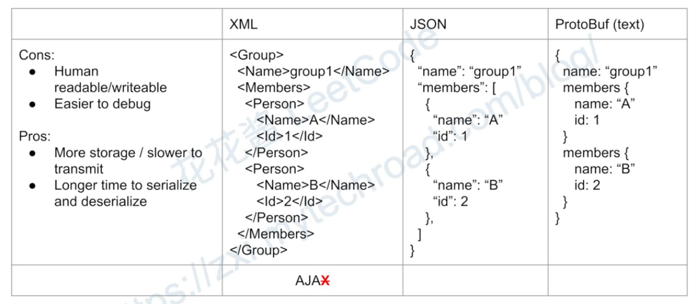
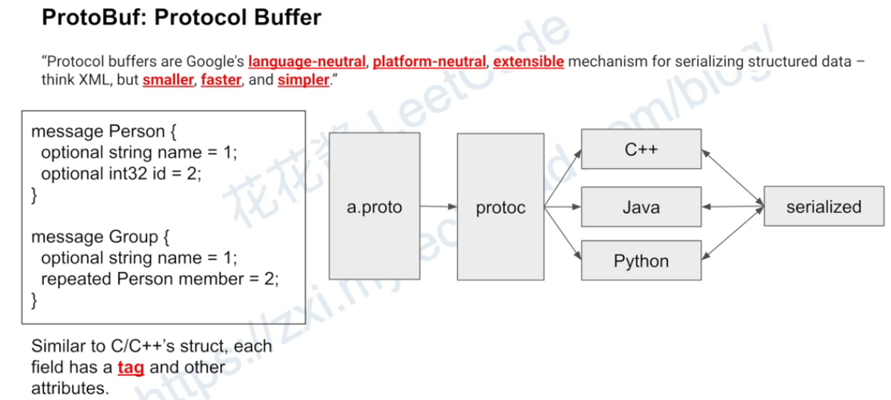
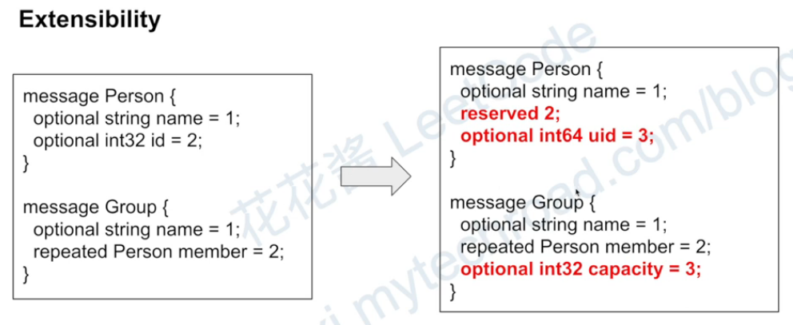

# Protocol Buffers — Typed Messages and Compatible Schema Evolution

## Definition
**Protocol Buffers, or Protobuf, is a language-neutral schema and serialization system.** You describe structured messages in a `.proto` file, generate classes for your programming language, and serialize instances to a compact binary representation.

Think of a shared form definition: both services agree what field number 1 means, how field 2 is typed, and which values are allowed. Generated code provides convenient accessors; the wire format uses field numbers rather than sending full field names for each value.

Protobuf is not a transport, encryption scheme, database, or complete business validator. It can be used in files, queues, logs, or gRPC. gRPC commonly uses it for messages and service definitions, but the ideas are distinct.

its extensible， 也就是说可以向下兼容

## Why do we need Serialization??

For a complex object, "Data" are <span style="color:red">everywhere</span> in memory. 
how can we store this object to a file?
how can we pass this object to another process for inter-process communication(IPC) or even machine for remote procedure call(RPC)?
We can not just store the memory address since there is no way to restore it.
we need **serialization**

### Serialization
serialization is the process of translating data structure or object state into a format that can be stored(for example, in a file or memory buffer) or transmitted(for example, across a network connection link) and reconstructed later(possibly in a different computer environment) 
序列化后，就会把那些存储在零散的各个地方的数据存储到一个完整的数据结构。 因为复杂数据对象大部分都是存的指针，而具体指向的内容分散在内存里的各个地方，这个复杂数据对象很难进行传播。
#### serialization with text

## Real-world use cases

| Real-world scenario | What Protobuf represents | Why it fits |
|---|---|---|
| Typed internal gRPC API | Inventory requests, job results, and service method contracts. | Generated classes and stable schemas let services written in different languages exchange agreed message types. |
| IoT telemetry | Device IDs, measurement values, timestamps, and battery readings. | A binary schema can reduce repeated field-name overhead across many structured messages; measure actual payload size for the workload. |
| Order events in an event log | Events such as order accepted or shipment created. | Producers and consumers can share an explicit schema and evolve it compatibly, with a strategy for identifying message types and schema versions. |
| Offline mobile synchronization | A client stores structured changes locally and later uploads them. | The same serialization can be used in local files and transport payloads; conflict resolution remains an application concern. |
| Game service messages | Structured player actions, match state, or inventory updates. | Typed compact messages can be useful across clients and servers, independently of the chosen transport. |
| Long-term measurement archives | Stored records are read by later versions of analytics software. | Stable field numbers and compatibility rules support reading older data, provided the necessary schema definitions are retained. |
| Batch exchange between languages | A Python pipeline writes records consumed by a Java service. | Generated implementations share a wire format rather than maintaining unrelated custom parsers. |

**Walk through an evolving sensor message:** version one includes a device ID and temperature. A later version adds an optional battery field with a new field number. Older readers can ignore the unknown field; newer readers must handle its absence in old messages. If temperature is later removed, reserve its old field number instead of reusing it for an unrelated measurement.

Protobuf answers “how are these structured values represented as bytes?” A broker, HTTP API, gRPC call, or file system still moves or stores those bytes. It is not general-purpose compression, and smaller size than JSON is workload-dependent.

**Interview practice:** explain how an old consumer and a new producer can coexist, then describe a schema change that would break that compatibility.

## Why use it instead of JSON?

| Need | Protobuf helps by... | Trade-off |
|---|---|---|
| Many languages | Generating typed message classes | Requires code-generation and compatible runtimes |
| Compact messages | Encoding typed fields with numeric tags | Binary payloads are less convenient to inspect manually |
| Evolving services | Supporting carefully designed additive changes | Incompatible schema changes can still corrupt meaning |
| Shared contract | Checking types and structure | Application constraints still need validation |

Do not promise that Protobuf is always faster or smaller for every workload. Measure representative messages, CPU cost, compression, and network size. Avoid treating deterministic serialization as a universal canonical byte representation for signatures or hashes.


-------------------------- Explanation ProtoBuf definition.  --------------------------
# Additional Explanation
关键是：**`.proto` 文件里的 `= 1`、`= 3` 不是赋值，而是给字段编号。**这里的 `=` 容易让人误以为它和 Python、Java 中的赋值一样。
看这两行：
```
string user_id = 1;
repeated string roles = 3;
```
它们的意思是：

| 字段名称      | 数据类型                    | 字段编号 | 实际数据示例                |
| --------- | ----------------------- | ---- | --------------------- |
| `user_id` | `string`：一个字符串          | `1`  | `"U1001"`             |
| `roles`   | `repeated string`：字符串列表 | `3`  | `["admin", "editor"]` |
所以，`user_id` 的**值是字符串**，而 `1` 是这个字段的**固定编号**。`roles` 的值是字符串列表，`3` 也是编号。接收方通过编号识别传过来的是哪个字段。[protobuf.dev](https://protobuf.dev/programming-guides/proto3/?utm_source=chatgpt.com)
编译生成 Python 的 `User` 类以后，**真正赋值**会是这样：
```
user = User(    user_id="U1001",    roles=["admin", "editor"])
```
你没有把 `1` 放进 `user_id`，也没有把 `3` 放进 `roles`。这些编号已经写在 `.proto` 的定义里了。
再看 `reserved`：
```
reserved 4, 9 to 11;
reserved "old_username";
```
**`reserved` 的意思是：把指定的字段编号或字段名称禁用，以后不能拿来定义字段。**

|声明|禁用什么|
|---|---|
|`reserved 4;`|字段编号 `4`|
|`reserved 9 to 11;`|字段编号 `9`、`10`、`11`，包含两端|
|`reserved "old_username";`|字段名称 `old_username`|
因此，在同一个 `User` 定义里，下面这些声明会报编译错误：
```
int32 age = 4;             // 错误：编号 4 被禁用了
string email = 9;          // 错误：编号 9 被禁用了
string old_username = 20;  // 错误：虽然编号可用，但名称被禁用了
```
这里限制的是**字段的定义**。例如，`reserved 4` 不会禁止某个整数类型字段的实际值等于 `4`。
为什么要这样做？**主要是为了避免删除旧字段后，别人误用它原来的编号。**
假设旧版有：
```
string old_username = 4;
```
旧数据里，编号 `4` 代表用户名。后来你删除了这个字段，如果新版本写成：
```
string email = 4;
```
新程序读取旧数据时，就可能把旧用户名当成邮箱，因为它们都使用编号 `4`。
所以，删除旧字段后，应把它的编号和名称保留下来禁用：
```
reserved 4;
reserved "old_username";
```
这样编译器就能阻止后续开发者误用它们。

在 **proto3** 中，你可以这样理解：
- **`optional`：一个值，可以不提供，而且能检查“有没有提供”。**
- **`repeated`：一组同类型的值，可以有零个、一个或多个。**

例如：
```
syntax = "proto3";

message User {
  optional int32 age = 2;
  repeated string roles = 3;
}
```

这里的 `2` 和 `3` 仍然是**字段编号**。

**先看 `optional`：为什么需要知道“有没有提供”？**

```
optional int32 age = 2;
```

接收方可能遇到两种不同情况：

|情况|业务含义|读取 `age`|检查是否提供|
|---|---|---|---|
|没有提供年龄|年龄未知|`0`|`False`|
|明确提供年龄 `0`|年龄是零岁|`0`|`True`|
|明确提供年龄 `40`|年龄是四十岁|`40`|`True`|

虽然前两种情况读取的值都是 `0`，但 **`optional` 让你能区分它们**。它不会让未提供的整数自动变成 Python 的 `None`。[protobuf.dev](https://protobuf.dev/programming-guides/field_presence/?utm_source=chatgpt.com)

编译生成 Python 类后：

```python
from user_pb2 import User

# 情况一：没有提供年龄
user_a = User()

print(user_a.age)               # 0
print(user_a.HasField("age"))   # False


# 情况二：明确提供年龄为 0
user_b = User(age=0)

print(user_b.age)               # 0
print(user_b.HasField("age"))   # True


# 情况三：明确提供年龄为 40
user_c = User(age=40)

print(user_c.age)               # 40
print(user_c.HasField("age"))   # True
```

这种能力适合**更新接口**。你可以在业务代码中约定：

```python
if request.HasField("age"):
    # 用户提供了年龄，才更新数据库
    update_age(request.age)
```

这样，没有提供 `age` 时，就可以保持数据库中的年龄不变。

注意：在 proto3 中，普通的 `int32 age = 2;` 也可以省略。**加上 `optional` 的关键作用，是额外记录有没有设置这个字段。**

**再看 `repeated`：它表示列表。**

```python
repeated string roles = 3;
```

意思是：`roles` 可以包含多个字符串，例如：

```python
user = User(roles=["admin", "editor"])
```

也可以逐个添加：

```python
user = User()

# 一开始是空列表
print(list(user.roles))  # []

# 添加一个角色
user.roles.append("admin")

# 再添加多个角色
user.roles.extend(["editor", "viewer"])

print(list(user.roles))
# ["admin", "editor", "viewer"]
```

`repeated` 会保留元素顺序，也允许重复值。**`= 3` 不是限制只能放三个角色，而是说明 `roles` 的字段编号为 3。**[protobuf.dev](https://protobuf.dev/programming-guides/proto3/?utm_source=chatgpt.com)

两者的区别可以放在一起看：

|                   | `optional int32 age` | `repeated string roles` |
| ----------------- | -------------------- | ----------------------- |
| 存放什么              | 一个整数                 | 多个字符串组成的列表              |
| 可以不提供吗            | 可以                   | 可以                      |
| 没提供时读取什么          | `0`                  | 空列表                     |
| 能区分“没提供”和“提供默认值”吗 | 可以，用 `HasField()`    | 不能区分“没提供”和“提供空列表”       |

`repeated` 本身已经允许零个元素，因此不需要、也不能写成 `optional repeated`。[protobuf.dev](https://protobuf.dev/programming-guides/field_presence/?utm_source=chatgpt.com)



serialized后的数据传到任何的后端都可以被deserialize，数据都是一致的， 不管是c++, java or python
protoBuf 就像一个默认的共同语言，不管两边的service是什么语言，这个buffer的传递都是一样的
### Extensibility



## The schema used by our gRPC guide
Save this as `jobs.proto`. The examples deliberately use proto3; newer Protobuf editions exist, but are not required for learning these fundamentals.
```proto
syntax = "proto3";
package learning;

enum State {
  STATE_UNSPECIFIED = 0;
  QUEUED = 1;
  RUNNING = 2;
  COMPLETED = 3;
}

message JobRequest {
  string job_id = 1;
}

message JobStatus {
  string job_id = 1;
  State state = 2;
  optional int32 progress = 3;
  reserved 4;
  reserved "old_detail";
  repeated string tags = 5;
}

service Jobs {
  rpc GetJob(JobRequest) returns (JobStatus);
  rpc WatchJob(JobRequest) returns (stream JobStatus);
}
```

The numbers are permanent field identities, not positions that should be renumbered when reorganizing a file. `repeated` is a list. The zero enum value provides an explicit unspecified default. `optional` lets this example distinguish absent progress from explicit zero.

## Generate Python code and run a round trip

Install `grpcio` and `grpcio-tools`, then run in the directory containing `jobs.proto`:

```bash
python -m grpc_tools.protoc -I. --python_out=. --grpc_python_out=. jobs.proto
```

This produces `jobs_pb2.py` (messages) and `jobs_pb2_grpc.py` (gRPC stubs/servicer interfaces). The Protobuf-only round trip below uses only `jobs_pb2.py`; gRPC code is generated here for the next guide. Keep generated code and runtime versions compatible; do not hand-edit generated modules.

Save as `protobuf_demo.py`:

```python
from google.protobuf.json_format import MessageToDict
import jobs_pb2 as pb

original = pb.JobStatus(job_id="job-123", state=pb.RUNNING, tags=["batch"])
assert not original.HasField("progress")
original.progress = 0
assert original.HasField("progress")

encoded = original.SerializeToString()
decoded = pb.JobStatus.FromString(encoded)
assert decoded == original
print("Binary bytes:", encoded)
print("Readable view:", MessageToDict(decoded, preserving_proto_field_name=True))

# A field's type does not enforce all business rules.
decoded.progress = 150  # Valid int32, invalid percentage for our application.
assert not 0 <= decoded.progress <= 100
```

Expected: binary bytes, a readable dictionary, and assertions passing. Without explicit presence, a scalar default can be indistinguishable from omission through the usual generated API. Do not call HasField indiscriminately on implicit-presence scalar fields.

## Schema evolution: what interviews focus on

1. Add fields with new numbers; old readers can generally ignore unknown binary fields.
2. Never reuse a deleted field number. Reserve its number and usually its name to prevent accidental reuse, including text/JSON considerations.
3. Do not casually change a field's type, cardinality, or meaning. Some changes are wire-compatible yet unsafe for application semantics.
4. Unknown fields may survive binary parse/reserialize, but conversions through JSON or hand-built objects can lose information. Design migrations across the actual pipeline.
5. Add enum values carefully: older business logic may not know what to do with them.
6. Roll out compatible readers before writers depend on new behavior; retain backward compatibility for queued or stored historical data.

Binary compatibility and ProtoJSON compatibility are different. Renaming a field while retaining its number may preserve binary meaning but change JSON names and generated source APIs. A schema registry can track event schemas and compatibility rules; it is not inherently required by Protobuf or automatically provided by a broker.

## Supporting technologies and implementation details

Use code generation in CI, contract/compatibility checks, pinned compatible build tools, and explicit domain validation. Limit message size and nesting where appropriate. Log a safe readable representation rather than dumping sensitive raw bytes.

A raw stream of concatenated serialized messages needs framing: protobuf messages are not generally self-delimiting at the top level. gRPC supplies its own message framing; the network guide shows why boundaries matter.

For HMAC or signatures, authenticate the exact transmitted bytes or a well-specified canonical representation. Parsing and reserializing is not a general substitute. Encryption still requires TLS or an appropriate payload-encryption scheme.

## Quick recall and practice

**Remember:** schema → generated classes → message bytes. Field numbers are identities. Compatible parsing does not guarantee compatible business meaning.

**Interview answer:** “I would use Protobuf for a shared typed contract and efficient serialization. I would make additive changes, reserve deleted field numbers, validate domain constraints separately, and test compatibility across deployed versions.”

1. Does Protobuf send data over the network by itself?
2. Why is explicit zero different from missing progress?
3. Why should a removed field number never be reused?
4. Can a valid Protobuf message contain an invalid business value?
5. Does converting a binary message to JSON preserve all compatibility behavior?

References: [Proto3 guide](https://protobuf.dev/programming-guides/proto3/), [field presence](https://protobuf.dev/programming-guides/field_presence/), [serialization is not canonical](https://protobuf.dev/programming-guides/serialization-not-canonical/). Related: [gRPC](11-grpc.md), [HMAC](07-hmac-and-encoding.md).
