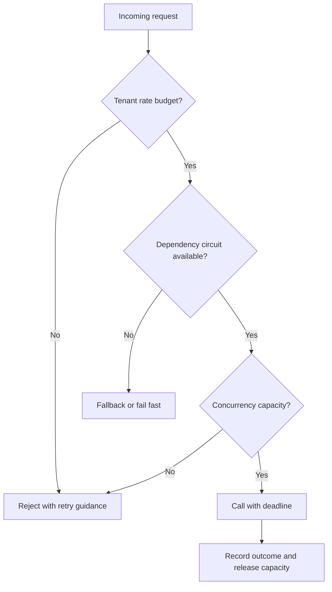

# Traffic Management and Resilience — Keep Services Useful Under Stress

## Definitions and mental model

**Traffic management** decides where requests go, how much work is admitted, and which priorities apply. **Resilience** means continuing to provide acceptable behavior when dependencies fail, slow down, or become overloaded.

Imagine 10,000 users requesting AI jobs while the model service slows down. A load balancer can distribute requests, but it cannot make the model infinitely fast. You also need admission limits, bounded queues, deadlines, and a recovery policy.

| Mechanism | What it does | What it does not solve alone |
|---|---|---|
| Reverse proxy | Accepts client traffic and forwards to upstreams | Does not necessarily balance multiple upstreams |
| Load balancer | Distributes requests or connections | Does not create backend capacity |
| API gateway | Centralizes API-facing policies/routing | Does not replace authorization inside every sensitive service operation |
| Service discovery | Finds current service endpoints | Endpoint existence does not prove readiness |
| Rate limit | Caps requests per time interval | Does not directly cap long-running concurrent work |
| Concurrency limit | Caps in-flight operations | Does not enforce a daily/monthly quota |
| Circuit breaker | Temporarily refuses calls to a failing dependency | Does not repair the dependency |
| Bulkhead | Isolates resource pools between workloads/dependencies | Poorly sized partitions can strand capacity |
| Load shedding | Rejects excess work deliberately | Must define which work can be rejected |

These names overlap in products: one proxy can perform several roles. Explain the responsibility rather than relying on a product name.

## Real-world use cases

| Real-world scenario | Product problem | Traffic-management or resilience response |
|---|---|---|
| Concert tickets go on sale | A sudden crowd exceeds normal API and inventory capacity. | Balance traffic across healthy instances and limit admitted work; use a bounded waiting room or explicit rejection when necessary. |
| Multi-tenant SaaS import | One customer's large import consumes resources needed by everyone else. | Per-tenant limits and isolated worker or connection pools reduce the impact on other customers. |
| Shipping provider outage during checkout | Slow quote requests occupy application workers and delay the whole page. | Deadlines and a circuit breaker bound waiting; show unavailable shipping options or a valid predefined fallback rather than inventing a quote. |
| AI service with limited GPUs | Request volume rises while each generation occupies capacity for a long time. | Concurrency limits and bounded queues protect execution capacity; request-rate limits alone may be insufficient. |
| Canary software release | A team wants to expose a new service version gradually. | Route a controlled traffic fraction to the new version, observe outcomes, and drain connections when retiring instances. |
| Shared partner API quota | Many workers call an external API under one account limit. | Coordinate rate limiting across workers and honor the provider's retry guidance. |
| Recommendation service slowdown | Optional recommendations delay the product page's essential content. | Separate resource pools and deadlines let the page omit recommendations while preserving core functions. |
| Autoscaling service instances | Endpoints change as instances start, fail, or terminate. | Service discovery, readiness checks, load balancing, and graceful draining direct requests to usable capacity. |

**Walk through an overloaded AI service:** admitting every request creates an ever-growing wait and may exhaust memory. Instead, cap concurrent model calls, keep only a bounded backlog, and return a clear overload response when no capacity remains. A caller with retryable work can try later within its budget. Separating interactive chat from background batch capacity can preserve the user experience during a batch surge.

**Interview practice:** identify the bottleneck before naming a mechanism. Explain why adding a load balancer cannot fix an overloaded database, why rate and concurrency limits differ, and which product features can degrade safely.

## Load-balancing choices

L4 balancing usually chooses a destination for a transport connection. L7 balancing understands application requests and can route by path, tenant, headers, or other protocol-aware information. Connection reuse and multiplexing affect how evenly load spreads.

- **Round robin:** simple distribution, but requests may have different costs.
- **Least connections/requests:** tries to account for outstanding load; one connection can contain many requests or very different work.
- **Weighted balancing:** reflects unequal capacity.
- **Consistent hashing:** limits remapping when membership changes; useful for locality, not a consistency or durability guarantee.
- **Sticky sessions:** keep a client on one instance; can improve locality but complicate failover and cause imbalance.

Readiness checks should reflect whether an instance can serve traffic. Liveness determines whether a process should be restarted. An overloaded downstream dependency should not automatically make every instance restart and worsen the incident. Drain existing streams during deployment and support reconnection.

## Admission-control workflow



The exact order is a design choice; make accounting clear so rejecting one layer does not accidentally consume an unlimited resource in another.

## Runnable Python: a token bucket

**Token bucket:** tokens refill at a rate up to a capacity. A request consumes tokens; an empty bucket rejects or waits. Capacity permits a bounded burst while refill controls the long-run rate.

Save as `token_bucket.py`. This is a thread-safe, single-process example. One instance represents one budget; a real multi-tenant system needs bounded storage for tenant buckets and a fleet-level quota design.

```python
import threading
import time

class TokenBucket:
    def __init__(self, rate, capacity, clock=time.monotonic):
        if rate <= 0 or capacity <= 0:
            raise ValueError("Positive rate/capacity required")
        self.rate, self.capacity, self.clock = rate, capacity, clock
        self.tokens, self.updated = float(capacity), clock()
        self.lock = threading.Lock()

    def allow(self, cost=1):
        if not 0 < cost <= self.capacity:
            raise ValueError("Cost must fit the bucket")
        with self.lock:
            now = self.clock()
            self.tokens = min(self.capacity, self.tokens + (now - self.updated) * self.rate)
            self.updated = now
            if self.tokens >= cost:
                self.tokens -= cost
                return True, 0.0
            return False, (cost - self.tokens) / self.rate

if __name__ == "__main__":
    now = [0.0]
    bucket = TokenBucket(rate=2, capacity=3, clock=lambda: now[0])
    print([bucket.allow()[0] for _ in range(4)])  # True, True, True, False
    now[0] += 0.5
    print(bucket.allow())  # One token refilled.
```

If exposing this over HTTP, 429 can carry a Retry-After delay rounded up to whole seconds. The estimate assumes no intervening consumption and is not a reserved future slot. Each server holding its own full bucket multiplies the fleet-wide allowance. A shared atomic limiter or budget-allocation scheme is needed for a strict shared quota.

## Runnable Python: circuit-breaker state transitions

**Closed:** calls proceed. **Open:** fail fast for a cooldown. **Half-open:** allow a limited probe to see whether recovery is safe.

Save as `circuit_breaker.py`. This teaching example is for sequential calls only. Concurrent production code must coordinate a bounded number of half-open probes and account for stale in-flight outcomes.

```python
import time

class TransientFailure(Exception):
    pass

class CircuitOpen(Exception):
    pass

class CircuitBreaker:
    def __init__(self, threshold=3, cooldown=10, clock=time.monotonic):
        self.threshold, self.cooldown, self.clock = threshold, cooldown, clock
        self.failures = 0
        self.opened_at = None

    def call(self, operation):
        probing = self.opened_at is not None
        if probing and self.clock() - self.opened_at < self.cooldown:
            raise CircuitOpen("Dependency cooling down")
        try:
            result = operation()
        except TransientFailure:
            self.failures += 1
            if probing or self.failures >= self.threshold:
                self.opened_at = self.clock()
            raise
        else:
            self.failures, self.opened_at = 0, None
            return result

if __name__ == "__main__":
    now = [0.0]
    breaker = CircuitBreaker(threshold=2, cooldown=5, clock=lambda: now[0])
    def fail():
        raise TransientFailure("Simulated timeout")
    for _ in range(2):
        try:
            breaker.call(fail)
        except TransientFailure:
            pass
    try:
        breaker.call(lambda: "not called")
    except CircuitOpen:
        print("Open: refused call")
    now[0] = 5
    print(breaker.call(lambda: "Probe succeeded; circuit closed"))
```

An adapter should classify timeout/unavailable failures as appropriate. An invalid user argument is not automatically evidence that a dependency is unhealthy. Real breakers may use sliding error/slow-call rates, minimum sample counts, per-dependency state, and controlled probes rather than consecutive failures.

## Supporting techniques and trade-offs

- Use deadlines to bound calls and pool waits; a circuit breaker is not a timeout.
- Combine limited retries with backoff/jitter. Repeated retries through a half-open circuit can defeat probe limits if layers are not coordinated.
- Isolate dependencies with separate concurrency limits, queues, or worker pools. Slow analytics should not consume all resources needed for job submission.
- Bound queues. Waiting forever converts overload into memory growth and unpredictable latency.
- Degrade deliberately: a cached progress display may be acceptable; fabricating a successful payment is not.
- Use tenant fairness and priority policies to limit noisy-neighbor effects.
- Match autoscaling to useful signals such as in-flight work, oldest queue age, and processing capacity. Scaling cannot repair every dependency bottleneck.

Monitor accepted/rejected requests, queue wait, p95/p99 latency, timeout rate, retry amplification, circuit state, and dependency saturation. “CPU is low” does not mean a service waiting on sockets or exhausted connections is healthy.

## Quick recall and interview practice

**Remember:** distribute traffic, admit only supportable work, bound waiting, isolate failures, and recover gradually.

**Interview answer:** “I would combine load balancing with tenant rate limits and bounded concurrency. Calls would have deadlines and limited retries. A circuit breaker and isolated resource pools would prevent one failing dependency from exhausting the whole service.”

1. Why can a rate-limited API still have too much concurrent work?
2. What happens if every replica independently enforces the full tenant quota?
3. How does a circuit breaker differ from retry backoff?
4. Why is half-open a limited probe rather than unrestricted traffic?
5. Why might least connections be misleading for HTTP/2 or streaming workloads?

References: [Envoy load-balancing concepts](https://www.envoyproxy.io/docs/envoy/latest/intro/arch_overview/upstream/load_balancing/overview), [AWS retry limits](https://docs.aws.amazon.com/wellarchitected/latest/reliability-pillar/rel_mitigate_interaction_failure_limit_retries.html). Related: [Retries](06-retries-backoff-jitter.md), [Caching](08-caching-and-coordination.md).
