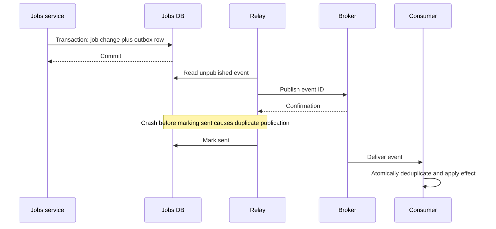

# Reliable Distributed Workflows — Idempotency, Outbox, CDC, and Sagas

## Definition and the central problem

**A distributed workflow coordinates business steps across processes or services that can fail independently.** One database transaction usually cannot atomically cover every service, broker, and external API involved.

For example: create an AI job, reserve a user's credits, run generation, store the result, and send a notification. A crash between two steps can leave partial progress. Reliability means recording enough state to retry, deduplicate, compensate, or reconcile without guessing what happened.

An HTTP timeout, lost broker acknowledgment, or crashed worker can leave an **unknown outcome**. Do not equate “no response” with “nothing happened.”

## Real-world use cases

| Real-world scenario | Steps that can partially succeed | Why a reliable distributed workflow is needed |
|---|---|---|
| E-commerce fulfillment | Reserve stock, authorize payment, create a shipment, and send confirmation. | Different services can fail independently; the order needs recorded progress, safe retries, and recovery actions. |
| Travel-package booking | Reserve a flight and hotel through separate providers. | One reservation may succeed while another fails; cancellation, refund, or manual resolution depends on provider and product rules. |
| Paid AI generation | Reserve credits, run a model, store the result, and settle usage. | A crash must not silently lose the result or charge repeatedly for the same logical job. |
| SaaS tenant provisioning | Create tenant records, allocate resources, configure access, and send onboarding instructions. | Provisioning may span multiple systems and take longer than one web request. |
| Document approval | Wait for human review, collect signatures, and activate a contract or account. | The process may pause for hours or days and must resume after service restarts. |
| Subscription activation | Record a successful purchase, update entitlements, and notify other services. | An outbox can couple the local state change with a publishable event; downstream consumers still need deduplication. |
| Warehouse reconciliation | Compare order records with an external fulfillment provider after ambiguous timeouts. | Recovery must detect missing, duplicated, or unresolved operations rather than assuming every earlier call failed. |

**Walk through an order failure:** inventory is reserved, but payment authorization is declined. The workflow records that outcome and attempts to release the reservation. If releasing fails, it records a pending recovery step and retries or escalates later. This compensation is a new business action; it is not a database rollback that erases all history. If payment instead times out with an unknown result, first determine whether authorization exists before deciding the next action.

For accepted orders, save the order change and its outbox record in the same local transaction. Publishing can then be retried without losing the intention to notify downstream systems. An inbox or another durable deduplication record protects consumers from repeat effects; it does not create a global transaction across every service.

**Interview practice:** describe the system state after each possible crash, including a crash after an external side effect succeeds but before the workflow records success.

## Definitions and guarantees

| Concept | Meaning | Important boundary |
|---|---|---|
| At-most-once delivery | May lose messages but avoids repeated delivery within its defined scope | Does not guarantee successful processing |
| At-least-once delivery | Retries seek delivery; duplicates are possible under the stated contract | Still depends on retention, recovery, and availability assumptions |
| Exactly-once effect | One logical effect despite duplicate attempts | Must specify storage/system boundaries and implementation |
| Idempotency | Repetition has the same intended effect as one operation | Requires atomic effect/deduplication coordination |
| Outbox | Event record committed with the business change in one database transaction | Relay can publish duplicates |
| Inbox | Durable received-event record, often deduplicated by ID | Ingestion deduplication alone does not deduplicate every later effect |
| CDC | Capture committed database changes for downstream propagation | Consumers still need schemas, ordering, and recovery logic |
| Saga | Sequence of local transactions with compensating actions | Compensation is not a global ACID rollback |

Two-phase commit is another coordination approach for systems supporting it, with blocking/availability and operational trade-offs. Sagas and outbox patterns do not secretly provide the same atomicity; they address different requirements with eventual progress and recovery.

## The dual-write problem

Writing `job completed` to a database and then publishing an event can fail between the two. Publishing first can instead notify others about a change that never commits. An outbox stores both the job change and its event in the same local transaction. A relay publishes pending outbox events later.



## Runnable Python: outbox plus an idempotent consumer

Save as `outbox_demo.py`. Standard library only. This simulates two independent databases and a broker represented by a list. It intentionally publishes one event twice to model a relay crash after publication but before marking sent. It demonstrates transaction boundaries, not a production relay or a durable broker.

```python
import json
import sqlite3
from uuid import uuid4

def producer_db():
    db = sqlite3.connect(":memory:")
    db.executescript("""
      CREATE TABLE jobs(job_id TEXT PRIMARY KEY, status TEXT NOT NULL);
      CREATE TABLE outbox(event_id TEXT PRIMARY KEY, body TEXT NOT NULL,
                          sent INTEGER NOT NULL DEFAULT 0);
    """)
    return db

def consumer_db():
    db = sqlite3.connect(":memory:")
    db.executescript("""
      CREATE TABLE inbox(event_id TEXT PRIMARY KEY, body TEXT NOT NULL);
      CREATE TABLE notifications(event_id TEXT PRIMARY KEY, job_id TEXT NOT NULL);
    """)
    return db

def create_completed_job(db, job_id):
    event_id = str(uuid4())
    event = {"event_id": event_id, "job_id": job_id, "type": "JobCompleted"}
    with db:
        db.execute("INSERT INTO jobs VALUES (?, 'completed')", (job_id,))
        db.execute("INSERT INTO outbox(event_id, body) VALUES (?, ?)",
                   (event_id, json.dumps(event, sort_keys=True)))
    return event_id

def relay_once(db, broker, simulate_crash=False):
    row = db.execute("SELECT event_id, body FROM outbox WHERE sent = 0 LIMIT 1").fetchone()
    if row is None:
        return
    event_id, body = row
    broker.append(body)  # Stand-in for confirmed durable publication.
    if simulate_crash:
        return  # No sent marker: restart will publish the same ID again.
    with db:
        db.execute("UPDATE outbox SET sent = 1 WHERE event_id = ?", (event_id,))

def consume(db, body):
    event = json.loads(body)
    with db:
        previous = db.execute("SELECT body FROM inbox WHERE event_id = ?",
                              (event["event_id"],)).fetchone()
        if previous:
            if previous[0] != body:
                raise ValueError("Conflicting payload for event ID")
            return False
        db.execute("INSERT INTO inbox VALUES (?, ?)", (event["event_id"], body))
        # This DB row is the demonstration's business effect, not an email send.
        db.execute("INSERT INTO notifications VALUES (?, ?)",
                   (event["event_id"], event["job_id"]))
    return True

if __name__ == "__main__":
    source, target, broker = producer_db(), consumer_db(), []
    try:
        create_completed_job(source, "job-123")
        relay_once(source, broker, simulate_crash=True)
        relay_once(source, broker)
        print("Deliveries:", len(broker))
        print("New effects:", sum(consume(target, body) for body in broker))
        print("Notification rows:", target.execute("SELECT COUNT(*) FROM notifications").fetchone()[0])
    finally:
        source.close()
        target.close()
```

Expected: two deliveries, one new effect, one notification row. The deduplication row and effect share the consumer's transaction. This single-threaded demo uses a SELECT before INSERT; a concurrent production consumer must additionally use appropriate transactional locking or unique-insert conflict handling so racing duplicate handlers cannot both proceed or fail unpredictably.

A real relay needs durable storage, ownership/claim leases, bounded retries, confirmed publication, cleanup/retention, and an ordering strategy. Multiple relay workers must not reorder events when a resource requires ordering. CDC can replace explicit outbox polling as a transport for committed records, but it does not remove consumer idempotency requirements.

## Sagas: handling partial business completion

Suppose a workflow reserves credits, runs a job, then discovers a permanent execution failure. A compensating action may release the reservation. If the job already produced an irreversible external effect, “undo” may not exist. Refunds, corrections, and manual intervention are business decisions.

| Step | Possible compensation | Important caveat |
|---|---|---|
| Reserve credits | Release reservation | Make release idempotent |
| Allocate temporary storage | Delete unused allocation | Do not delete a resource another step now owns |
| Charge payment | Refund or adjust | Refund is a new operation that can itself fail |
| Send email | Usually cannot unsend | Prefer a later irreversible step or a correction notice |

**Orchestration** uses a coordinator with durable workflow state. **Choreography** lets services react to events; it reduces a central coordinator but can make global progress and cycles harder to understand.

An illustrative saga control flow is shown below. The `state` and `payments` adapters are application-specific, not implemented libraries. Persisted states and idempotency are part of their required contracts.

```python
def continue_saga(state, payments, workflow_id):
    current = state.load(workflow_id)
    if current == "RESERVE_PENDING":
        # Repeating this key must return the same logical reservation.
        reservation = payments.reserve(idempotency_key=f"{workflow_id}:reserve")
        state.save(workflow_id, "RESERVED", reservation=reservation)
    elif current == "RELEASE_PENDING":
        payments.release(idempotency_key=f"{workflow_id}:release")
        state.save(workflow_id, "COMPENSATED")
```

This sketch omits concurrent workflow claiming, retries, and unknown-outcome reconciliation. If reserve succeeds but saving RESERVED fails, retrying reserve must not reserve twice. If the provider cannot guarantee idempotency, query/reconcile before repeating. A timeout is not a reason to blindly compensate an operation whose outcome is unknown.

## Supporting techniques

Use durable state transitions, idempotency keys scoped to tenant/operation, payload hashes for conflicting reuse, bounded retry policies, leases/fencing where relevant, correlation IDs, and explicit terminal/needs-attention states. Track stuck-workflow age, outbox backlog, duplicate rate, compensation failures, and reconciliation mismatches.

**Reconciliation** compares desired/recorded state with authoritative external state and repairs discrepancies. It is a normal reliability mechanism, not merely an emergency script. **DLQ/replay** needs an operator policy: replaying old events can repeat side effects or violate new schemas.

## Quick recall and interview practice

**Remember:** one transaction for one authoritative database; reliable propagation between databases; idempotent effects at each boundary; explicit recovery for partial progress.

**Interview answer:** “I would commit business state and an outbox event together, then publish with retries. Consumers would deduplicate atomically with their local effects. Multi-service workflows would persist progress and use idempotent steps, compensation, and reconciliation for partial failures.”

1. Which failure window remains after adding an outbox?
2. Why does an inbox record alone not make a later email send exactly once?
3. How does a saga compensation differ from rolling back a database transaction?
4. What should happen when a payment request times out with an unknown outcome?
5. Why must replay be designed rather than treated as harmless?

References: [Transactional outbox](https://docs.aws.amazon.com/prescriptive-guidance/latest/cloud-design-patterns/transactional-outbox.html), [Saga orchestration](https://docs.aws.amazon.com/prescriptive-guidance/latest/cloud-design-patterns/saga-orchestration.html). Related: [Queues](13-message-queues.md), [Event streaming](15-event-streaming.md), [Webhooks](05-webhooks.md).
