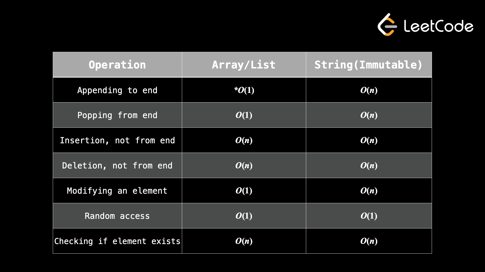

Date: 2026-02-05
Course:
Tags: 

# Content


## why appending/popping to/from end, the string of complexity is O(n) 
Yes — **amortized it’s O(n)** for Python `str`, and the “why” is: **strings are immutable**.
### What happens when you “append” to a string
In Python, `s += ch` or `s = s + ch` does **not** modify `s` in place. It must:
1. allocate a **new** string of length `len(s)+1`
2. **copy** all characters from `s` into the new buffer (`len(s)` work)
3. write the new char at the end (O(1))
    
So the dominant cost is the copy → **O(n)** where `n = len(s)`.
### Important nuance: repeated appends
If you do this in a loop:
```python
s = ""
for ch in chars:
    s += ch
```
Total time becomes **O(n²)** overall, because you pay O(1 + 2 + 3 + ... + n) copies.

### What to do instead
Use a list (amortized O(1) `append`) and join at the end:
```python
parts = []
for ch in chars:
    parts.append(ch)
s = "".join(parts)   # O(n) once
```

This makes the whole build **O(n)**.

# Note


# Reference

