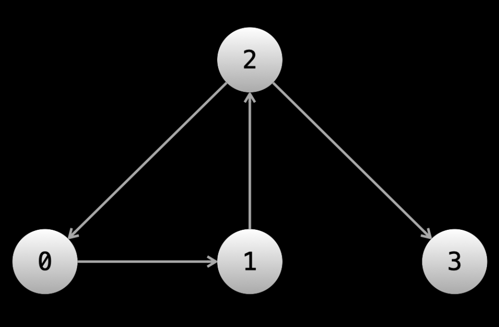
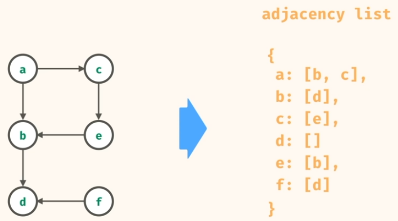
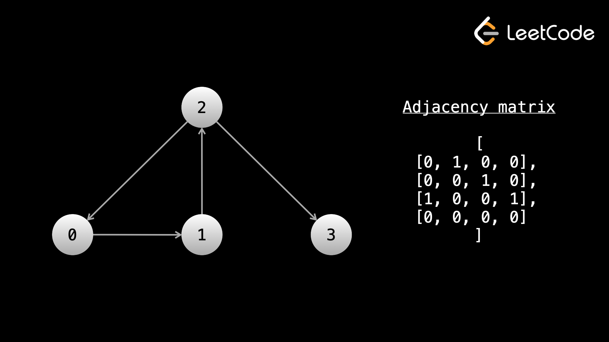
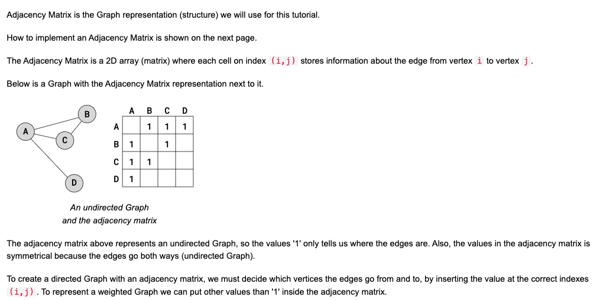
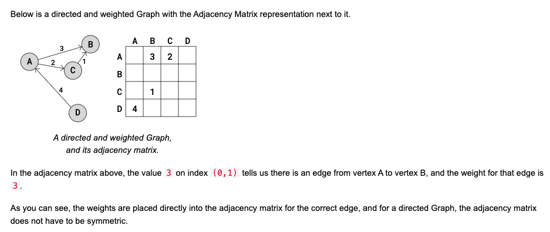

Date: 2026-04-02
Course:
Tags: 

# Content

A graph is any collection of nodes and connections between those nodes.
> Another term for nodes is vertices, and the connections between the nodes are called edges.


A node can have any number of edges connected to it. If we have a directed graph, it can have any number of edges leaving it and any number of edges entering it. The number of edges that can be used to reach the node is the node's **indegree**. The number of edges that can be used to leave the node is the node's **outdegree**. Nodes that are connected by an edge are called **neighbors**. So if you have a graph like `A <-> B <-> C`, `A` is neighbors with `B`, `B` is neighbors with `A` and `C`, and `C` is neighbors with `B`.

## How are graphs given in algorithm problems?

In linked list problems, the `head` of the linked list is given. In binary tree problems, the `root` of the tree is given. In graph problems, only information about a graph is given. There are multiple common formats that this information can come in. We will take a look at a few.

<span style="color:#ad8db5">
An important thing to understand is that with linked lists and binary trees, you are literally given objects in memory that contain data and pointers. With graphs, the graph doesn't literally exist in memory.

In fact, only the "idea" of the graph exists. The input will give you some information about it, and it's up to you to figure out how to represent and traverse the graph with code.

Many times, the nodes of a graph will be labeled from `0` to `n - 1`. The problem statement may or may not explicitly state the input is a graph. Sometimes there might be a story, and you need to determine that the input is a graph. For example, "there are `n` cities labeled from `0` to `n - 1`". You can treat each city as a node and each city has a unique label.
</span>


### **First input format: array of edges**


```python
# For example
edges = [[0, 1], [1, 2], [2, 0], [2, 3]]
```
So, why can't we immediately start traversal? Let's say that we want to start a DFS from node `0` (sometimes the problem will state which node you should start from, sometimes you will need to figure this out yourself). When we're at node `0`, how do we find the neighbors? We would need to iterate over the entire input to find all edges that include `0`. When we move to a neighbor node, we would need to iterate over the entire input again to find all the neighbors of that node.

**<span style="color:#bd736d;font-weight:bold">At every node, we would need to iterate over the entire input to find the neighbors.</span>** This is very slow!

Before starting the traversal, we can pre-process the input so that we can easily find all neighbors of any given `node`. Ideally, you want a data structure where you can give `node` as an argument and be returned a list of neighbors. The easiest way to accomplish this is <span style="color: #bd736d">using a hash map.</span>

Let's say you had a hash map `graph` that mapped integers to lists of integers. We can iterate over the input and for each `[x, y]` pair, we can put `y` in the list associated with `graph[x]`. If the edges are undirected, we will also need to put `x` in the list associated with `graph[y]`. After building this hash map, we can do `graph[0]` and immediately have all the neighbors of node `0`.

```python
edges = [[0, 1], [1, 2], [2, 0], [2, 3]]

from collections import defaultdict

def build_graph(edges):
    graph = defaultdict(list)
    for x, y in edges:
        graph[x].append(y)
        # graph[y].append(x)
        # uncomment the above line if the graph is undirected
    
    return graph

```

#### Why it is important to build the graph hashmap
>A good analogy for this: imagine you're on Facebook and you want to see a list of all your friends. However, the Facebook engineers decided to keep their graph in the form of an array of edges! You would need to look at **every single connection in the world** (which is likely in the hundreds of billions if not trillions) and find the connections that involve you. However, if the `graph` is built beforehand, you can easily just click the friends tab on your profile to see only your friends.

### **Second input format: adjacency list**

```python
# adjacency list example
graph = [[1], [2], [0, 3], []]
```
In an adjacency list, the nodes will be numbered from `0` to `n - 1`. The input will be a 2D integer array, let's call it `graph`. `graph[i]` will be a list of all the outgoing edges from the ithith node.

### **Third input format: adjacency matrix**

The next format is an adjacency matrix. Once again, the nodes will be numbered from `0` to `n - 1`. You will be given a 2D matrix of size `n x n`, let's call it `graph`. If `graph[i][j] == 1`, that means there is an outgoing edge from node `i` to node `j`. For example:





As you can see, the weights are placed directly into the adjacency matrix for the correct edge, and for a directed Graph, 
<span style="color:orange">the adjacency matrix does NOT have to be symmetric.</span>

### Acyclic: no cycles

## Complexity
lets say the n = number of nodes, e = number of edges
so the time complexity is O(e), depends on how many edges it has
the space complexity is O(n), the number of nodes.
# Note


# Reference

