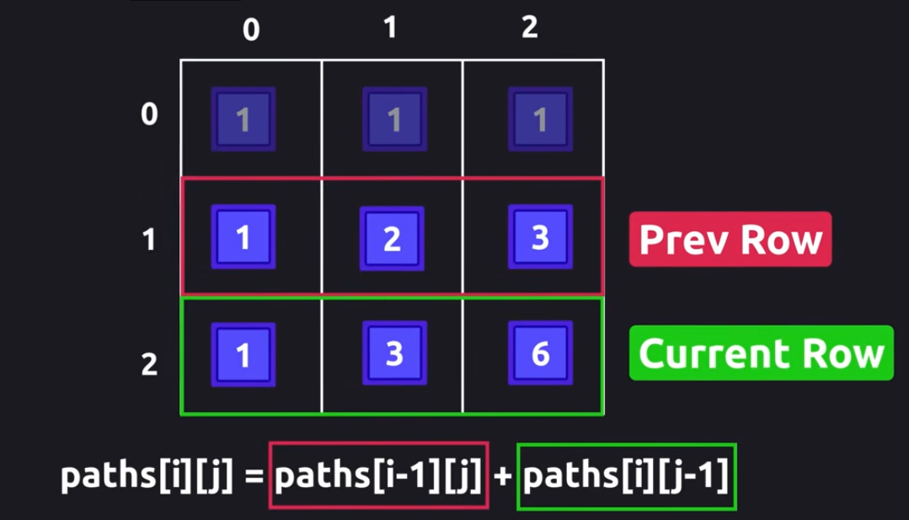

Date: 2026-04-17
Course:
Tags: 
#review/daily  #review/7d 
# Dynamic Programming vs Greedy

## What bottom-up vs top-down actually means

| | Top-down | Bottom-up |
|---|---|---|
| Direction | Start from `n`, break into subproblems | Start from base case, build up to `n` |
| Mechanism | Recursion + memoization | Iteration |
| Call stack | Yes | No |

## Memoization vs DP table
| | True Memoization | DP Table (your code) |
|---|---|---|
| Used with | Top-down recursion | Bottom-up iteration |
| Storage | Cache to avoid re-calling | Table to build up results |
| Lookup purpose | Skip redundant recursive calls | Read previous iteration's result |
| Trigger | "Have I computed this before?" | "What did I compute last step?" |

## Tabulation
is bottom up, fill to an array step by step form the start all the way to the final answer. 
If the order is clear, you can use the bottom up, 
for example: the climb stairs. 
Since we know the base cases, when stair == 1, it has 1 options
when the stair == 2, it has 2 options, 
1. from 0 jump to 1, and from 1 to 2, 
2. from 0 jump to 2 directly

### Pattern 1
```python
# one direction solution pattern
def climb_stairs(n):
	# Mechanism: Iteration, Its not Recursion + Memoization
	# it's button-up. start from the base cases
	if n <= 2: return n
	ways = [0] * (n) # pre-sized
	# from stair 0 to 1, it has 1 way, from 0 to 2, it has two ways, jump form 0 to 1 and from 1 to 2, or from 0 to 2 directly
	ways[0], ways[1] = 1, 2 # these are the base cases
	for i in range(2, n):
		# if wants to jump to stair i, it counts from i - 1 and i - 2. 
		# because i - 1 and i - 2 include all possibilities. 
		ways[i] = ways[i - 1] + ways[i - 2] 
	return ways[n-1] # ways[-1] works correctly here, but ways[n-1] is more explicit and communicates intent better.
```

### Pattern 2
```python
# one direction solution pattern
def climb_stairs(n):
	# Call this solution as `Constant Transition`
	# becuase the problem only needs to know the accummuative answer, 
	# It's not necessary to store all answers in the list.
	if n <= 2: return n
	prev_1, prev_2 = 1, 2
	for i in range(3, n):
		curr = prev_1 + prev_2
		prev_1 = prev_2
		prev_2 = curr
	return curr
```

## Memorization (Recursive)
The memorization is recursion with memory, 
is Top-Down when the order is unclear or hard to reason about, 

### Pattern 3
```python
# one direction solution pattern
def climb_stairs(n):
	# recursive + memoization
	# it's top to down, it starts from n. 
	memo = {}
	# with memo - skips alreday-computed nodes.
	if n in memo: return memo[n] # <- this is memoization
	if n == 1: return 1
	if n == 2: return 2
	
	result = climb_stair(n - 1) + climb_stair(n - 2)
	# the result gets from the previous two status.
	# definitely, should be the n in the memo
	memo[n] = result 
	return result
```

## Two Directions
```
problem is: there has a n x m grid, the rabbit from the (0, 0) to the (n - 1, m - 1). how many paths of the rabbit can go to reach the target location. Note, it only alows to right or down. 
-----------------------------
|(0,0) |    |               |
-----------------------------
|      |    |               |
-----------------------------
|      |    | (n -1, m - 1) |
-----------------------------
```

The idea of solution
```text
Its a grid, in the each cell, we can store the number of ways from the adjacency left or up directions. 
If the rabbit goes all the way to the right, 
1. from (0,0) to (0,1) only has one way, from (0,1) to (0, 2), has one way, so I can say from the direction to the right, from 0 to n (the row), 
2. each of the cell if it wants to get the all options from the left, only has one way. the same for the rabbit goes all the way down. it only has one way from the prev cell. 
3. Since all rest of cells are able to get the answer from the previous cells, there is no other condition need to be considered. 
for the cell (1,1), it can get the way from (1,0)[goes down] or from (0, 1)[goes left]. some the (1, 0) and (0, 1) have one way to get there. the cell (1,1) has 1 + 1 = 2 ways.
```

```python
# the same pattern as the pattern 1: recursive + memory + buttom-up
# dynamic programming
def uniquePaths(m, n):
	# m is row, n is col
	# [0] * n is each row has n col
	paths = [[0] * n for _ in range(m)] # paths = defaultdict(lambda: defaultdict(int))
	# the item 2 in the above idea solution
	for i in range(m): 
		paths[0][i] = 1 # only one way from prev cell
	# the item 2 in the above idea solution	
	for j in range(n): 
		paths[j][0] = 1 # only one way from prev cell
	
	# the item 3 in the above, the previous condition
	# has been setup completely.
	for i in range(m):
		for j in range(n):
			paths[i][j] = paths[i - 1][j] + paths[i][j - 1]
	return paths[m-1][n-1]
```

### Optimization

```python
# so the grid problem also can use the prev row and current row, 
# without using an array to stores each path count, because
paths [i][j] = paths[i-1][j] + paths[i][j-1]
# so that we can use single row to store the current and prevous values 
def uniquePaths(m, n):
	"""
	Space complexity: O(m)
	"""
	row = [1] * n # one row with n cols
	for i in range(m):
		for j in range(n):
			row[j] = row[j] + row[j-1]
			# row[j] += row[j-1]
	return row[n - 1]

```
# The above is greedy or DP solution, and why

```python
# since using collections.defaultdict, there is no need to setup the default lenght. 
paths = defaultdict(lambda: defaultdict(int))
# equals to, bue the below one has explicity define the row and cols
paths = [[0] * n for _ in range(m)] 
```

# Note


# Reference

