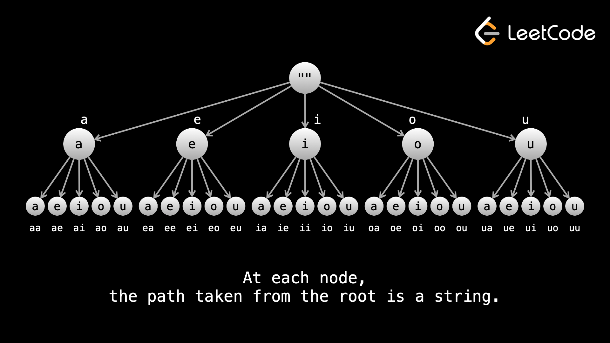

Date: 2026-05-11
Course:
Tags: [[Backtracking]]

# Reference
- [[../../../LeetCode Questions/M - 0046. Permutations|M - 0046. Permutations]]

# Content

Backtracking is a problem-solving technique where you:
> build a solution step-by-step,  
> explore possibilities,  
> and undo choices when needed.

The key idea is:
```python
try
recurse
undo
```

# Core intuition
Imagine walking through a maze.
At every intersection:
- choose a path
- continue exploring
- if dead end:
    - go back
    - try another path

That “go back and try again” is:
```python
backtracking
```

# Classic structure
```python
def backtrack(path, choices):

    if solution found:
        save answer
        return

    for choice in choices:

        make choice

        backtrack(...)

        undo choice
```
The “undo choice” part is what makes it backtracking.
# Example 1 — Subsets

Problem:
```python
nums = [1,2]
```
Find all subsets:
```python
[]
[1]
[2]
[1,2]
```

# Decision tree
At each number:
```python
take it
or
skip it
```

# Backtracking code
```python
res = []
def backtrack(start, path):
    res.append(path[:])
    for i in range(start, len(nums)):
        path.append(nums[i])
        backtrack(i + 1, path)
        path.pop()

backtrack(0, [])
```

# Important part
```python
path.append(...) # choose
```
Choose, 
Then:
```python
path.pop() # undo chioce
```
undo choice.

<span style="color:red; font-weight:bold">That is the essence(真髓).</span>

# Why recursion works
Each recursive call represents:
```python
a partial solution state
```
Backtracking explores all valid continuations.

# Common Backtracking Problems
## Subsets
Choose/not choose.
## Permutations
Arrange elements.
## Combination Sum
Find combinations reaching target.
## N-Queens
Place queens safely.
## Word Search
DFS through board.
## Sudoku Solver
Try valid digits recursively.
## Palindrome Partitioning
Try every valid split.

# Mental model
Backtracking usually means:
```python
generate all possibilities
```
with pruning to avoid invalid paths.

# The three major ingredients

## 1. State
What currently exists?
Example:
```python
current path
current sum
visited nodes
```

## 2. Choices
What can we try next?
Example:
```python
which number to pick
which cell to visit
which character to use
```

## 3. Constraints
When should we stop/prune?
Example:
```python
sum > target
duplicate detected
invalid queen placement
```

# Why backtracking is expensive
Because it often explores:
```python
all combinations
all permutations
```
Complexity often becomes:
```text
                    O(2^n)  
    or 
                    O(n!)  
```

# Difference between DFS and Backtracking
People often confuse them.
## DFS
General traversal technique.
Example:
- trees
- graphs

May not undo state.

## Backtracking
DFS + undo choices.
Specifically for:
```python
searching solution space
```

# Example analogy

## DFS
Walk through all rooms in a house.
## Backtracking
Try all possible ways to arrange furniture,  
undoing arrangements repeatedly.

# Typical interview signal words

When problem says:
```python
all combinations
all permutations(排列)
generate
find every possible
```

suspect:
```python
backtracking
```

immediately.

# One of the most important interview patterns
Backtracking is a core interview category alongside:
- graph traversal
- sliding window
- binary search
- dynamic programming
- greedy

Mastering it unlocks many medium/hard problems quickly.


# Content from LeetCode
**Backtracking** is a way to efficiently run through all possibilities in a problem. It typically uses an optimization that involves abandoning a "path" once it is determined that the path cannot lead to a solution. The idea is similar to binary search trees - if you're looking for a value `x`, and the root node has a value greater than `x`, then you know you can ignore the entire right subtree. Because the number of nodes in each subtree is exponential relative to the depth, backtracking can save huge amounts of computation. Imagine if the constraint was that the string could only have vowels - an exhaustive search would still generate all 26n26n strings, and then check each one for if it only had vowels. With backtracking, we discard all subtrees that have non-vowels, improving from O(26n)O(26n) candidates to O(5n)O(5n).

<span style="color: orange">
Abandoning a path is also sometimes called "pruning(修剪)". <br/>
To summarize the difference between exhaustive search and backtracking: <br/>
In an exhaustive search, we generate all possibilities and then check them for solutions. <br/>
In backtracking, we prune(修剪) paths that cannot lead to a solution, generating far fewer possibilities
</span>

On LeetCode, a strong hint that you should use backtracking is if the input constraints are very small  `(n <= ~15)`, as backtracking algorithms usually have <span style="color:red">exponential time </span> complexities.
Unfortunately in an interview, you will not usually be told the constraints, and even if you try to clarify with the interviewer, they will give a vague answer or just tell you to do your best. This is why it's important to build a good intuition for recognizing when to use a certain algorithm.

## **Implementation**
Backtracking is almost always implemented with recursion - it really doesn't make sense to do it iteratively. In most backtracking problems, you will be building something, either directly (like modifying an array) or indirectly (using variables to represent some state). Here is some pseudocode for a general backtracking format:
```python
// let curr represent the thing you are building
// it could be an array or a combination of variables

function backtrack(curr) {
    if (base case) {
        Increment or add to answer
        return
    }

    for (iterate over input) {
        Modify curr
        backtrack(curr)
        Undo whatever modification was done to curr
    }
}
```

# Note


# Reference

