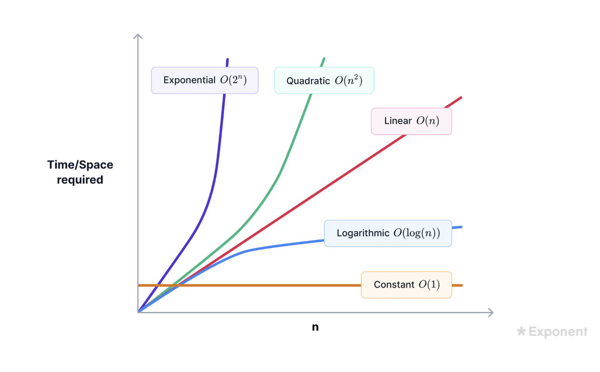

Date: 2026-01-27
Course:
Tags: [Interview]

# Content
hexadecimal：十六进制
decimal： 十进制
binary： 二进制
exponential: 指数
linear: 线性
Pseudo(su do) code: 伪代码
ambiguous problem translate to tangible requirements: 将模糊的问题转化为具体的需求
hash_function(key) % N. % is called mod.
2^32: two to thirty-second power
1/sqrt N: compliexity of consistent hashing with circle.

monotonic time: 只能往前不能退后的时间。用于rate limiter and round robin 。
uniform:均匀分布, used for sliding window counter for reliability, consistent hashing for cache, DynamoDB, CDN(content delivery Network)
uneven：不均匀分布。用于 sliding window counter, consistent hashing circle(ring)
Logarithmic: 对数
Linear: 线性
Linearithmic: 线性对数
Quadratic: 二次方
Exponential: 指数
Factorial: 阶乘



The common English names:

| Symbol  | Common name     | Also called             |
| ------- | --------------- | ----------------------- |
| `(` `)` | parentheses     | round brackets          |
| `[` `]` | square brackets | brackets                |
| `{` `}` | curly braces    | curly brackets / braces |

---

So you would say:
> "open paren, close paren, open bracket, close bracket, open brace, close brace"

Or collectively just:
> "parentheses, square brackets, and curly braces"

---
logarithmic: 对数


## graph
- The nodes of a graph are also called **vertices**, 
- and the pointers that connect them are called **edges**

```text
        1
       / \
      2   3
     /
    4
    
we call the above tree is a skewed tree, if no node 3, then, its a shewed linear tree.
```
arrowheads箭头

numerator: 分子
denominator: 分母

Amortized (分摊): Amortized = 分摊到多次操作后的平均成本
```
arr.append(x), noramlly it should be O(1), but it needs to expend from n to 2n when the capacity is full. 
then, it should be O(n). 
BUT from the long term, the average of the time complexity is O(1)
```
# Note


# Reference

