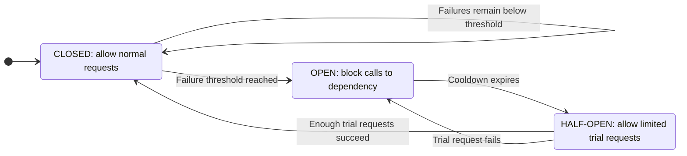
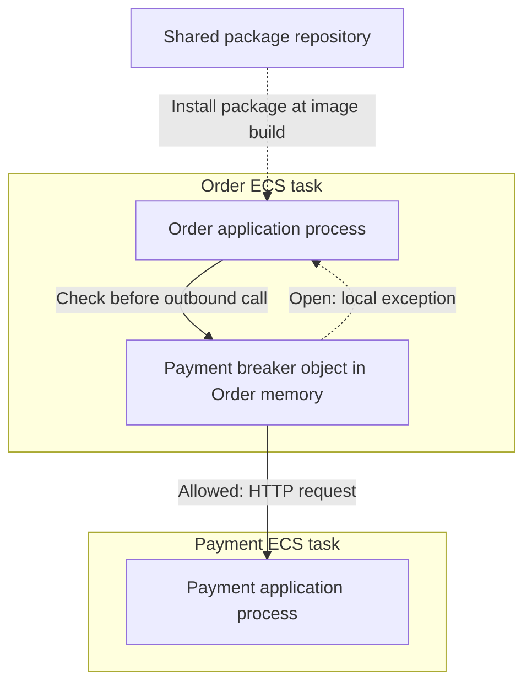
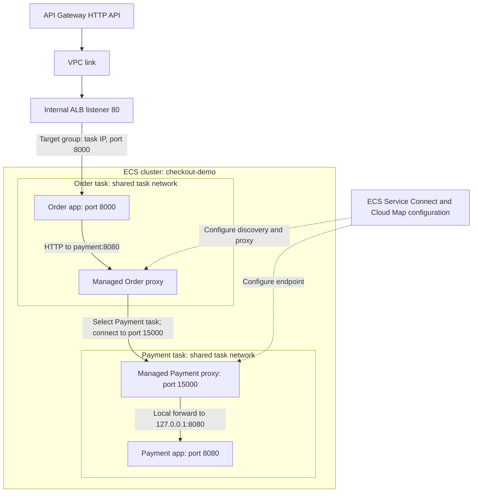
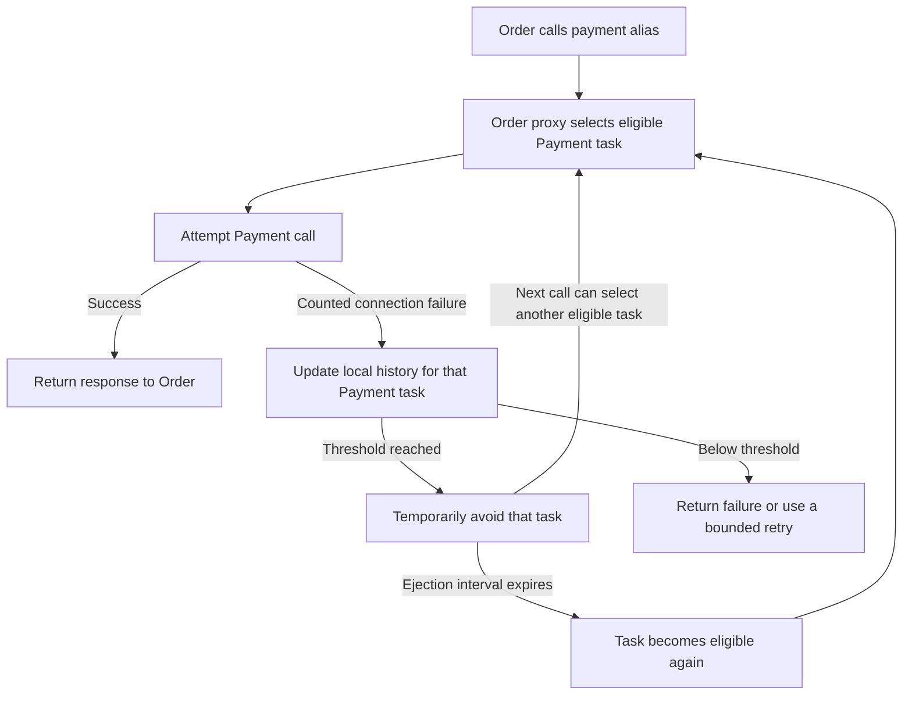

Course:
Tags:  [[System Design Interview]] [[../../../../3 - Zettelkasten/B - Tags/High Level]] [[Low Level]] [[Reliability]]

# Content
A **circuit breaker** is a reliability pattern that **stops your service from repeatedly calling a failing dependency** (like another microservice, database, or third-party API), so you avoid **cascading failures** and recover faster.
### How it works (the core idea)
Your service wraps an outbound call with a “breaker” that tracks failures:
- **Closed (normal):** calls go through.
- **Open (tripped(绊倒)):** calls are **blocked immediately** (fail fast) for a cooldown period.
- **Half-open (test mode):** after cooldown, allow a few test calls:
    - if they succeed → go back to **Closed**
    - if they fail → back to **Open**

### Why it improves reliability
- **Prevents retry storms** and thread/connection pool exhaustion
- **Reduces latency** by failing fast instead of waiting on timeouts
- **Limits blast radius** so one bad dependency doesn’t take down everything
- **Gives dependencies time to recover**
    
### What you typically pair with it
- **Timeouts** (always)
- **Retries with exponential backoff** (only when it makes sense)
- **Fallbacks** (cached data, default response, degrade gracefully)
- **Bulkheads** (separate pools so one dependency can’t starve others)
## Examples
- Service crashed/dead
- Database is down
- Bug causing service to always return 500
- Dependency service deployed with breaking changes
- Hardware failure
- Configuration error

### Circuit Breaker example
```python
# Stop calling failed service, provide fallback
@circuit_breaker(
    failure_threshold=5,
    timeout=60
)
def call_payment_service():
    try:
        return payment_api.charge(amount)
    except CircuitOpen:
        # Use fallback: queue for later processing
        return queue_payment_for_retry()
```

**Interview insight**: "Circuit breakers are for non-transient failures. For transient failures(瞬态故障), we use retry logic. Using circuit breaker for transient failures would cause unnecessary service degradation. Using retry for non-transient failures wastes resources and increases latency."

**Where a circuit breaker helps**
Suppose your  [[../../../1 - Cloud Platforms/A - AWS/AWS Kafka]] consumers call a video-processing API:
- **One request times out:** retry within your budget.
- **Requests keep timing out across many jobs:** the dependency may be unhealthy. A circuit breaker can temporarily stop further calls.
- **After a waiting period:** allow a few trial calls. Resume normal traffic if they succeed.
- **One job contains an unsupported video:** quarantine that job or send it to a DLQ. Usually, this should not open a shared circuit and block valid videos.

## 3. Circuit Breaker States



| State         | What happens                                                                        |
| ------------- | ----------------------------------------------------------------------------------- |
| **Closed**    | Requests reach the dependency. The breaker monitors failures.                       |
| **Open**      | Calls are blocked immediately; the application returns an error or uses a fallback. |
| **Half-open** | A few trial requests check whether the dependency has recovered.                    |
### State 1: CLOSED (Normal Operation)

**Behavior:** Requests pass through normally

python
```python
State: CLOSED
Failure count: 0/5

Request 1 → Success → failure_count = 0
Request 2 → Success → failure_count = 0
Request 3 → Failure → failure_count = 1
Request 4 → Success → failure_count = 0 (reset on success)
Request 5 → Failure → failure_count = 1
```

**Characteristics:**
- All requests are attempted
- Failures are counted
- Success resets failure count (or uses sliding window)
- Stays CLOSED until threshold exceeded

### State 2: OPEN (Blocking Requests)
**Behavior:** All requests fail immediately without calling service

python
```python
State: OPEN (since 14:32:00)
Timeout: 60 seconds
Current time: 14:32:30

Request 1 → IMMEDIATE FAIL (CircuitOpenException)
Request 2 → IMMEDIATE FAIL (CircuitOpenException)
Request 3 → IMMEDIATE FAIL (CircuitOpenException)

# Fast fail in ~1ms instead of waiting 30s for timeout
```

**Characteristics:**
- No requests to downstream service
- Fails fast (microseconds instead of seconds)
- Protects downstream service from overload
- Prevents resource exhaustion (threads, connections)
- After timeout period → transitions to HALF_OPEN

### State 3: HALF_OPEN (Testing Recovery)
**Behavior:** Allow limited requests to test if service recovered

python
```python
State: HALF_OPEN
Test requests allowed: 3

Request 1 → SUCCESS ✓ (1/3 successes needed)
Request 2 → SUCCESS ✓ (2/3 successes needed)
Request 3 → SUCCESS ✓ (3/3 successes needed)

→ Circuit transitions to CLOSED

# OR if failures:

Request 1 → SUCCESS ✓ (1/3 needed)
Request 2 → FAILURE ✗

→ Circuit immediately back to OPEN
```

**Characteristics:**
- Only limited number of requests allowed through
- **Acts as "health check"**
- All successes → CLOSED
- Any failure → back to OPEN
- Other requests (beyond test limit) still fail fast
## 4. Complete Implementation
Basic Circuit Breaker
```python
from enum import Enum
from datetime import datetime, timedelta
from threading import Lock
import time

class CircuitState(Enum):
    CLOSED = "CLOSED"
    OPEN = "OPEN"
    HALF_OPEN = "HALF_OPEN"

class CircuitBreakerOpenError(Exception):
    """Raised when circuit is open"""
    pass

class CircuitBreaker:
    def __init__(
        self,
        failure_threshold=5,      # Open after 5 failures
        timeout_seconds=60,       # Stay open for 60s
        success_threshold=3,      # Need 3 successes to close
        expected_exception=Exception
    ):
        self.failure_threshold = failure_threshold
        self.timeout_seconds = timeout_seconds
        self.success_threshold = success_threshold
        self.expected_exception = expected_exception
        
        # State
        self.state = CircuitState.CLOSED
        self.failure_count = 0
        self.success_count = 0
        self.last_failure_time = None
        self.lock = Lock()
    
    def call(self, func, *args, **kwargs):
        """Execute function with circuit breaker protection"""
        with self.lock:
            if self.state == CircuitState.OPEN:
                # Check if timeout expired
                if self._should_attempt_reset():
                    self._transition_to_half_open()
                else:
                    raise CircuitBreakerOpenError(
                        f"Circuit breaker is OPEN. "
                        f"Retry after {self._time_until_retry()}s"
                    )
            
            if self.state == CircuitState.HALF_OPEN:
                # In half-open, only allow limited requests
                if self.success_count >= self.success_threshold:
                    self._transition_to_closed()
        
        # Actually make the call
        try:
            result = func(*args, **kwargs)
            self._on_success()
            return result
        
        except self.expected_exception as e:
            self._on_failure()
            raise
    
    def _on_success(self):
        """Handle successful call"""
        with self.lock:
            if self.state == CircuitState.HALF_OPEN:
                self.success_count += 1
                if self.success_count >= self.success_threshold:
                    self._transition_to_closed()
            else:
                # In CLOSED state, reset failure count on success
                self.failure_count = 0
    
    def _on_failure(self):
        """Handle failed call"""
        with self.lock:
            self.failure_count += 1
            self.last_failure_time = datetime.now()
            
            if self.state == CircuitState.HALF_OPEN:
                # Any failure in half-open → back to open
                self._transition_to_open()
            
            elif self.failure_count >= self.failure_threshold:
                self._transition_to_open()
    
    def _transition_to_open(self):
        """Transition to OPEN state"""
        self.state = CircuitState.OPEN
        self.last_failure_time = datetime.now()
        print(f"⚠️  Circuit breaker OPENED at {self.last_failure_time}")
    
    def _transition_to_half_open(self):
        """Transition to HALF_OPEN state"""
        self.state = CircuitState.HALF_OPEN
        self.success_count = 0
        self.failure_count = 0
        print(f"🔄 Circuit breaker HALF_OPEN")
    
    def _transition_to_closed(self):
        """Transition to CLOSED state"""
        self.state = CircuitState.CLOSED
        self.failure_count = 0
        self.success_count = 0
        print(f"✅ Circuit breaker CLOSED")
    
    def _should_attempt_reset(self):
        """Check if enough time passed to try half-open"""
        if self.last_failure_time is None:
            return False
        
        elapsed = (datetime.now() - self.last_failure_time).total_seconds()
        return elapsed >= self.timeout_seconds
    
    def _time_until_retry(self):
        """Time remaining until half-open attempt"""
        if self.last_failure_time is None:
            return 0
        
        elapsed = (datetime.now() - self.last_failure_time).total_seconds()
        return max(0, self.timeout_seconds - elapsed)
    
    @property
    def current_state(self):
        """Get current state info"""
        return {
            "state": self.state.value,
            "failure_count": self.failure_count,
            "success_count": self.success_count,
            "time_until_retry": self._time_until_retry()
        }

# Usage Example
def unreliable_service():
    """Simulates an unreliable external service"""
    import random
    if random.random() < 0.7:  # 70% failure rate
        raise Exception("Service unavailable")
    return "Success"

# Create circuit breaker
cb = CircuitBreaker(
    failure_threshold=3,
    timeout_seconds=10,
    success_threshold=2
)

# Test it, call it once per protected operation, here just an example to call once. 
for i in range(20):
    try:
        result = cb.call(unreliable_service)
        print(f"Request {i+1}: {result} | State: {cb.current_state}")
    except CircuitBreakerOpenError as e:
        print(f"Request {i+1}: BLOCKED - {e}")
    except Exception as e:
        print(f"Request {i+1}: FAILED - {e} | State: {cb.current_state}")
    
    time.sleep(1)
```

**Output example:**
```
Request 1: FAILED - Service unavailable | State: CLOSED, failures: 1
Request 2: Success | State: CLOSED, failures: 0
Request 3: FAILED - Service unavailable | State: CLOSED, failures: 1
Request 4: FAILED - Service unavailable | State: CLOSED, failures: 2
Request 5: FAILED - Service unavailable | State: CLOSED, failures: 3
⚠️  Circuit breaker OPENED
Request 6: BLOCKED - Circuit breaker is OPEN. Retry after 9s
Request 7: BLOCKED - Circuit breaker is OPEN. Retry after 8s
...
Request 15: BLOCKED - Circuit breaker is OPEN. Retry after 0s
🔄 Circuit breaker HALF_OPEN
Request 16: Success | State: HALF_OPEN, successes: 1
Request 17: Success | State: HALF_OPEN, successes: 2
✅ Circuit breaker CLOSED
Request 18: Success | State: CLOSED, failures: 0
```
## 5. Advanced Circuit Breaker with Sliding Window
**Problem with simple counter:** One burst of errors can trip circuit, even if overall health is good.
>Use a **sliding window** in a circuit breaker when you want the breaker to react to the **recent health** of a dependency (last N requests or last T seconds), not lifetime counters. It’s the most common production approach because it’s stable under traffic spikes and avoids “one old incident keeps poisoning the breaker.”

eg:
```
If QPS changes a lot (API traffic, user-driven load), a simple “N consecutive failures” or “failure_count since start” behaves badly.
- Sliding window answers: “In the last 20 calls (or last 10s), how bad is it?”
- That’s what you want when load can spike.
```

**Solution:** Use sliding window to track failures over time.
```python
from collections import deque
from datetime import datetime, timedelta

class SlidingWindowCircuitBreaker:
    def __init__(
        self,
        window_size_seconds=60,
        failure_threshold_percentage=50,  # Open if >50% failures
        minimum_requests=10,               # Need at least 10 requests
        timeout_seconds=30
    ):
        self.window_size = timedelta(seconds=window_size_seconds)
        self.failure_threshold_pct = failure_threshold_percentage
        self.minimum_requests = minimum_requests
        self.timeout_seconds = timeout_seconds
        
        # Sliding window of (timestamp, success: bool)
        self.requests = deque()
        self.state = CircuitState.CLOSED
        self.last_open_time = None
        self.lock = Lock()
    
    def call(self, func, *args, **kwargs):
        with self.lock:
            self._clean_old_requests()
            
            if self.state == CircuitState.OPEN:
                if self._should_attempt_reset():
                    self._transition_to_half_open()
                else:
                    raise CircuitBreakerOpenError("Circuit is OPEN")
        
        # Execute
        start_time = datetime.now()
        try:
            result = func(*args, **kwargs)
            self._record_result(start_time, success=True)
            return result
        except Exception as e:
            self._record_result(start_time, success=False)
            raise
    
    def _record_result(self, timestamp, success):
        """Record request result in sliding window"""
        with self.lock:
            self.requests.append((timestamp, success))
            self._clean_old_requests()
            
            # Check if should open circuit
            if self.state == CircuitState.CLOSED:
                if self._should_open():
                    self._transition_to_open()
            
            elif self.state == CircuitState.HALF_OPEN:
                if success:
                    self._transition_to_closed()
                else:
                    self._transition_to_open()
    
    def _clean_old_requests(self):
        """Remove requests outside the time window"""
        cutoff = datetime.now() - self.window_size
        
        while self.requests and self.requests[0][0] < cutoff:
            self.requests.popleft()
    
    def _should_open(self):
        """Determine if circuit should open based on failure rate"""
        total = len(self.requests)
        
        if total < self.minimum_requests:
            return False
        
        failures = sum(1 for _, success in self.requests if not success)
        failure_rate = (failures / total) * 100
        
        return failure_rate > self.failure_threshold_pct
    
    def _should_attempt_reset(self):
        if self.last_open_time is None:
            return False
        
        elapsed = (datetime.now() - self.last_open_time).total_seconds()
        return elapsed >= self.timeout_seconds
    
    def _transition_to_open(self):
        self.state = CircuitState.OPEN
        self.last_open_time = datetime.now()
        print(f"⚠️  Circuit OPENED - Failure rate too high")
    
    def _transition_to_half_open(self):
        self.state = CircuitState.HALF_OPEN
        print(f"🔄 Circuit HALF_OPEN - Testing recovery")
    
    def _transition_to_closed(self):
        self.state = CircuitState.CLOSED
        self.requests.clear()
        print(f"✅ Circuit CLOSED - Service recovered")
    
    @property
    def metrics(self):
        """Get current metrics"""
        total = len(self.requests)
        if total == 0:
            return {
                "state": self.state.value,
                "total_requests": 0,
                "failure_rate": 0
            }
        
        failures = sum(1 for _, success in self.requests if not success)
        
        return {
            "state": self.state.value,
            "total_requests": total,
            "failures": failures,
            "failure_rate": f"{(failures/total)*100:.1f}%"
        }
```

**Why sliding window is better:**
```
Simple counter (last 5 requests):
[S, S, S, F, F] → 2/5 failures = 40%

[F, F, F, F, F] → 5/5 failures = 100% → OPENS
↑ Could be old failures from 2 hours ago!

Sliding window (last 60 seconds):
Current time: 14:35:00
Window: 14:34:00 - 14:35:00

14:34:05: F
14:34:10: F
14:34:15: F
14:34:58: S
14:34:59: S
→ 3 failures in 60s = 60% → OPENS

14:35:15: Old failures drop out of window
14:35:15: S
14:35:16: S
→ 0 failures in last 60s = 0% → CLOSED
```
## 6. Fallback Strategies
When circuit is open, you need a **fallback** strategy:
### Strategy 1: Return Cached/Stale Data
```python
class CachedCircuitBreaker:
    def __init__(self):
        self.cb = CircuitBreaker(failure_threshold=3)
        self.cache = {}
    
    def get_user_profile(self, user_id):
        try:
            # Try to fetch fresh data
            profile = self.cb.call(user_service.get_profile, user_id)
            
            # Cache successful response
            self.cache[user_id] = {
                'data': profile,
                'timestamp': datetime.now()
            }
            return profile
        
        except CircuitBreakerOpenError:
            # Circuit open - return cached data
            cached = self.cache.get(user_id)
            
            if cached:
                print(f"⚠️  Using cached data from {cached['timestamp']}")
                return cached['data']
            else:
                # No cache available
                return {"error": "Service unavailable", "user_id": user_id}
```

### Strategy 2: Return Default/Degraded Response
```python
def get_product_recommendations(user_id):
    try:
        return cb.call(ml_service.get_recommendations, user_id)
    except CircuitBreakerOpenError:
        # Fallback to popular products (not personalized)
        print("⚠️  ML service down, showing popular products")
        return db.get_popular_products(limit=10)
```

### Strategy 3: Queue for Later Processing
```python
def process_payment(order_id, amount):
    try:
        return cb.call(payment_gateway.charge, order_id, amount)
    
    except CircuitBreakerOpenError:
        # Queue payment for later
        print(f"⚠️  Payment service down, queuing order {order_id}")
        message_queue.enqueue({
            'order_id': order_id,
            'amount': amount,
            'retry_after': datetime.now() + timedelta(minutes=5)
        })
        return {"status": "pending", "message": "Payment queued for processing"}
```

### Strategy 4: Fail Gracefully with User Message
```python
def send_email(user_email, subject, body):
    try:
        return cb.call(email_service.send, user_email, subject, body)
    
    except CircuitBreakerOpenError:
        # Can't send email, but don't crash the request
        logger.error(f"Email service unavailable for {user_email}")
        
        # Save to DB for retry
        db.save_pending_email(user_email, subject, body)
        
        return {
            "sent": False,
            "message": "Email will be sent once service recovers"
        }
```
## 7. Circuit Breaker in Distributed Systems
### Challenge: Multiple Instances
```
Instance 1: CB (failures: 2/5)
Instance 2: CB (failures: 1/5)
Instance 3: CB (failures: 3/5)

Problem: Each instance has its own circuit breaker!
         No shared state
         Inconsistent behavior
```

Solution 1: Shared State (Redis) - redis is used when you need **shared state across instances**.

>If you limit by **user ID / API key / tenant**, requests will hit many order-service instances behind a load balancer.  
To enforce a single global limit, you need shared counters → **Redis is the common choice**.
Example: “Free users: 30 req/min; paid: 300 req/min” across all instances.

```python
import redis
from datetime import datetime, timedelta

class DistributedCircuitBreaker:
    def __init__(self, redis_client, service_name):
        self.redis = redis_client
        self.service_name = service_name
        self.failure_threshold = 5
        self.timeout_seconds = 60
    
    def _get_key(self, suffix):
        return f"circuit_breaker:{self.service_name}:{suffix}"
    
    def call(self, func, *args, **kwargs):
        # Check state in Redis
        state = self.redis.get(self._get_key("state"))
        
        if state == b"OPEN":
            # Check if timeout expired
            open_time = self.redis.get(self._get_key("open_time"))
            if open_time:
                elapsed = time.time() - float(open_time)
                if elapsed < self.timeout_seconds:
                    raise CircuitBreakerOpenError(
                        f"Circuit open. Retry in {self.timeout_seconds - elapsed:.0f}s"
                    )
                else:
                    # Transition to half-open
                    self.redis.set(self._get_key("state"), "HALF_OPEN")
        
        # Execute call
        try:
            result = func(*args, **kwargs)
            self._record_success()
            return result
        except Exception as e:
            self._record_failure()
            raise
    
    def _record_failure(self):
        """Record failure in Redis"""
        key = self._get_key("failures")
        
        # Increment failure count
        failures = self.redis.incr(key)
        self.redis.expire(key, 60)  # Sliding window of 60s
        
        # Check threshold
        if failures >= self.failure_threshold:
            self.redis.set(self._get_key("state"), "OPEN")
            self.redis.set(self._get_key("open_time"), time.time())
            print(f"⚠️  Circuit OPENED (failures: {failures})")
    
    def _record_success(self):
        """Record success in Redis"""
        state = self.redis.get(self._get_key("state"))
        
        if state == b"HALF_OPEN":
            # Success in half-open → close circuit
            self.redis.set(self._get_key("state"), "CLOSED")
            self.redis.delete(self._get_key("failures"))
            print(f"✅ Circuit CLOSED")
        else:
            # Regular success - reset failure count
            self.redis.delete(self._get_key("failures"))

# Usage across multiple instances
redis_client = redis.Redis(host='redis.example.com')
cb = DistributedCircuitBreaker(redis_client, "payment-service")

# All instances share the same circuit state in Redis
```

### Solution 2: Sidecar Pattern (Envoy:  is a high performance C++ distributed _proxy_ designed for single services and applications, as well as a communication bus and “universal data plane”)
```
┌─────────────────┐
│  App Instance   │
│  ┌──────────┐   │
│  │Your App  │   │
│  └────┬─────┘   │
│       │         │
│  ┌────▼──────┐  │
│  │  Envoy    │  │ ← Sidecar with circuit breaker
│  │  Proxy    │  │
│  └────┬──────┘  │
└───────┼─────────┘
        │
        ▼
   External Service

Envoy configuration:
outlier_detection:
  consecutive_5xx: 5
  interval: 10s
  base_ejection_time: 30s
  max_ejection_percent: 50
```
#### NOTE: sidecar means here:
- Same Pod
- Different container
- They share:
	- the same network namespace (same pod ip)
	- localhost access to each other
- your app sends outbound traffic to Envoy (often transparently via iptables in a service mesh), and Envoy forwards to the external service.
#### Why same Pod matters
- Envoy can intercept the app’s traffic with low latency.
- It can apply circuit breaking, retries, timeouts, outlier detection, mTLS, etc., consistently for that workload.
#### Not always a sidecar
Envoy can also be deployed in other roles:
- **Ingress / Gateway** (separate deployment)
- **Edge proxy** in front of many services
- **Dedicated egress gateway** for outbound traffic

## 8. Real-World Examples
AWS API Gateway Circuit Breaker
```python
# API Gateway configuration
x-amazon-apigateway-integration:
  type: http_proxy
  httpMethod: POST
  uri: https://backend-service.com/api
  connectionId: my-vpc-link
  connectionType: VPC_LINK
  
  # Circuit breaker settings
  circuitBreaker:
    tripThreshold: 50        # Percentage of failures
    resetAfter: 30           # Seconds
    volumeThreshold: 10      # Minimum requests
```

---
## 9. System Design Interview Framework

### Question: "Design a resilient microservices architecture"
**Interviewer**: "How would you handle one service going down?"
**Your Answer** (Step-by-step):
#### Step 1: Identify the Problem
**You**: "When a dependency service fails, we face several risks:
1. **Resource exhaustion**: Threads blocked waiting for timeouts
2. **Cascading failures**: Slow service makes caller slow, which makes its caller slow...
3. **User impact**: Long wait times, poor experience

To address non-transient failures, I'd implement circuit breakers at service boundaries."
#### Step 2: Draw the Architecture
```
┌─────────────────────────────┐
│        API Gateway          │
└─────────────┬───────────────┘
              │
              ▼
┌──────────────────────────────┐
│   Order Service              │
│   ┌────────────────┐         │
│   │ Circuit        │         │
│   │ Breaker        │         │
│   └───┬────────────┘         │
└───────┼──────────────────────┘
        │
    ┌───┴──────┬───────────────┐
    ▼          ▼               ▼
┌────────┐ ┌──────────┐   ┌───────────┐
│Payment │ │Inventory │   │Shipping   │
│Service │ │Service   │   │Service    │
└────────┘ └──────────┘   └───────────┘
   CB         CB              CB

Each downstream call protected by circuit breaker
```

#### Step 3: Explain Circuit Breaker Behavior
**You**: "Let's trace what happens when Payment Service goes down:

**Normal operation (Circuit CLOSED):**
```
User places order
→ Order Service calls Payment Service
→ Payment processes successfully
→ Order completed
```
**Payment Service crashes:**
```
Request 1 → Payment timeout (30s) ❌
Request 2 → Payment timeout (30s) ❌
Request 3 → Payment timeout (30s) ❌
Request 4 → Payment timeout (30s) ❌
Request 5 → Payment timeout (30s) ❌

Circuit breaker threshold reached (5 failures)
→ Circuit OPENS
```

**Circuit OPEN:**
```
Request 6 → Circuit breaker blocks immediately (1ms) ❌
           → Returns fallback: "Payment queued for later"
           → Order Service stays responsive!

Request 7-100 → All fail fast with fallback
                No wasted resources
                Users get immediate response
```

**After 60 seconds (Circuit HALF_OPEN):**
```
Request 101 → Test call to Payment Service
            → If successful → Circuit CLOSES
            → If fails → Circuit stays OPEN for another 60s
```

#### Step 4: Discuss Configuration
**Interviewer**: "What values would you use for the thresholds?"
**You**: "It depends on the service's characteristics, but here's my thinking:
**For critical services (Payment, Auth):** setting the failure_threshold, timeout_seconds, success_threshold and window_size_seconds are higher than less critical, because, want to make sure the service is back without false position, otherwise, it will cost lot of issues, even for the downstream service will be invoked and get errors.
```python
CircuitBreaker(
    failure_threshold=10,          # More tolerance to avoid false positives. if only 3 failures, it might block a lot of legit traffic even thought the dependency would successed on the next try
    timeout_seconds=120,           # Longer recovery time
    success_threshold=5,           # Need multiple successes
    window_size_seconds=60
)
```
For less critical services (Recommendations, Analytics):
```python
CircuitBreaker(
    failure_threshold=3,           # Trip faster
    timeout_seconds=30,            # Quick retry
    success_threshold=2,           # Less stringent
    window_size_seconds=30
)
```
**Rationale:**
- Critical services: Give more time to recover, be more conservative
- High traffic: Need more samples before tripping (avoid false positives)
- Low traffic: Can trip faster (fewer samples is OK)"
#### Step 5: Add Fallback Strategies
**Interviewer**: "What happens when circuit is open?"
**You**: "Depends on the service. Let me give examples:
**Payment Service (critical):**
```python
try:
    payment_cb.call(payment_service.charge, amount)
except CircuitBreakerOpenError:
    # Queue for async processing
    message_queue.publish({
        'order_id': order.id,
        'amount': amount,
        'retry_at': now() + timedelta(minutes=5)
    })
    return {
        'status': 'pending',
        'message': 'Payment will be processed shortly'
    }
```

Recommendation Service (non-critical):
```python
try:
    recommendations = reco_cb.call(ml_service.personalized, user_id)
except CircuitBreakerOpenError:
    # Fallback to popular items
    recommendations = db.get_popular_items(limit=10)
    
return recommendations  # User never knows service was down
```
Inventory Service (partial degradation):
```python
try:
    live_stock = inventory_cb.call(inventory_service.check, product_id)
except CircuitBreakerOpenError:
    # Use cached data with warning
    cached_stock = cache.get(f'stock:{product_id}')
    return {
        'quantity': cached_stock,
        'warning': 'Stock levels may not be current'
    }
```

#### Step 6: Handle Distributed Systems
**Interviewer**: "You have 100 Order Service instances. How does circuit breaker work?"

**You**: "Great question. We have two options:
**Option 1: Local circuit breakers (simpler)**
- Each instance has its own circuit breaker
- Pros: No network dependency, faster
- Cons: Inconsistent behavior across instances

**Option 2: Shared circuit breaker (better for critical services)**
```
All Order Service instances
         ↓
    Share state in Redis
         ↓
Circuit breaker state:
- Current state (OPEN/CLOSED/HALF_OPEN)
- Failure count
- Last failure time

Redis key structure:
circuit:payment_service:state → "OPEN"
circuit:payment_service:failures → 15
circuit:payment_service:opened_at → 1699564800
```

I'd use **Option 1 for most cases** because:
- Simpler, no external dependency
- If 20% of instances trip, that's a strong signal
- Once enough instances trip, overall traffic to failing service drops

**Option 2 for critical services** where we need:
- Consistent behavior across all instances
- Precise control over when to stop calling service"

---

## 10. Common Interview Mistakes
### ❌ Mistake 1: Confusing Retry with Circuit Breaker
**Wrong:**
"When a request fails, the circuit breaker retries it."
**Right:**
"Circuit breaker prevents calls to a failing service. Retry logic handles transient failures. They serve different purposes:
- Retry: For temporary issues (network blip)
- Circuit breaker: For persistent failures (service down)"

### ❌ Mistake 2: Not Discussing Fallback
**Wrong:**
"When circuit opens, requests fail."
**Right:**
"When circuit opens, we need a fallback strategy. For example:
- Return cached data
- Return default response
- Queue for later processing
The fallback depends on whether the operation is critical and whether we have alternative data sources."

### ❌ Mistake 3: Ignoring Distributed Systems
**Wrong:**
"I'll add a circuit breaker class to my service."
**Right:**
"In a distributed system with multiple instances, I need to consider:
- Should circuit state be shared (Redis) or local?
- How do we coordinate across instances?
- For most cases, local circuit breakers are simpler and sufficient."
#### You usually run **separate breakers per dependency + per endpoint**:
- Order → Payment (breaker A)
- Order → Inventory (breaker B)
- Order → Shipping (breaker C)
Because each dependency has different failure modes and SLOs.

### ❌ Mistake 4: No Metrics/Monitoring
**Wrong:**
Just implementing circuit breaker without discussing observability.
**Right:**
"We need to monitor:
- Circuit state transitions (OPEN/CLOSED)
- Failure rates per service
- Time spent in OPEN state
- Fallback execution rates
This helps us: (Metrics/monitoring tells _humans_ (and alerting) what’s happening.)
- Detect service degradation
- Tune threshold values
- Identify cascade failure patterns"

---

## 11. Advanced Topics

### Health Checks vs Circuit Breaker

**They're complementary:**
```
Health Check (active):
- Periodic probe to service
- "Hey service, are you alive?"
- Proactive detection

Circuit Breaker (passive): th circuit breakers must be in the request path so that it can observe the real calls.
- Monitors actual traffic
- "Service failed 5 real requests"
- Reactive protection
```

Best practice: Use both!
```python
class HealthAwareCircuitBreaker:
    def __init__(self, health_check_interval=30):
        self.cb = CircuitBreaker()
        self.last_health_check = None
        self.health_check_interval = health_check_interval
    
    def call(self, func, *args, **kwargs):
        # Run health check if due
        if self._should_health_check():
            if not self._check_health():
                # Proactively open circuit
                self.cb._transition_to_open()
        
        return self.cb.call(func, *args, **kwargs)
    
    def _check_health(self):
        try:
            # Simple health endpoint
            response = requests.get(
                "https://service/health",
                timeout=1
            )
            return response.status_code == 200
        except:
            return False
```

## 12. Interview Cheat Sheet

### Key Points to Cover

✅ **Problem**: Prevent cascading failures from non-transient errors
✅ **States**: CLOSED (normal), OPEN (blocking), HALF_OPEN (testing)
✅ **Thresholds**:
- Failure threshold: When to open (e.g., 5 failures)
- Timeout: How long to stay open (e.g., 60 seconds)
- Success threshold: When to close (e.g., 3 successes)
✅ **Fallback**: What to do when circuit is open
- Cached data
- Default response
- Queue for later
- Graceful degradation
✅ **Distributed**: Local vs shared state
✅ **Monitoring**: Track state transitions, failure rates

### Quick Decision Framework
```
Is the failure transient?
├─ YES: Use RETRY logic (with exponential backoff)
└─ NO: Use CIRCUIT BREAKER

Is the operation critical?
├─ YES: Conservative thresholds, robust fallback
└─ NO: Aggressive thresholds, simple fallback

Multiple service instances?
├─ YES: Consider shared state (Redis) for critical services
└─ NO: Local circuit breaker is fine

```

---

## 13. Practical placement: shared library or ECS sidecar?

Added: **2026-11-01**. This appendix uses **Order → Payment** to explain code ownership, runtime placement, request routing, and AWS Console setup. The examples check payment status with **GET**; they do not charge a card or pretend to persist/queue an order.

### 13.1 Clarifications that apply to the earlier examples

- A breaker observes the outcome of real dependency calls. It must be able to prevent an outbound call, rather than merely monitor a service from somewhere else.
- Reuse breaker state across requests. A new breaker for every request cannot accumulate failure history.
- Sharing a repository/package does **not** mean sharing one running service or one global counter. Usually each caller process has its own breaker for each dependency or independently failing operation.
- Repeated timeouts or overload can justify opening a breaker even when the underlying problem is temporary. The earlier “transient = retry, non-transient = breaker” shortcut is too absolute. Use bounded retries for safe operations and a breaker to stop repeated calls to an unhealthy dependency; classify failures before counting them.
- A valid business rejection, such as a declined card, does not by itself mean Payment is unhealthy.
- The earlier `x-amazon-apigateway-integration.circuitBreaker` block is **not a supported native API Gateway integration setting**. API Gateway does not acquire an outbound three-state breaker merely by adding those keys. Put supported protection in the application or a suitable proxy. [Supported integration fields](https://docs.aws.amazon.com/apigateway/latest/developerguide/api-gateway-swagger-extensions-integration.html)
- The ECS Console's **deployment circuit breaker** detects failed deployments and can roll them back. It is different from the request-time breaker discussed here. [ECS deployment breaker](https://docs.aws.amazon.com/AmazonECS/latest/developerguide/deployment-circuit-breaker.html)

### 13.2 Compare the two choices

| Question | Option 1: application library | Option 2: ECS Service Connect proxies |
| --- | --- | --- |
| Where is the implementation maintained? | A package repository; callers install a version | AWS manages the proxy software; you configure ECS services |
| Where does protection execute? | Inside the caller's application process | In a separate proxy container in each ECS task |
| Does Order import a breaker library? | Yes | No, for the proxy protection shown here |
| Where are runtime counters/state? | Local to each caller process by default | Local to each managed proxy; not a single shared breaker service |
| Who decides business fallback? | Order application | Order application |
| Can I configure the exact three-state algorithm below? | Yes, through the library | Not through equivalent Service Connect threshold/cooldown/half-open settings |
| Practical starting point | A system needing application-specific protection without an existing mesh | An ECS platform needing managed service discovery and communication policies |

“Service mesh” means software infrastructure for service-to-service communication. A sidecar is one component of such a system. On ECS, the deployment boundary in this example is a **task**, not a Kubernetes pod.

## 14. Option 1 — a reusable Python library inside Order

### 14.1 Repository location versus runtime location

Maintain `company_resilience` in a separate repository and distribute it as a Python wheel. Each microservice installs that package during its image build. Importing it loads code into that microservice's process; there is no network call to a central “breaker server.”



Payment does not need a breaker merely to **receive** this request. If Payment later calls another dependency, it can import the same package and create its own outbound breaker. Code is reusable; runtime state remains separate. Two Order workers also have separate in-memory state.

### 14.2 Shared package: `company_resilience/__init__.py`

This wrapper uses **PyBreaker 1.4.1** rather than reproducing the earlier teaching implementation. Its breaker object is created once and reused. The simple threshold below counts consecutive failures; it is not a sliding-window percentage.

```python
# company_resilience/__init__.py — in the shared package repository
import logging
import pybreaker

log = logging.getLogger("company_resilience")


class StateLogger(pybreaker.CircuitBreakerListener):
    def state_change(self, cb, old_state, new_state):
        log.warning("breaker=%s %s -> %s", cb.name,
                    old_state.name, new_state.name)


def make_breaker(name, excluded_exceptions=()):
    # Each invocation creates an INDEPENDENT object, not shared global state.
    # Call this during application initialization, not per HTTP request.
    return pybreaker.CircuitBreaker(
        name=name,
        fail_max=3,                  # Three consecutive counted failures.
        reset_timeout=10,            # Seconds before a trial is permitted.
        success_threshold=1,         # One successful trial closes this demo.
        exclude=list(excluded_exceptions),
        listeners=[StateLogger()],
    )
```

Package metadata, `pyproject.toml` in that same repository:

```toml
[build-system]
requires = ["setuptools>=68"]
build-backend = "setuptools.build_meta"

[project]
name = "company-resilience"
version = "0.1.0"
requires-python = ">=3.10"
dependencies = ["pybreaker==1.4.1"]

[tool.setuptools.packages.find]
include = ["company_resilience*"]
```

Build with `python -m build` after installing `build`. Publish the wheel to your package registry. Order installs `company-resilience==0.1.0` from that registry. For a local exercise, put the package repository beside your demo directory and run `python -m pip install -e ../company-resilience`.

PyBreaker exposes failure thresholds, reset timeouts, success thresholds and excluded exceptions. Its synchronous API is used with synchronous HTTP calls here. Do not wrap an `async def` HTTP operation with this synchronous example and assume it awaits the operation. [PyBreaker documentation](https://github.com/danielfm/pybreaker)

### 14.3 Payment service: `payment_service.py` — used by both options

```python
import logging
import os
from fastapi import FastAPI, HTTPException

app = FastAPI()
log = logging.getLogger("uvicorn.error")
# Change this environment variable and restart Payment to simulate recovery.
# Leave it unset (healthy) in a normal deployment.
MODE = os.getenv("PAYMENT_MODE", "healthy")


@app.get("/health")
def health():
    # Liveness stays independent of the simulated business dependency failure.
    return {"status": "ok"}


@app.get("/payments/{order_id}/status")
def payment_status(order_id: str):
    log.info("Payment received order_id=%s mode=%s", order_id, MODE)
    if MODE == "unavailable":
        raise HTTPException(503, "Payment temporarily unavailable")
    if MODE == "declined":
        raise HTTPException(402, "Payment declined")
    return {"order_id": order_id, "payment_status": "authorized"}
```

### 14.4 HTTP adapter: `payment_client.py` — used by both Order examples

HTTP 5xx responses are ordinary HTTP responses, so explicitly translate them into exceptions that a Python breaker can count. Do not count a documented business rejection as an outage. The HTTP client has no automatic application retry in these examples.

```python
import httpx


class PaymentRejected(Exception):
    def __init__(self, status_code):
        self.status_code = status_code
        super().__init__("Payment rejected the request")


class PaymentUnavailable(Exception):
    pass


def fetch_payment_status(client, base_url, order_id):
    # order_id comes from a single FastAPI path segment in this exercise.
    try:
        response = client.get(
            f"{base_url.rstrip('/')}/payments/{order_id}/status"
        )
    except httpx.TransportError as exc:
        # Includes connection errors and HTTPX timeout exceptions.
        raise PaymentUnavailable("Payment connection failed") from exc

    # These are business/client outcomes in THIS demo's contract.
    if response.status_code in {400, 402, 404, 409, 422}:
        raise PaymentRejected(response.status_code)
    if response.is_error:
        # Includes 429, 5xx, and integration problems such as 401/403.
        raise PaymentUnavailable(f"Payment returned {response.status_code}")
    try:
        data = response.json()
        if not isinstance(data, dict) or "payment_status" not in data:
            raise ValueError("Unexpected Payment response schema")
        return data
    except ValueError as exc:
        raise PaymentUnavailable("Invalid Payment response") from exc
```

### 14.5 Order service with the library: `order_library.py`

```python
import logging
import os
from contextlib import asynccontextmanager

import httpx
import pybreaker
from fastapi import FastAPI, HTTPException
from company_resilience import make_breaker
from payment_client import (
    PaymentRejected, PaymentUnavailable, fetch_payment_status,
)

logging.basicConfig(level=logging.INFO)
PAYMENT_BASE_URL = os.getenv("PAYMENT_BASE_URL", "http://127.0.0.1:8080")

# One long-lived breaker PER CALLER PROCESS for this Payment integration.
# A declined payment is excluded from the dependency failure count.
payment_breaker = make_breaker("order-to-payment", (PaymentRejected,))


@asynccontextmanager
async def lifespan(app):
    # Reuse connections. These are HTTPX operation timeouts, not a total
    # end-to-end deadline. No retries are added to this teaching example.
    # Internal dependency calls bypass ambient HTTP_PROXY/HTTPS_PROXY settings.
    with httpx.Client(timeout=httpx.Timeout(5.0, connect=1.0),
                      trust_env=False) as client:
        app.state.payment_http = client
        yield


app = FastAPI(lifespan=lifespan)


@app.get("/health")
def health():
    return {"status": "ok"}


@app.get("/orders/{order_id}/payment-status")
def get_order_payment_status(order_id: str):
    try:
        payment = payment_breaker.call(
            fetch_payment_status,
            app.state.payment_http, PAYMENT_BASE_URL, order_id,
        )
        return {"order_id": order_id, "payment": payment}
    except pybreaker.CircuitBreakerError:
        # fetch_payment_status is skipped if the circuit was already OPEN.
        # On the trip-causing request, the failed call has already happened.
        raise HTTPException(503, "Payment circuit open; try later")
    except PaymentRejected as exc:
        raise HTTPException(exc.status_code, "Payment rejected the request")
    except PaymentUnavailable:
        raise HTTPException(503, "Payment unavailable")


@app.get("/debug/payment-breaker")
def breaker_status():
    # Local learning endpoint: do not expose through the public API route.
    return {"state": payment_breaker.current_state,
            "consecutive_failures": payment_breaker.fail_counter}
```

Order still owns the response when Payment cannot be reached. A real “pending payment” workflow would additionally persist state, use a durable queue, and handle idempotency; this example returns 503 instead of claiming that work was queued.

### 14.6 Run and observe the state transitions locally

Install `fastapi`, `uvicorn`, `httpx`, and the shared package into one virtual environment for the exercise. Copy the three application files into the same demo directory. Run each server in its own terminal, with **one worker** to make the local failure history easy to observe.

Payment terminal:

```bash
PAYMENT_MODE=unavailable python -m uvicorn payment_service:app --host 0.0.0.0 --port 8080
```

Order terminal:

```bash
PAYMENT_BASE_URL=http://127.0.0.1:8080 python -m uvicorn order_library:app --host 0.0.0.0 --port 8000 --workers 1
```

Client terminal:

```bash
curl -i http://127.0.0.1:8000/orders/demo-1/payment-status
curl -i http://127.0.0.1:8000/orders/demo-2/payment-status
curl -i http://127.0.0.1:8000/orders/demo-3/payment-status
curl -i http://127.0.0.1:8000/orders/demo-4/payment-status
curl http://127.0.0.1:8000/debug/payment-breaker
```

| Request | What happens |
| --- | --- |
| First and second failures | Payment is called; Order returns 503; breaker remains closed |
| Third consecutive failure | Payment is called; failure reaches threshold; breaker opens |
| Fourth request, within 10 seconds | Order fails locally; Payment receives no request |
| First request after at least 10 seconds | PyBreaker permits a half-open trial |
| Trial succeeds | Breaker closes; future calls resume |
| Trial fails | Breaker reopens for another cooldown |

Stop only Payment with Ctrl-C and restart it using `PAYMENT_MODE=healthy`; leave Order running so its breaker state survives. After the cooldown, call Order again and inspect its logs/debug endpoint. To test business errors independently, restart Order for a clean state, start Payment in `declined` mode, and verify repeated 402 responses do not open the circuit.

The cooldown does not create a background health-check loop here. The **next incoming request** after the cooldown triggers the half-open trial. Multiple workers/replicas retain separate counters. Review concurrency behavior and throughput for the chosen library before a production rollout.

### 14.7 If Option 1 runs on ECS

Use the same external ingress described in section 15.4: HTTP API → VPC link → internal ALB → Order. Disable Service Connect for this comparison. Give Payment a private internal load balancer or separately configured service discovery address, set Order's `PAYMENT_BASE_URL` to it, and allow the corresponding security-group path. The name `payment` does not automatically resolve without discovery configuration. The breaker remains in Order memory; API Gateway does not decide its state.

## 15. Option 2 — ECS Service Connect manages sidecar proxies

### 15.1 Current AWS choice and a limit of this option

As of **2026-11-01**, use **Amazon ECS Service Connect** for this managed ECS example. AWS's App Mesh end-of-support date was **2026-09-30**; the App Mesh documentation says its console/resources are unavailable after that date. Do not follow an old App Mesh virtual-node setup for a new deployment. [AWS App Mesh notice](https://docs.aws.amazon.com/app-mesh/latest/userguide/what-is-app-mesh.html)

Service Connect supplies discovery and managed proxies. You do not deploy a separate Python “breaker service,” manually add the managed proxy to the task definition, or send application requests through a central control-plane server. [Service Connect overview](https://docs.aws.amazon.com/AmazonECS/latest/developerguide/service-connect.html)

**It is not a drop-in implementation of the Python three-state breaker.** Service Connect provides managed endpoint selection, passive outlier detection, retries and timeouts. Its public configuration does not offer equivalents of `fail_max=3`, `reset_timeout=10`, and `success_threshold=1`. If that exact application-level policy is required, retain a suitable application breaker, including when using Service Connect for networking. Do not duplicate retry loops across layers without budgeting the total attempts.

### 15.2 Request path: tasks, containers, ports and control plane

The example intentionally makes Order **client side only** for Service Connect. It receives external requests directly from the internal ALB on port 8000. It uses its sidecar for the outgoing Payment call. Payment is **client and server** in Service Connect.



Solid arrows carry requests. Dashed arrows describe configuration, not business traffic. Responses return along the same request path in reverse. ECS task containers use the task's network namespace in `awsvpc` mode. [ECS task networking](https://docs.aws.amazon.com/AmazonECS/latest/developerguide/task-networking-awsvpc.html)

Order calls `http://payment:8080`, which is a **Service Connect client alias**. ECS configures that endpoint to reach Order's local proxy. That proxy chooses a Payment task and connects to its managed proxy on port **15000**. Payment's proxy forwards to the app on local port **8080**. A direct task-IP call can bypass the intended alias routing; use the configured endpoint. Service Connect does not intercept every arbitrary outbound URL. [Service Connect networking and proxy](https://docs.aws.amazon.com/AmazonECS/latest/developerguide/service-connect-concepts-deploy.html)

### 15.3 Python app for Order: `order_mesh.py`

Reuse `payment_service.py` and `payment_client.py` from Option 1. This Order app does **not** import `company_resilience` or PyBreaker. It makes a normal HTTP call and handles errors returned through the proxies.

```python
import os
from contextlib import asynccontextmanager

import httpx
from fastapi import FastAPI, HTTPException
from payment_client import (
    PaymentRejected, PaymentUnavailable, fetch_payment_status,
)

# This short endpoint exists inside configured Service Connect client tasks.
# It is not a public hostname and is not the control plane's URL.
PAYMENT_BASE_URL = os.getenv("PAYMENT_BASE_URL", "http://payment:8080")


@asynccontextmanager
async def lifespan(app):
    # Keep this internal alias call out of any ambient corporate HTTP proxy.
    with httpx.Client(timeout=httpx.Timeout(5.0, connect=1.0),
                      trust_env=False) as client:
        app.state.payment_http = client
        yield


app = FastAPI(lifespan=lifespan)


@app.get("/health")
def health():
    return {"status": "ok"}


@app.get("/orders/{order_id}/payment-status")
def get_order_payment_status(order_id: str):
    try:
        payment = fetch_payment_status(
            app.state.payment_http, PAYMENT_BASE_URL, order_id,
        )
        return {"order_id": order_id, "payment": payment}
    except PaymentRejected as exc:
        raise HTTPException(exc.status_code, "Payment rejected the request")
    except PaymentUnavailable:
        # This can represent a backend failure, proxy rejection or timeout.
        # A generic 503 does not prove that a circuit or ejection occurred.
        raise HTTPException(503, "Payment unavailable through Service Connect")
```

For a **local app-only** check, start Payment on 8080 and run Order with `PAYMENT_BASE_URL=http://127.0.0.1:8080`. That verifies Python request/response handling; it does not emulate or validate Service Connect.

### 15.4 AWS Console: create ingress and networking

These steps describe an example in one account/Region/VPC. Resource names and JSON placeholders below must be replaced. Console labels can vary; the API field names show the intended configuration. The selected HTTP API has a public client-facing endpoint and a **private backend integration**; “private integration” does not mean the HTTP API itself is VPC-only.

1. **VPC Console:** use two private subnets across two Availability Zones for tasks and the internal ALB. Provide NAT or appropriate VPC endpoints for image pulls, logging and required AWS API access. Task public IPs remain disabled.
2. **EC2 Console → Target groups:** create target group `order-tg`, target type **IP**, protocol HTTP, port **8000**, health-check path `/health`. ECS will register Order task IPs.
3. **EC2 Console → Load balancers:** create an **internal Application Load Balancer** in the VPC, listener HTTP **80**, forwarding to `order-tg`. The ALB does not need a public IP to accept VPC-link traffic.
4. **API Gateway Console → VPC links → Create:** create an HTTP-API-compatible VPC link using private subnets and `sg-vpclink`. Wait until it is available.
5. **API Gateway → HTTP APIs:** create an HTTP API. Add a **private resource integration** targeting the internal ALB's **listener ARN**, using that VPC link. Add route `GET /orders/{order_id}/payment-status` to this integration. Create an auto-deploy stage such as `$default`.
6. In the integration request parameter mapping, overwrite the path with `$request.path` so a named API stage is not prepended to the backend route. Set integration timeout to **10000 ms** for this example. Configure the API's intended authorization before exposing business data.

Relevant API Gateway integration fields (a **configuration fragment**, not an entire API export):

```json
{
  "IntegrationType": "HTTP_PROXY",
  "IntegrationMethod": "ANY",
  "ConnectionType": "VPC_LINK",
  "ConnectionId": "REPLACE_WITH_VPC_LINK_ID",
  "IntegrationUri": "REPLACE_WITH_INTERNAL_ALB_LISTENER_ARN",
  "PayloadFormatVersion": "1.0",
  "TimeoutInMillis": 10000,
  "RequestParameters": {"overwrite:path": "$request.path"}
}
```

These are API/CloudFormation-style integration property names. AWS CLI command flags and ECS JSON use their own casing; do not paste this fragment into an ECS task definition. [Private integration reference](https://docs.aws.amazon.com/apigateway/latest/developerguide/http-api-develop-integrations-private.html), [AWS Console tutorial](https://docs.aws.amazon.com/apigateway/latest/developerguide/http-api-private-integration.html)

Security groups for the example's application traffic:

| Destination security group | Allow inbound TCP | Source security group |
| --- | --- | --- |
| `sg-alb` | 80 | `sg-vpclink` |
| `sg-order` | 8000 | `sg-alb` |
| `sg-payment` | 15000 | `sg-order` |

Allow matching outbound flows from VPC link → ALB → Order, and Order → Payment proxy, plus the AWS access required for the deployment. Security groups are stateful, so replies do not need a separate inbound ephemeral-port rule. Do not open Payment app port 8080 to Order in this design; the intended inter-task entry point is its proxy port 15000.

### 15.5 AWS Console: task definitions and managed proxy configuration

**Images and task definitions**

Build separate Order and Payment application images and push them to ECR. Their requirements are `fastapi`, `uvicorn` and `httpx` (HTTPX is needed by Order). Use a locked dependency set for deployed images. The application commands are:

```text
Order:   python -m uvicorn order_mesh:app --host 0.0.0.0 --port 8000
Payment: python -m uvicorn payment_service:app --host 0.0.0.0 --port 8080
```

In **ECS → Task definitions**, create Linux/Fargate definitions with `awsvpc` networking. For a small demo, use task CPU **512** and task memory **1024 MiB**, leaving room for the managed proxy; size production tasks from load tests. Set the task execution role for ECR/log access and application logs to CloudWatch. Do not allocate the entire task's memory to an application container.

Application-container fragments, not complete task definitions:

```json
{
  "name": "payment",
  "image": "REPLACE_WITH_PAYMENT_ECR_IMAGE_URI",
  "essential": true,
  "command": ["python", "-m", "uvicorn", "payment_service:app", "--host", "0.0.0.0", "--port", "8080"],
  "portMappings": [{"name": "payment-http", "containerPort": 8080, "protocol": "tcp", "appProtocol": "http"}],
  "healthCheck": {
    "command": ["CMD", "python", "-c", "import urllib.request; urllib.request.urlopen('http://127.0.0.1:8080/health', timeout=1)"],
    "interval": 10, "timeout": 3, "retries": 3, "startPeriod": 10
  }
}
```

```json
{
  "name": "order",
  "image": "REPLACE_WITH_ORDER_ECR_IMAGE_URI",
  "essential": true,
  "command": ["python", "-m", "uvicorn", "order_mesh:app", "--host", "0.0.0.0", "--port", "8000"],
  "portMappings": [{"name": "order-http", "containerPort": 8000, "protocol": "tcp", "appProtocol": "http"}],
  "environment": [{"name": "PAYMENT_BASE_URL", "value": "http://payment:8080"}],
  "healthCheck": {
    "command": ["CMD", "python", "-c", "import urllib.request; urllib.request.urlopen('http://127.0.0.1:8000/health', timeout=1)"],
    "interval": 10, "timeout": 3, "retries": 3, "startPeriod": 10
  }
}
```

Add image-compatible runtime architecture, `executionRoleArn`, task CPU/memory, `requiresCompatibilities`, and the application `logConfiguration` in the full definitions. **Do not add a second hand-written Service Connect proxy container**: enabling Service Connect on the ECS service adds it. [Configuration overview](https://docs.aws.amazon.com/AmazonECS/latest/developerguide/service-connect-concepts.html)

**Create Payment first**

In **ECS → Clusters**, create/select `checkout-demo` and a Service Connect namespace named `checkout` (a Cloud Map HTTP namespace is sufficient). In **Services → Create**, choose Payment's task definition, Fargate, two desired tasks, the private subnets, `sg-payment`, and no public IP. Payment needs no load balancer in this design.

Expand **Service Connect**, select **Turn on Service Connect**, mode **Client and server**, namespace `checkout`. Select named port `payment-http`, discovery name `payment`, client DNS name `payment`, client port **8080**, ingress override **15000**, request timeout **2 seconds**, and idle timeout **60 seconds**. Enable proxy log collection. If a Console revision does not expose an advanced field, set that field through the ECS service API/CLI instead of inventing a Console control.

The exact `serviceConnectConfiguration` object for Payment is:

```json
{
  "enabled": true,
  "namespace": "checkout",
  "services": [{
    "portName": "payment-http",
    "discoveryName": "payment",
    "clientAliases": [{"dnsName": "payment", "port": 8080}],
    "ingressPortOverride": 15000,
    "timeout": {"perRequestTimeoutSeconds": 2, "idleTimeoutSeconds": 60}
  }],
  "logConfiguration": {
    "logDriver": "awslogs",
    "options": {
      "awslogs-group": "/ecs/service-connect",
      "awslogs-region": "us-east-1",
      "awslogs-stream-prefix": "payment-proxy"
    }
  }
}
```

Create the log group in the chosen Region first and grant the execution role its log-stream/write permissions. Replace `us-east-1` throughout if using another Region. Field definitions: [ServiceConnectService](https://docs.aws.amazon.com/AmazonECS/latest/APIReference/API_ServiceConnectService.html), [client aliases](https://docs.aws.amazon.com/AmazonECS/latest/APIReference/API_ServiceConnectClientAlias.html), [timeouts](https://docs.aws.amazon.com/AmazonECS/latest/APIReference/API_TimeoutConfiguration.html).

**Create Order second**

Create Order's ECS service with two desired tasks, Fargate, private subnets, `sg-order`, no public IP, and attach `order-tg` to container `order`, port **8000**. Under Service Connect select **Client side only**, namespace `checkout`, and enable proxy logs. Do not publish an Order Service Connect endpoint for this client-only design.

Order's `serviceConnectConfiguration`:

```json
{
  "enabled": true,
  "namespace": "checkout",
  "logConfiguration": {
    "logDriver": "awslogs",
    "options": {
      "awslogs-group": "/ecs/service-connect",
      "awslogs-region": "us-east-1",
      "awslogs-stream-prefix": "order-proxy"
    }
  }
}
```

“Client side only” refers to Order's role **inside Service Connect**; it can still receive HTTP from the ALB. The missing `services` array is intentional. [ServiceConnectConfiguration](https://docs.aws.amazon.com/AmazonECS/latest/APIReference/API_ServiceConnectConfiguration.html), [ECS Console creation flow](https://docs.aws.amazon.com/AmazonECS/latest/developerguide/create-service-console-v2.html)

Deploy Payment before Order. If Order already existed before Payment's endpoint was created, choose **Update service → Force new deployment** for Order so new client tasks receive endpoint configuration. Merely editing a Python environment variable does not configure discovery. For later controlled changes, keep these configurations in infrastructure code and deploy them through the normal pipeline.

### 15.6 How does the sidecar decide to forward or avoid Payment?

There are **two different mechanisms** to understand:

| Mechanism | Decision | Recovery |
| --- | --- | --- |
| Python library breaker | Stop this caller's protected operation after its configured failure threshold | Permit a gated half-open trial after the cooldown |
| Service Connect outlier detection | Temporarily avoid a particular unhealthy Payment task when selecting an endpoint | Make it eligible again after the ejection interval; continued failures can cause renewed avoidance |
| Proxy resource limits | Reject/limit work when a connection/request resource threshold is exhausted | Capacity becomes available as active work finishes |

AWS documents Service Connect's managed passive detection using this example: **5 or more failed connections to a specific task within the last 30 seconds** cause that task to be avoided for **30–300 seconds**. The client proxy observes actual failures and makes the endpoint-selection decision locally. A healthy second Payment task can continue receiving traffic. Do not describe this as one global Payment breaker opening for every Order task. [Managed proxy behavior](https://docs.aws.amazon.com/AmazonECS/latest/developerguide/service-connect-concepts-deploy.html)



This diagram describes endpoint selection across requests and **bounded** retry opportunities. It is not an infinite retry loop for one request. A failed call may be retried only within the proxy's managed retry/timeout behavior. When no usable endpoint or budget remains, Order receives a failure.

**Where are the settings?** ECS configures Service Connect's managed behavior. The API object above exposes endpoint/port, timeout, logging and optional TLS configuration; it does not expose the Python-style failure count, cooldown, or half-open success threshold. Do not add arbitrary `outlierDetection`, `circuitBreaker`, or raw Envoy YAML to `serviceConnectConfiguration` and assume ECS accepts it.

**Is this literally OPEN → HALF_OPEN → CLOSED?** No. Generic Envoy calls its connection/request-capacity limits “circuit breaking,” and separately supports unhealthy-host ejection as outlier detection. Timed re-eligibility is not the same as a controlled half-open state with exactly one probe. Ejection limits and fallback/panic behavior can also affect endpoint selection; all backends failing does not imply guaranteed immediate rejection of every subsequent call. [Envoy circuit breaking](https://www.envoyproxy.io/docs/envoy/latest/intro/arch_overview/upstream/circuit_breaking), [Envoy outlier detection](https://www.envoyproxy.io/docs/envoy/latest/intro/arch_overview/upstream/outlier)

The **2-second request timeout** in the sample is a response-wait budget, not the **30–300-second endpoint-avoidance interval**. Order's HTTP client and API Gateway have separate outer timeouts. A timed-out request might already have reached Payment. For real money-moving POSTs, use durable idempotency and reconciliation; this is why the exercise uses GET.

### 15.7 Verify the AWS request path and failure handling

1. Check both ECS services have healthy running tasks and Order is healthy in `order-tg`.
2. Inspect an Order task: it should contain the application container and the ECS-managed Service Connect proxy. Confirm `PAYMENT_BASE_URL=http://payment:8080`.
3. Call the configured HTTP API route `/orders/demo-1/payment-status`. Expect the normal Payment response. Correlate Order, proxy and Payment logs to follow the request.
4. From an Order task using configured ECS Exec, call `http://payment:8080/payments/demo-1/status`. This isolates service-to-service routing from API Gateway/ALB ingress. Do not use the Payment task IP as the primary alias-routing test.
5. In an isolated test environment, introduce controlled connection failures for one Payment instance while keeping another healthy. Observe proxy errors/endpoint avoidance and continued traffic to the healthy instance. ECS health replacement may remove the bad task before passive detection is visible; capture that distinction in the test result.
6. Restore the backend and observe eventual traffic eligibility. Do not redeploy Order during this observation if you want to retain that particular proxy's local failure history.
7. Use `PAYMENT_MODE=declined` to test the app's business-error response. Do not assume that a 402 should eject Payment. Likewise, a 503 or timeout alone is not proof that an endpoint was ejected; inspect proxy diagnostics.

The Python-only local exercise verifies application code and the library's three-state transitions. The ECS configuration here is a sourced deployment walkthrough; it must be validated in the target AWS account. No AWS resources are created by adding this note.

### 15.8 What I would say in an interview

> “I protect outgoing dependency calls at the caller. A reusable application library gives me explicit failure classification and a three-state circuit breaker. On ECS, Service Connect can supply managed discovery and proxies, with outlier detection, retries and timeouts. I distinguish endpoint ejection from an application breaker, and keep business fallback in the calling service. API Gateway handles the external entry path; it does not automatically protect a direct Order-to-Payment call.”

### 15.9 Validation recorded when adding these examples

The five Python blocks were extracted and checked with Python 3.12 and PyBreaker 1.4.1. Functional checks verified opening after counted failures, skipping the downstream call while open, reopening after a failed trial, closing after recovery, excluding business rejections, and handling connection/schema errors. Both Order variants' response handling was exercised, and separate local Order/Payment HTTP processes completed a successful request. The three Mermaid diagrams passed syntax parsing; the five JSON fragments and package TOML parsed, with endpoint/port names cross-checked. This does not validate an AWS deployment, live Service Connect ejection behavior, or every library concurrency scenario.

