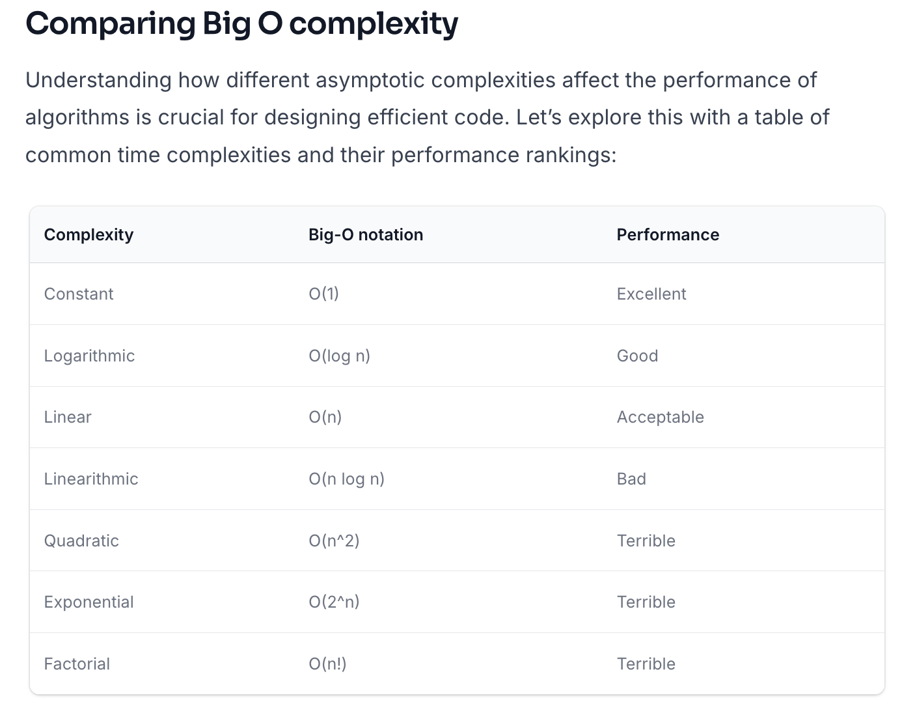

Date: 2026-01-27
Course:
Tags: [Interview]

# Content
hexadecimal：十六进制
decimal： 十进制
binary： 二进制
exponential: 指数
linear: 线性
Pseudo(su do) code: 伪代码
ambiguous problem translate to tangible requirements: 将模糊的问题转化为具体的需求
hash_function(key) % N. % is called mod.
Logarithmic: 对数
Linear: 线性
Linearithmic: 线性对数
Quadratic: 二次方
Exponential: 指数
Factorial: 阶乘

# Note

# Reference

